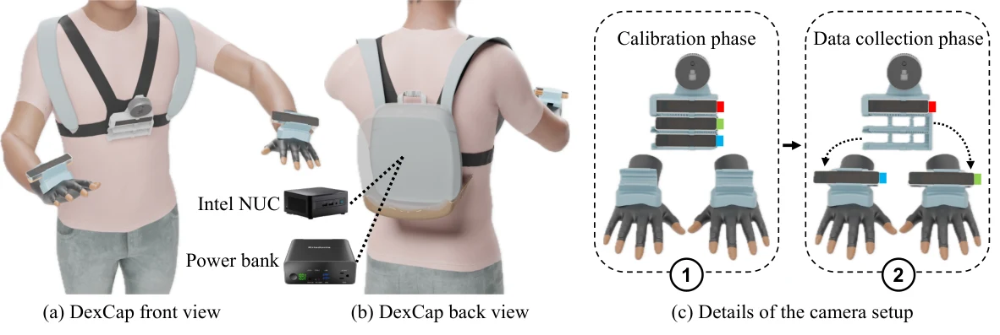
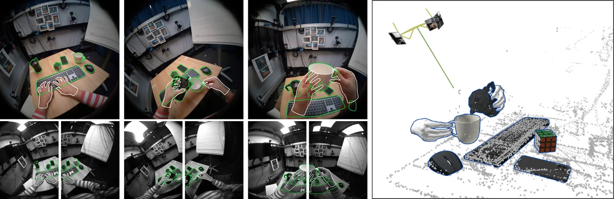
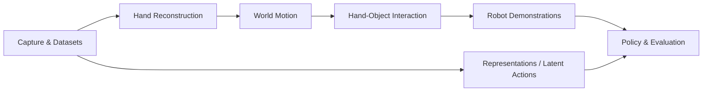

<div align="center">

<h1 id="awesome-ego-robotics">Awesome-Ego-Robotics</h1>

<p>
  <strong>A curated map of hardware, datasets, methods, and tools for egocentric robot learning.</strong>
</p>

<!-- [](https://awesome.re) -->
<!-- [](http://makeapullrequest.com) -->

<p>
  <a href="#hardware-and-capture-systems"></a>
  <a href="#methods-and-toolchains"></a>
  <a href="#datasets"></a>
  <a href="#robot-learning-and-evaluation"></a>
  <a href="#overview-and-taxonomy"></a>
</p>

</div>

<p align="center"><a href="https://chang-xinhai.github.io/Awesome-Ego-Robotics/"><strong>Explore the visual atlas →</strong></a> · Images, filters, details, and side-by-side comparison · <a href="website/README.md">Website source and local preview</a></p>

## About

**Awesome-Ego-Robotics**: A curated list for **egocentric and wearable human capture, data, and learning for robotics**.

This repository focuses on:
- **Hardware and Capture Systems**: first-person cameras, headsets, gloves, EMG bands, body capture, and tactile sensing
- **Methods and Toolchains**: hand and body reconstruction, hand-object interaction, robotization, and direct video-learning routes
- **Datasets**: first-person activity, interaction geometry, whole-body motion, physical signals, and human-to-robot demonstrations
- **Robot Learning and Evaluation**: policies, depth and spatial perception, SLAM and odometry, calibration, trajectory evaluation, and capture workflows
- **Overview and Taxonomy**: independent dimensions, the Ego Data Pyramid reading route, and evidence conventions

The scope follows human experience into robot skills. Supporting wearable sensors and capture-relevant SLAM foundations are included with their role stated. Reference-only and synthetic resources are labeled. Tool-based gripper interfaces are covered in [Awesome-UMI](https://github.com/chang-xinhai/Awesome-UMI).

<p align="center">
  
  <br>
  <sub><span style="color: #777;">Source: original DexCap paper, <a href="https://arxiv.org/html/2403.07788v1">arxiv.org</a>. Figure rights remain with the original authors.</span></sub>
</p>

<p align="center">
  
  <br>
  <sub><span style="color: #777;">Source: original HOT3D project page, <a href="https://facebookresearch.github.io/hot3d/">facebookresearch.github.io/hot3d</a>. Figure rights remain with the original authors.</span></sub>
</p>

## Must Read

Start here for the shortest path through the capture-to-learning ecosystem.

| Goal | Start with |
| :-- | :-- |
| What can an ego capture platform actually record? | [Project Aria tools](https://github.com/facebookresearch/projectaria_tools), [HOT3D](https://facebookresearch.github.io/hot3d/) |
| Where are large first-person video corpora? | [Ego4D](https://ego4d-data.org/), [Ego-Exo4D](https://ego-exo4d-data.org/), [EPIC-KITCHENS](https://epic-kitchens.github.io/) |
| What data support hands, objects and whole-body recovery? | [EgoDex](https://github.com/apple-aiml-research/ml-egodex), [ARCTIC](https://arctic.is.tue.mpg.de/), [Nymeria](https://github.com/facebookresearch/nymeria_dataset) |
| How do reconstruction stages differ? | [HaMeR](https://geopavlakos.github.io/hamer/), [HaWoR](https://hawor-project.github.io/), [EgoAllo](https://egoallo.github.io/) |
| How can demonstrations reach a robot? | [DexCap](https://dex-cap.github.io/), [EgoMimic](https://egomimic.github.io/) |
| Recover and validate capture trajectories | [ORB-SLAM3](https://github.com/UZ-SLAMLab/ORB_SLAM3), [OpenVINS](https://docs.openvins.com/), [FAST-LIVO2](https://github.com/hku-mars/FAST-LIVO2), [MegaSaM](https://github.com/mega-sam/mega-sam), [SLAM and processing tools](#evaluation-and-toolchains) |
| Understand neural geometry and long video reconstruction | [DUSt3R](https://github.com/naver/dust3r), [VGGT](https://github.com/facebookresearch/vggt), [LingBot-Map](https://github.com/Robbyant/lingbot-map), [ABot-Recon](https://github.com/amap-cvlab/ABot-Recon) |
| How should the larger ecosystem connect? | [Awesome-UMI](https://github.com/chang-xinhai/Awesome-UMI), [Awesome-Robot-Data-Engine](https://github.com/chang-xinhai/Awesome-Robot-Data-Engine) |

## News

- [2026-10-16] Launched the [visual atlas](https://chang-xinhai.github.io/Awesome-Ego-Robotics/) with collection-specific discovery, sourced details and comparison.
- [2026-10-16] Initialized the single-README collection and local visual atlas with independent hardware, dataset and method views.

## Contents

- [Awesome-Ego-Robotics](#awesome-ego-robotics)
  - [About](#about)
  - [Must Read](#must-read)
  - [News](#news)
  - [Hardware and Capture Systems](#hardware-and-capture-systems)
    - [Egocentric cameras and headsets](#egocentric-cameras-and-headsets)
    - [Gloves and hand capture](#gloves-and-hand-capture)
    - [EMG and neural interfaces](#emg-and-neural-interfaces)
    - [Whole-body and hybrid capture](#whole-body-and-hybrid-capture)
    - [Contact and tactile capture](#contact-and-tactile-capture)
  - [Methods and Toolchains](#methods-and-toolchains)
    - [Hand reconstruction](#hand-reconstruction)
    - [World-space and body motion](#world-space-and-body-motion)
    - [Hand-object interaction](#hand-object-interaction)
    - [Demonstration translation](#demonstration-translation)
    - [Representation and latent actions](#representation-and-latent-actions)
  - [Datasets](#datasets)
    - [Video and activity](#video-and-activity)
    - [Hand-object geometry and pose](#hand-object-geometry-and-pose)
    - [Whole-body and multimodal](#whole-body-and-multimodal)
    - [Touch force and EMG](#touch-force-and-emg)
    - [Robot demonstration and transfer](#robot-demonstration-and-transfer)
  - [Robot Learning and Evaluation](#robot-learning-and-evaluation)
    - [Policy learning from human data](#policy-learning-from-human-data)
    - [Evaluation and toolchains](#evaluation-and-toolchains)
      - [Depth and perception](#depth-and-perception)
      - [SLAM](#slam)
      - [Calibration and synchronization](#calibration-and-synchronization)
      - [Trajectory evaluation](#trajectory-evaluation)
      - [Ego and UMI workflows](#ego-and-umi-workflows)
      - [Others](#others)
  - [Overview and Taxonomy](#overview-and-taxonomy)
    - [Independent Dimensions](#independent-dimensions)
    - [Research Roadmap](#research-roadmap)
    - [Evidence and Inclusion](#evidence-and-inclusion)
  - [Citation](#citation)
  - [Acknowledgement](#acknowledgement)

## Hardware and Capture Systems

Research rigs and commercial devices are both included. A commercial listing does not establish availability in every region or an independently tested tracking accuracy.

### Egocentric cameras and headsets

| Date | Keywords | Institute (first) | Paper | Publication | Others |
| :--: | :------: | :---------------: | :--- | :---------: | :----: |
| 2026-08-18 | Headband, Vision, IMU, Audio | 51WORLD / Union Image | [AperEgo 2 / 4 / 6 multimodal capture headbands](https://unionimage-aperdata.ai/) | Product / Official resource | [Platform](https://www.51world.com.cn/aperdata) / [Launch](https://www.prnewswire.com/apac/news-releases/51world-unveils-two-embodied-ai-products-and-reveals-aerospace-strategy-from-low-altitude-to-deep-space-302855152.html) <!-- work:aperdata-aperego --> |
| 2026-08-08 | Headband, Vision, IMU | FPV Labs | [Ego-OSCAR: Egocentric Open source Stereo CAptuRe System](https://arxiv.org/abs/2608.08285) | arXiv | [Code & hardware](https://github.com/fpv-labs/ego-oscar) / [Dataset](https://huggingface.co/datasets/fpvlabs/stereo-550) <!-- work:ego-oscar --> |
| 2026-07-08 | Vision, IMU, Audio; Headband | PIA Automation | [PIA Primus Ego industrial egocentric data capture terminal](https://cn.piagroup.com/news/company2/538.html) | Product / Official resource | — <!-- work:pia-primus-ego --> |
| 2026-07 | Vision, IMU; Headband | Orbbec | [Orbbec EGO first-person capture modules](https://www.orbbec.com.cn/index/Product/info.html?cate=38&id=78) | Product / Official resource | — <!-- work:orbbec-ego --> |
| 2025-12-04 | Hybrid, Vision, Depth, Tactile, State | Lightwheel | [EgoSuite multimodal human data capture](https://lightwheel.ai/egosuite) | Product | — <!-- work:lightwheel-egosuite --> |
| 2024 | Headset, Vision, ARKit, Estimated pose | Apple | [Apple Vision Pro (M2) spatial capture headset](https://support.apple.com/en-us/117810) | Product | [EgoDex capture](https://github.com/apple-aiml-research/ml-egodex) / [Camera access](https://developer.apple.com/documentation/visionos/accessing-the-main-camera) <!-- work:apple-vision-pro-m2 --> |
| 2020-08-25 | Headset, Vision, Depth, IMU, Gaze | Microsoft | [HoloLens 2 Research Mode as a Tool for Computer Vision Research](https://arxiv.org/abs/2008.11239) | arXiv / Official research toolkit | [Code](https://github.com/microsoft/HoloLens2ForCV) / [Documentation](https://learn.microsoft.com/en-us/windows/mixed-reality/develop/advanced-concepts/research-mode) <!-- work:hololens2-research-mode --> |
| — | Glasses, Vision, IMU, Gaze, Audio | Meta | [Project Aria Gen 1 research glasses](https://facebookresearch.github.io/projectaria_tools/docs/tech_spec/hardware_spec) | Official resource | [Tools](https://github.com/facebookresearch/projectaria_tools) <!-- work:project-aria-gen1 --> |
| — | Glasses, Vision, IMU, Gaze, Audio | Meta | [Project Aria Gen 2 research glasses](https://facebookresearch.github.io/projectaria_tools/gen2/technical-specs/device/hardware) | Official resource | [Tools](https://github.com/facebookresearch/projectaria_tools) / [Research kit](https://ai.meta.com/aria-application/) <!-- work:project-aria-gen2 --> |
| — | Glasses, Vision, IMU, Gaze, Audio | Pupil Labs | [Neon wearable eye tracker](https://pupil-labs.com/products/neon) | Product | [Documentation](https://docs.pupil-labs.com/neon/) <!-- work:pupil-neon --> |
| — | Glasses, Vision, IMU, Gaze, Audio | Tobii | [Tobii Pro Glasses 3 wearable eye tracker](https://www.tobii.com/products/eye-trackers/wearables/tobii-pro-glasses-3) | Product | — <!-- work:tobii-pro-glasses-3 --> |
| — | Headband, Vision, State | Kinetix AI | [Kai Ego Suite human demonstration capture](https://www.kinetixai.tech/zh/KaiEgo) | Product | [Documentation](https://www.kinetixai.tech/zh/docs/kaiego) <!-- work:kai-ego --> |
| — | Headband, Vision, IMU, Audio | GenRobot | [DAS Ego head-mounted capture system](https://docs.genrobot.ai/products/das-ego) | Product | [Data format](https://docs.genrobot.ai/guides/das-ego-data-introduction) / [Dataset](https://huggingface.co/datasets/genrobot2025/Gen-HumanEgo) <!-- work:das-ego --> |
| — | Headband, Vision, Depth, IMU, State | Lumos Robotics | [Lumos Ego head-mounted multimodal recorder](https://www.lumosbot.tech/products/ego/) | Product | — <!-- work:lumos-ego --> |
| — | Hybrid, Vision | Maniformer | [MEgo View human demonstration capture kit](https://maniformer.ai/mego) | Product | — <!-- work:mego-view --> |
| — | Headband, Vision, IMU, Audio | General Intelligence Labs | [Global-shutter stereo egocentric headset](https://www.gilabs.xyz/products/ego1gs) | Product | — <!-- work:gi-ego1gs --> |
| — | Headset, Vision, State | Meta | [Meta Quest 3 egocentric capture headset](https://www.meta.com/quest/quest-3/) | Product | [HOT3D capture](https://facebookresearch.github.io/hot3d/) / [RGB camera API](https://developers.meta.com/vr/documentation/unity/unity-pca-overview/) <!-- work:meta-quest3 --> |
| — | Headset, Vision, Stereo | Ultraleap | [Ultraleap Stereo IR 170 head-mounted hand tracker](https://docs.ultraleap.com/hand-tracking/XR-Setup/XR-setup.html) | Product | [Tracking and SDK](https://docs.ultraleap.com/hand-tracking/index.html) / [Pico integration](https://docs.ultraleap.com/pico/overview.html) <!-- work:ultraleap-stereo-ir170 --> |
| — | Vision, IMU, Audio; Headband | Livsyn Robotics | [LivEgo first-person data collection headband](https://livsynrobotics.com/products/ego) | Product / Official resource | — <!-- work:liv-ego --> |
| — | Vision, IMU, Audio; Headband | Samtzu | [Samtzu EGO POV wearable data capture device](https://www.samtzu.com/zh/products/ego-pov-wearable/) | Product / Official resource | — <!-- work:samtzu-ego --> |
| — | Vision, IMU, Audio; Headband | TOBI Technology | [TOBI Ego E2 / E6 / E8 capture family](https://www.tobi.cn/ego-landing.html) | Product / Official resource | — <!-- work:tobi-ego --> |
| — | Vision, Depth, IMU, Audio; Headband | NOLO | [NOLO EgoCapture first-person multimodal capture system](https://www.nolovr.com/ego-page/index.html?v=3) | Product / Official resource | — <!-- work:nolo-egocapture --> |
| — | Vision, Depth, IMU, Audio; Headband | LITCHI | [LITCHI EgoDepth egocentric data capture device](https://litchibot.com/) | Product / Official resource | — <!-- work:litchi-egodepth --> |
| — | Vision, IMU, Audio; Headband | PhysenAI | [Physen Ego Thor-Duo / Thor-Quad / Thor-Hex capture family](https://www.physen.ai/products/thor-ego/) | Product / Official resource | — <!-- work:physen-thor --> |
| — | Vision, IMU; Hybrid | YeeGooAI | [EgoEasy lightweight egocentric capture system](https://www.yeegooai.com/) | Product / Official resource | — <!-- work:egoeasy --> |
| — | Vision, IMU; Headband | Xvisio Technology | [Xvisio SeerFusion One egocentric data acquisition terminal](https://en.xvisiotech.com/SeerController/312) | Product / Official resource | — <!-- work:xvisio-seerfusion-one --> |
| — | Headband, Vision, IMU | SynapX | [OctoS-Ego quad-fisheye capture headband](https://synapxdynamics.ai/en/products/octosense) | Product / Official resource | — <!-- work:synapx-octos-ego --> |
| — | Wristband, Vision, IMU | Orbbec | [WristCam wrist-view human demonstration capture module](https://www.orbbec.com.cn/index/Product/info.html?cate=38&id=78) | Product / Official resource | — <!-- work:orbbec-wristcam --> |
| — | Hybrid, Vision, IMU, Audio | Panoculon Labs | [Trinet Mono / Stereo / Stereo GS and Wrist Kit](https://www.panoculonlabs.com/trinet) | Product / Official resource | [SDK](https://github.com/Panoculon-Labs/Trinet-SDK) / [Documentation](https://docs.panoculonlabs.com/) <!-- work:panoculon-trinet --> |
| — | Headband, Vision | OpenGraph Labs | [OVISION calibrated egocentric camera system](https://www.opengraphlabs.com/products/ovision) | Product / Official resource | — <!-- work:opengraph-ovision --> |
| — | Wristband, Vision, IMU, Audio | 51WORLD / Union Image | [Aper WristCAM close-range wrist capture camera](https://unionimage-aperdata.ai/) | Product / Official resource | — <!-- work:aperdata-wristcam --> |
| — | Headband, Vision, IMU | EgoScale | [Capture C1 stereo egocentric capture system](https://www.egoscale.com/capture-c1) | Product / Official resource | — <!-- work:egoscale-capture-c1 --> |
| — | Head-mounted, Four cameras, IMU, Audio | Ropedia | [HOMIE Gen2](https://ropedia.com/homie) | Product | [Toolkit (MIT)](https://github.com/Ropedia/HOMIE-toolkit) <!-- work:homie-gen2 --> |

### Gloves and hand capture

| Date | Keywords | Institute (first) | Paper | Publication | Others |
| :--: | :------: | :---------------: | :--- | :---------: | :----: |
| 2025-11-19 | Glove, Vision, State | Sunday Robotics | [Skill Capture Glove human demonstration interface](https://www.sunday.ai/blog/no-robot-data) | Product / Official resource | — <!-- work:sunday-skill-capture --> |
| 2025-07 | Glove, State | CyberOrigin | [OpenCyberGlove: An Open-source Data Glove for Embodied AI](https://cyberorigin2077.github.io/open_cyber_glove/) | Product / Official resource | [Code](https://github.com/CyberOrigin2077/open_cyber_glove) / [ROS 2](https://github.com/CyberOrigin2077/open_cyber_glove_ros2) <!-- work:cyberorigin-opencyberglove --> |
| 2025-05-12 | Hybrid, Vision, State | Carnegie Mellon | [DexWild: Dexterous Human Interactions for In-the-Wild Robot Policies](https://arxiv.org/abs/2505.07813) | RSS 2025 | [Project](https://dexwild.github.io/) / [Code](https://github.com/dexwild/dexwild) / [Dataset](https://huggingface.co/datasets/boardd/dexwild-dataset) / [Code](https://github.com/dexwild/dexwild-training) / [Project](https://dexwild.github.io) <!-- work:dexwild --> |
| — | Glove, State | MANUS | [EMF finger-tracking gloves for robotics](https://www.manus-meta.com/products/metagloves-pro) | Product | [Licenses](https://www.manus-meta.com/software) <!-- work:manus-metagloves-pro --> |
| — | Glove, State | MANUS | [Legacy Quantum motion-capture gloves](https://www.manus-meta.com/products/quantum-metagloves) | Product | — <!-- work:manus-quantum-metagloves --> |
| — | Glove, State | StretchSense | [StretchSense human manipulation data capture](https://www.stretchsense.com/robotics) | Product | [Hardware](https://www.stretchsense.com/hardware) / [API](https://www.stretchsense.com/api-integrations) <!-- work:stretchsense-pro --> |
| — | Glove, IMU, State | Rokoko | [Inertial hand and finger capture gloves](https://www.rokoko.com/products/smartgloves-ii) | Product | [Device SDK](https://sdk.rokoko.com/) <!-- work:rokoko-smartgloves-ii --> |
| — | IMU, Tactile; Glove | LITCHI | [LITCHI T1 / T1 Lite / T1 Pro data collection gloves](https://litchibot.com/) | Product / Official resource | — <!-- work:litchi-t1 --> |
| — | Glove, IMU, State | Forsense | [ForMotion Glove G7 electromagnetic–inertial hand capture](https://forsense-sdk-docs.xin/hardware/G7-glove) | Product / Official resource | [Manufacturer](https://www.forsense.cn/robot/) / [Specification](https://forsense-sdk-docs.xin/hardware/g7/specification) <!-- work:forsense-g7 --> |

### EMG and neural interfaces

| Date | Keywords | Institute (first) | Paper | Publication | Others |
| :--: | :------: | :---------------: | :--- | :---------: | :----: |
| 2026-06-24 | Wristband, Vision, EMG, IMU, Force | Amazon FAR | [ForceBand: Learning Forceful Manipulation with sEMG](https://arxiv.org/abs/2606.26093) | arXiv | [Project](https://forceband-emg.github.io/) / [Code & BOM](https://github.com/Bottle101/ForceBand) / [Data (8.6 h)](https://huggingface.co/datasets/boootaooo/forceband-emg2force) / [Model (DINOv2)](https://github.com/Bottle101/ForceBand/tree/main/checkpoints) <!-- work:forceband --> |
| 2026-05-07 | Hybrid, Vision, Depth, IMU, EMG, State | Tsinghua | [EgoEMG: A Multimodal Egocentric Dataset with Bilateral EMG and Vision for Hand Pose Estimation](https://arxiv.org/abs/2605.05712) | arXiv | [Code](https://github.com/zhenqis123/EgoEMG) <!-- work:egoemg --> |
| 2025-09-17 | Wristband, EMG, IMU | Meta | [Wrist EMG interface for wearable computing](https://www.meta.com/en-gb/emerging-tech/emg-wearable-technology/) | Product | [Launch](https://about.fb.com/news/2025/09/meta-ray-ban-display-ai-glasses-emg-wristband/) <!-- work:meta-neural-band --> |
| — | Armband, EMG, IMU | MindRove | [MindRove EMG Armband wearable EMG capture](https://mindrove.com/product/emg-armband/) | Product | [SDK](https://docs.mindrove.com/main/index.html) <!-- work:mindrove-armband --> |
| — | Hybrid, EMG, IMU | Delsys | [Delsys Trigno Avanti wearable EMG capture](https://delsys.com/trigno/) | Product | [SDK manual](https://www.delsys.com/downloads/USERSGUIDE/trigno/sdk.pdf) <!-- work:delsys-trigno-avanti --> |
| — | Wristband, EMG, IMU | SynapX | [OctoS-Band EMG and inertial capture wristband](https://synapxdynamics.ai/en/products/octosense) | Product / Official resource | — <!-- work:synapx-octos-band --> |
| — | Armband, EMG, IMU | OYMotion | [gForcePro+ EMG and inertial armband](https://www.oymotion.com/product32/149) | Product / Official resource | [Documentation](https://developer.oymotion.com/gForcePro/gForcePro/) / [SDK](https://github.com/oymotion/gForceSDKPython) <!-- work:oymotion-gforcepro-plus --> |

### Whole-body and hybrid capture

| Date | Keywords | Institute (first) | Paper | Publication | Others |
| :--: | :------: | :---------------: | :--- | :---------: | :----: |
| 2026-10-14 | Hybrid, Vision, IMU, Tactile | PHANES AI / Tinno Mobile | [SeePhys Hub whole-body multimodal capture system](https://m.leiphone.com/category/robot/HYxX8W4aXp8UgmIO.html) | Announced system | — <!-- work:seephys-hub --> |
| 2026-10-12 | Headset, Vision, State | Zhongguancun Academy | [EgoWholeView: Camera-Only Head-Mounted Capture of Body and Bimanual Hand Motion for Embodied Demonstrations](https://arxiv.org/abs/2610.16256) | arXiv | — <!-- work:egowholeview --> |
| 2026-05-16 | Hybrid, Vision | George Mason University | [EgoKit: Towards Unified Low-Cost Egocentric Data Collection with Heterogeneous Devices](https://arxiv.org/abs/2605.16797) | arXiv | [Project](https://www.chuange.org/papers/EgoKit.html) / [Releases](https://github.com/luffy-yu/EgoKit/releases) <!-- work:egokit --> |
| 2025-03-14 | Headset, Vision, State | MPI Informatics | [Bring Your Rear Cameras for Egocentric 3D Human Pose Estimation](https://arxiv.org/abs/2503.11652) | ICCV 2025 | [Code](https://github.com/hiroyasuakada/EgoRear) <!-- work:egorear --> |
| 2024-03-12 | Hybrid, Vision, Depth, State | Stanford | [DexCap: Scalable and Portable Mocap Data Collection System for Dexterous Manipulation](https://arxiv.org/abs/2403.07788) | RSS 2024 | [Project](https://dex-cap.github.io/) / [Code](https://github.com/j96w/DexCap) / [Project](https://dex-cap.github.io) <!-- work:dexcap --> |
| 2016-09-23 | Headset, Vision, State | — | [EgoCap: Egocentric Marker-less Motion Capture with Two Fisheye Cameras](https://arxiv.org/abs/1609.07306) | SIGGRAPH Asia 2016 | — <!-- work:egocap --> |
| — | Suit, IMU, State | Xsens | [Xsens Link inertial full-body capture](https://www.xsens.com/motion-capture/xsens-link-specifications) | Product | [Robotics context](https://www.xsens.com/products/motion-capture) <!-- work:xsens-link --> |
| — | Suit, IMU, State | Xsens | [Xsens Awinda wireless body tracking](https://www.xsens.com/motion-capture/xsens-mvn-awinda) | Product | — <!-- work:xsens-awinda --> |
| — | Suit, IMU, State | Rokoko | [Wireless inertial full-body mocap suit](https://www.rokoko.com/products/smartsuit-pro) | Product | [Device SDK](https://sdk.rokoko.com/) <!-- work:rokoko-smartsuit-pro-ii --> |
| — | Suit, IMU, State | Sony | [Portable sparse-inertial full-body capture](https://xyn.sony.net/en/developer/technical/mocopi/aboutmocopi) | Product | — <!-- work:sony-mocopi --> |
| — | State; Hybrid | DexRobot | [DexRobot DexCap wearable exoskeleton data collection system](https://www.dex-robot.com/dexCap) | Product / Official resource | [SDK](https://github.com/DexRobot/dexcap-sdk-python) <!-- work:dexrobot-dexcap --> |
| — | Armband, FMG, IMU | PhysenAI | [FMG + IMU forearm capture armband](https://www.physen.ai/products/fmg-imu/) | Product / Official resource | — <!-- work:physen-fmg-imu --> |

### Contact and tactile capture

| Date | Keywords | Institute (first) | Paper | Publication | Others |
| :--: | :------: | :---------------: | :--- | :---------: | :----: |
| 2025-12-09 | Glove, Tactile, Magnetic flux | Meta FAIR | [OSMO: Open-Source Tactile Glove for Human-to-Robot Skill Transfer](https://arxiv.org/abs/2512.08920) | arXiv | [Project](https://jessicayin.github.io/osmo_tactile_glove/) / [Hardware & code](https://github.com/jessicayin/osmo_tactile_glove) <!-- work:osmo --> |
| 2024-09-03 | Hybrid, Vision, Depth, Tactile, State | ETH Zürich | [EgoPressure: A Dataset for Hand Pressure and Pose Estimation in Egocentric Vision](https://arxiv.org/abs/2409.02224) | CVPR 2025 | [Project](https://yiming-zhao.github.io/EgoPressure/) / [Project](https://siplab.org/projects/EgoPressure) / [GitHub](https://github.com/eth-siplab/EgoPressure) / [Dataset](https://dataset.egopressure.inf.ethz.ch/) <!-- work:egopressure --> |
| — | Tactile, Force; Glove | NOLO | [NOLO OmniGlove tactile data collection glove](https://www.nolovr.com/ego-page/index.html?v=3) | Product / Official resource | — <!-- work:nolo-omniglove --> |
| — | Glove, Vision, IMU, Tactile, Force | SynapX | [OctoS-Glove isomorphic visual-tactile exoskeleton glove](https://synapxdynamics.ai/en/products/octosense) | Product / Official resource | — <!-- work:synapx-octos-glove --> |
| — | Glove, Tactile, IMU | OpenGraph Labs | [OGLO tactile capture glove](https://www.opengraphlabs.com/products/oglo) | Product / Official resource | — <!-- work:opengraph-oglo --> |
| — | Glove, Tactile, State | PhysenAI | [Tactile and electromagnetic hand capture glove](https://www.physen.ai/products/data-glove/) | Product / Official resource | — <!-- work:physen-tactile-glove --> |

## Methods and Toolchains

Organized by the transformation they perform; inputs, output frame/scale, supervision and evidence are available in the visual atlas.

### Hand reconstruction

| Date | Keywords | Institute (first) | Paper | Publication | Others |
| :--: | :------: | :---------------: | :--- | :---------: | :----: |
| 2026-10-21 | EgoHand, Human video, Vision | NVIDIA | [EgoHand: Monocular 3D Hand Reconstruction from Egocentric Video](https://arxiv.org/abs/2610.30293) | arXiv | [Code (inference, OpenMDW)](https://github.com/NVIDIA/IsaacCapture/tree/main/src/python/isaaccapture_egopost) / [Code (training)](https://github.com/NVlabs/GEM-X) / [Models (OpenMDW)](https://huggingface.co/nvidia/EgoHand-v1) <!-- work:egohand --> |
| 2026-10-07 | Hand reconstruction, Human video, Contact prediction, Force prediction, RGB | RLWRLD | [RLHND: Video Foundation Models as Physically Grounded Hand Trackers for Robot Learning](https://arxiv.org/abs/2610.09455) | arXiv | [Project](https://seungjun-moon.github.io/rlhnd/) / [Code (announced)](https://github.com/seungjun-moon/rlhnd) <!-- work:rlhnd --> |
| 2026-09-28 | Hand reconstruction, Human video, Hand, RGB, Stereo | City University of Hong Kong | [ESTHER: Egocentric Stereo Hand Estimation and Reconstruction in the Wild](https://arxiv.org/abs/2609.34817) | arXiv | — <!-- work:esther --> |
| 2026-09-15 | Hand reconstruction, Wearable capture, Hand, Event | Keio University | [EventEgoHands++: Event-based Egocentric 3D Hand Mesh Reconstruction with Real Dataset](https://arxiv.org/abs/2609.17189) | IEEE Access 2026 | [Code](https://github.com/ryhara/EventEgoHandsV2) / [Project](https://ryhara.github.io/EventEgoHandsV2/) <!-- work:eventegohands-plus-plus --> |
| 2026-08-20 | Hand reconstruction, Wearable capture, Hand, RGB | Shanghai Jiao Tong University | [ACE-Ego-Hand: Repurposing Video Diffusion Models for Occlusion-Robust Egocentric 3D Hand Motion Recovery](https://arxiv.org/abs/2608.20308) | arXiv | [Code](https://github.com/ggxxii/ACE-Ego-Hand) <!-- work:ace-ego-hand --> |
| 2026-06-29 | Hand reconstruction, Human video, Hand, RGB | Nanyang Technological University | [The Surprising Effectiveness of Video Diffusion Models for Hand Motion Reconstruction](https://arxiv.org/abs/2606.30308) | arXiv | [Code](https://github.com/NTUYWANG103/ViDiHand) / [Project](https://vidihand.github.io) <!-- work:vidihand --> |
| 2026-05-20 | Hand reconstruction, Vision, IMU, Hands | Meta Reality Labs | [AVI-HT: Adaptive Vision-IMU Fusion for 3D Hand Tracking](https://arxiv.org/abs/2605.21714) | arXiv | — <!-- work:avi-ht --> |
| 2026-01-27 | Hand reconstruction, Wearable capture, Hand, RGB | The Chinese University of Hong Kong | [EgoHandICL: Egocentric 3D Hand Reconstruction with In-Context Learning](https://arxiv.org/abs/2601.19850) | ICLR 2026 | [Code](https://github.com/Nicous20/EgoHandICL) <!-- work:egohandicl --> |
| 2024-12-18 | Hand reconstruction, Human video, Hands, RGB | University of North Carolina at Charlotte | [MaskHand: Generative Masked Modeling for Robust Hand Mesh Reconstruction in the Wild](https://arxiv.org/abs/2412.13393) | ICCV 2025 | [Project](https://m-usamasaleem.github.io/publication/MaskHand/MaskHand.html) <!-- work:maskhand --> |
| 2024-12-02 | Hand reconstruction, EMG, Hands | Meta Reality Labs | [emg2pose: A Large and Diverse Benchmark for Surface Electromyographic Hand Pose Estimation](https://arxiv.org/abs/2412.02725) | NeurIPS 2024 | [Code](https://github.com/facebookresearch/emg2pose) <!-- work:emg2pose --> |
| 2024-12-02 | Hand reconstruction, Human video, Hands, RGB | Peking University | [HandOS: 3D Hand Reconstruction in One Stage](https://arxiv.org/abs/2412.01537) | CVPR 2025 | [Project](https://idea-research.github.io/HandOSweb/) <!-- work:handos --> |
| 2024-09-18 | Hand reconstruction, Wearable capture, Hand, RGB | Imperial College London | [WiLoR: End-to-end 3D Hand Localization and Reconstruction in-the-wild](https://arxiv.org/abs/2409.12259) | CVPR 2025 | [Code](https://github.com/rolpotamias/WiLoR) / [Project](https://rolpotamias.github.io/WiLoR) / [proceedings](https://openaccess.thecvf.com/content/CVPR2025/html/Potamias_WiLoR_End-to-end_3D_Hand_Localization_and_Reconstruction_in-the-wild_CVPR_2025_paper.html) <!-- work:wilor --> |
| 2024-07-22 | Hand reconstruction, Human video, Hands, RGB | Niantic | [HandDGP: Camera-Space Hand Mesh Prediction with Differentiable Global Positioning](https://arxiv.org/abs/2407.15844) | ECCV 2024 | [Project](https://nianticlabs.github.io/handdgp/) / [Code](https://github.com/nianticlabs/HandDGP) <!-- work:handdgp --> |
| 2024-07-12 | Hand reconstruction, Wearable capture, Hand, RGB | Carnegie Mellon University | [Hamba: Single-view 3D Hand Reconstruction with Graph-guided Bi-Scanning Mamba](https://arxiv.org/abs/2407.09646) | arXiv | [Code](https://github.com/humansensinglab/Hamba) / [Project](https://humansensinglab.github.io/Hamba/) <!-- work:hamba --> |
| 2024-05-30 | Hand reconstruction, Human video, Hand, RGB | Beijing Normal University | [OmniHands: Towards Robust 4D Hand Mesh Recovery via A Versatile Transformer](https://arxiv.org/abs/2405.20330) | arXiv | [Code](https://github.com/LinDixuan/OmniHands) / [Project](https://OmniHand.github.io) <!-- work:omnihands --> |
| 2023-12-27 | Hand reconstruction, Human video, Hands, RGB | Max Planck Institute for Intelligent Systems | [HMP: Hand Motion Priors for Pose and Shape Estimation from Video](https://arxiv.org/abs/2312.16737) | WACV 2024 | [Project](https://hmp.is.tue.mpg.de/) / [Code](https://github.com/enesduran/HMP) <!-- work:hmp --> |
| 2023-12-11 | Hand reconstruction, Wearable capture, Hand, RGB | UIUC | [3D Hand Pose Estimation in Everyday Egocentric Images](https://arxiv.org/abs/2312.06583) | arXiv | [Code](https://github.com/ap229997/hands) <!-- work:wildhands --> |
| 2023-12-08 | Hand reconstruction, Wearable capture, Hand, RGB | UC Berkeley | [Reconstructing Hands in 3D with Transformers](https://arxiv.org/abs/2312.05251) | CVPR 2024 | [Code](https://github.com/geopavlakos/hamer) / [Project](https://geopavlakos.github.io/hamer/) / [proceedings](https://openaccess.thecvf.com/content/CVPR2024/html/Pavlakos_Reconstructing_Hands_in_3D_with_Transformers_CVPR_2024_paper.html) <!-- work:hamer --> |
| 2023-03-09 | Hand reconstruction, Human video, Hands, RGB | Carnegie Mellon University | [Deformer: Dynamic Fusion Transformer for Robust Hand Pose Estimation](https://arxiv.org/abs/2303.04991) | ICCV 2023 | [Project](https://fuqichen1998.github.io/Deformer/) / [Code](https://github.com/fuqichen1998/Deformer) <!-- work:deformer --> |
| 2022-03-28 | Hand reconstruction, Wearable capture, Hand, RGB | Seoul National University | [HandOccNet: Occlusion-Robust 3D Hand Mesh Estimation Network](https://arxiv.org/abs/2203.14564) | arXiv | [Code](https://github.com/namepllet/HandOccNet) <!-- work:handoccnet --> |
| 2022-01-07 | Hand reconstruction, Wearable capture, Hand | Max Planck Institute for Intelligent Systems | [Embodied Hands: Modeling and Capturing Hands and Bodies Together](https://arxiv.org/abs/2201.02610) | SIGGRAPH Asia 2017 | [Project](http://mano.is.tue.mpg.de) <!-- work:mano --> |

### World-space and body motion

| Date | Keywords | Institute (first) | Paper | Publication | Others |
| :--: | :------: | :---------------: | :--- | :---------: | :----: |
| 2026-10-21 | DewHand, Human video, Vision | The University of Tokyo | [DewHand: Direct Metric World-Space Hand Motion Reconstruction from Egocentric Videos](https://arxiv.org/abs/2610.29936) | arXiv | [Project](https://narusuzuki.github.io/projects/26-dewhand/) <!-- work:dewhand --> |
| 2026-10-19 | ExMR, Exocentric reference, Vision | Leibniz University Hannover | [ExMR: Extremity Motion Refinement for Monocular Human Motion Capture](https://arxiv.org/abs/2610.26213) | arXiv | [Project](https://twehrbein.github.io/exmr-website/) / [Code (demo, noncommercial)](https://github.com/twehrbein/ExMR) / [Models](https://huggingface.co/twehrbein/ExMR) <!-- work:exmr --> |
| 2026-10-19 | EgoRayFormer, Human video, Vision | Boden AI | [EgoRayFormer: Ray-Space Stereo Refinement for Egocentric 3D Human Pose Estimation](https://arxiv.org/abs/2610.26641) | arXiv | — <!-- work:egorayformer --> |
| 2026-10-19 | V-JEPA Hand, Human video, Vision | Tsinghua University | [V-JEPA Hand: Simple, Accurate and Fast 3D Hand and Camera Trajectory Recovery from Egocentric Videos](https://arxiv.org/abs/2610.26780) | arXiv | [Project](https://qft-333.github.io/V-JEPA-Hand-Page/) / [Repository (code paused)](https://github.com/qft-333/V-JEPA-Hand) <!-- work:v-jepa-hand --> |
| 2026-10-12 | FlowAvatar, Wearable tracking, State, Gaze | Northwestern University | [FlowAvatar: Real-Time Full-Body Avatars from Sparse Egocentric Inputs on Consumer XR Devices](https://arxiv.org/abs/2610.16277) | ISMAR / TVCG 2026 | [Code](https://github.com/SPICExLAB/FlowAvatar) <!-- work:flowavatar --> |
| 2026-09-28 | World-space and body motion, Wearable capture, Hand, RGB | Shanghai AI Laboratory | [InfiniHand: Streaming World-Space Hand Motion Estimation from Egocentric Video](https://arxiv.org/abs/2609.35743) | arXiv | [Code](https://github.com/infinihand/InfiniHand) <!-- work:infinihand --> |
| 2026-09-04 | World-space and body motion, Human video, Hand, RGB | ShanghaiTech University | [MINT: A Unified Model for World-Space Camera and Hand Motion Estimation from Scalable Egocentric Pipeline Supervision](https://arxiv.org/abs/2609.04958) | arXiv | [Code](https://github.com/wuji-technology/wuji-ego-mint) <!-- work:mint --> |
| 2026-08-30 | World-space and body motion, Vision, State, Whole body | University of California, Irvine | [Everybody Tracking Every Body](https://arxiv.org/abs/2608.29927) | arXiv | [Project](https://vision.ics.uci.edu/papers/everybody-tracking-every-body-2026/) <!-- work:everybody-tracking --> |
| 2026-07-13 | World-space and body motion, Human video, Hands, RGB | The Hong Kong University of Science and Technology (Guangzhou) | [HandFlow: Fully Generative 4D Hand Recovery with Flow Matching](https://arxiv.org/abs/2607.11221) | arXiv | [Project](https://mxxu00.github.io/HandFlow/) / [Code](https://github.com/mxxu00/HandFlow) / [Models](https://huggingface.co/mxxu00/HandFlow) <!-- work:handflow --> |
| 2026-02-25 | World-space and body motion, Hand reconstruction, RGB, State | Fudan University | [UniHand: A Unified Model for Diverse Controlled 4D Hand Motion Modeling](https://arxiv.org/abs/2602.21631) | ICLR 2026 | [Publication](https://openreview.net/forum?id=upUl6hMYwy) <!-- work:unihand --> |
| 2026-02-05 | Whole body, Wearable capture, Reconstruction, RGB, Depth, Pose | — | [EgoPoseVR: Spatiotemporal Multi-Modal Reasoning for Egocentric Full-Body Pose in Virtual Reality](https://arxiv.org/abs/2602.05590) | arXiv | — <!-- work:egoposevr --> |
| 2025-04-11 | World-space and body motion, Vision, IMU, Language, Whole body | Max Planck Institute for Informatics | [Ego4o: Egocentric Human Motion Capture and Understanding from Multi-Modal Input](https://arxiv.org/abs/2504.08449) | CVPR 2025 | [Project](https://jianwang-mpi.github.io/ego4o/) <!-- work:ego4o --> |
| 2025-02-11 | Whole body, Wearable capture, Reconstruction, Event | Max Planck Institute for Informatics | [EventEgo3D++: 3D Human Motion Capture from a Head-Mounted Event Camera](https://arxiv.org/abs/2502.07869) | arXiv | [Project](https://eventego3d.mpi-inf.mpg.de/) / [code](https://github.com/Chris10M/EventEgo3D_plus_plus) <!-- work:eventego3d-plus-plus --> |
| 2025-01-14 | World-space and body motion, Human video, Hands, RGB | Carnegie Mellon University | [Predicting 4D Hand Trajectory from Monocular Videos](https://arxiv.org/abs/2501.08329) | 3DV 2026 | [Project](https://judyye.github.io/haptic-www/) / [Code](https://github.com/JudyYe/haptic) <!-- work:haptic --> |
| 2025-01-06 | World-space and body motion, Human video, Hand, RGB | Shanghai Jiao Tong University | [HaWoR: World-Space Hand Motion Reconstruction from Egocentric Videos](https://arxiv.org/abs/2501.02973) | CVPR 2025 | [Code](https://github.com/ThunderVVV/HaWoR) / [Project](https://hawor-project.github.io/) / [proceedings](https://openaccess.thecvf.com/content/CVPR2025/html/Zhang_HaWoR_World-Space_Hand_Motion_Reconstruction_from_Egocentric_Videos_CVPR_2025_paper.html) <!-- work:hawor --> |
| 2024-12-17 | World-space and body motion, Human video, Hand, RGB | Imperial College London | [Dyn-HaMR: Recovering 4D Interacting Hand Motion from a Dynamic Camera](https://arxiv.org/abs/2412.12861) | arXiv | [Code](https://github.com/ZhengdiYu/Dyn-HaMR) / [Project](https://dyn-hamr.github.io/) <!-- work:dyn-hamr --> |
| 2024-10-04 | World-space and body motion, Wearable capture, Whole body, RGB, SLAM | UC Berkeley | [Estimating Body and Hand Motion in an Ego-sensed World](https://arxiv.org/abs/2410.03665) | arXiv | [Code](https://github.com/brentyi/egoallo) / [Project](https://egoallo.github.io/) <!-- work:egoallo --> |
| 2024-03-26 | World-space and body motion, Vision, Stereo, Whole body | University of Edinburgh | [EgoPoseFormer: A Simple Baseline for Stereo Egocentric 3D Human Pose Estimation](https://arxiv.org/abs/2403.18080) | ECCV 2024 | [Code](https://github.com/ChenhongyiYang/egoposeformer) <!-- work:egoposeformer --> |
| 2024-03-06 | World-space and body motion, State, IMU, Whole body | PICO, ByteDance | [HMD-Poser: On-Device Real-time Human Motion Tracking from Scalable Sparse Observations](https://arxiv.org/abs/2403.03561) | CVPR 2024 | [Code](https://github.com/PICO-AI-TEAM/HMD-Poser) <!-- work:hmd-poser --> |
| 2024-02-28 | World-space and body motion, Vision, Stereo, Whole body | Seoul National University | [Attention-Propagation Network for Egocentric Heatmap to 3D Pose Lifting](https://arxiv.org/abs/2402.18330) | CVPR 2024 | [Code](https://github.com/tho-kn/EgoTAP) <!-- work:egotap --> |
| 2023-08-12 | Whole body, Wearable capture, Reconstruction, Pose | ETH Zurich | [EgoPoser: Robust Real-Time Egocentric Pose Estimation from Sparse and Intermittent Observations Everywhere](https://arxiv.org/abs/2308.06493) | arXiv | [Project](https://siplab.org/projects/EgoPoser) / [code](https://github.com/eth-siplab/EgoPoser) <!-- work:egoposer --> |
| 2023-05-02 | Whole body, Wearable capture, Reconstruction, IMU, RGB | — | [EgoLocate: Real-time Motion Capture, Localization, and Mapping with Sparse Body-mounted Sensors](https://arxiv.org/abs/2305.01599) | arXiv | [Code](https://github.com/Xinyu-Yi/EgoLocate) <!-- work:egolocate --> |
| 2022-12-09 | Whole body, Wearable capture, Reconstruction, RGB | Stanford University | [Ego-Body Pose Estimation via Ego-Head Pose Estimation](https://arxiv.org/abs/2212.04636) | arXiv | [Code](https://github.com/lijiaman/egoego_release) <!-- work:egoego --> |
| 2022-10-31 | World-space and body motion, Wearable capture, Hand | Meta Reality Labs | [UmeTrack: Unified multi-view end-to-end hand tracking for VR](https://arxiv.org/abs/2211.00099) | arXiv | [Code](https://github.com/facebookresearch/UmeTrack) <!-- work:umetrack --> |

### Hand-object interaction

| Date | Keywords | Institute (first) | Paper | Publication | Others |
| :--: | :------: | :---------------: | :--- | :---------: | :----: |
| 2026-10-20 | Gaze2HOI, Human video, Vision, Gaze | Beijing University of Posts and Telecommunications | [Gaze2HOI: Gaze-Aware Intention Disambiguation for Egocentric Hand-Object Interaction Forecasting](https://arxiv.org/abs/2610.27877) | arXiv | [Project](https://gaze2hoi.github.io/) / [Code (inference, MIT)](https://github.com/gaze2hoi/Gaze2HOI) / [Models](https://huggingface.co/gaze2hoi/Gaze2HOI) / [Data (demo only)](https://huggingface.co/datasets/gaze2hoi/EgoAIM-Demo) <!-- work:gaze2hoi --> |
| 2026-10-19 | EgoXperience, Human video, Vision | Ropedia | [EgoXperience: Learning World-Grounded Egocentric Representations from Human Experience](https://arxiv.org/abs/2610.26625) | arXiv | [Project](https://ropedia.github.io/EgoXperience/) / [Repository (forthcoming)](https://github.com/Ropedia/EgoXperience) / [Data / models (forthcoming)](https://huggingface.co/collections/ropedia-ai/egoxperience-6ad5e578b329cace0db09473) <!-- work:egoxperience --> |
| 2026-10-16 | RGB, Predicted touch, Human-to-robot transfer | Carnegie Mellon University | [Ego2Contact: Predicting Touch from Egocentric Human Video for Contact-Rich Robot Manipulation](https://arxiv.org/abs/2610.22932) | arXiv | — <!-- work:ego2contact --> |
| 2026-10-06 | Hand-object interaction, Human video, Hands, RGB | Texas A&M University | [4D-HOF: Hand-Object Flow Matching for Feed-Forward 4D Interaction Reconstruction](https://arxiv.org/abs/2610.08782) | arXiv | [Project](https://tamu-visual-ai.github.io/4D-HOF/) / [Code (HO3D inference)](https://github.com/TAMU-Visual-AI/4D-HOF) / [Models / initialization](https://huggingface.co/eggplant71/4D-HOF) <!-- work:4d-hof --> |
| 2026-10-01 | Hand-object interaction, Human video, Hand, RGB | Shanghai Jiao Tong University | [EgoFound3R: End-to-End Egocentric Hand Reconstruction in World Space with Point-Wise Interaction Attributes](https://arxiv.org/abs/2610.01210) | arXiv | [Project](https://mint-sjtu.github.io/EgoFound3R.io/) / [Code (inference)](https://github.com/MINT-SJTU/EgoFound3R) / [Models](https://huggingface.co/Frank-F2021/EgoFound3R) <!-- work:egofound3r --> |
| 2026-09-17 | Hand-object interaction, Human video, Hand, RGB | Tsinghua University | [TouchSight: Bare-Handed Tactile Prediction from Egocentric Video via Generative Visual Augmentation](https://arxiv.org/abs/2609.20414) | arXiv | — <!-- work:touchsight --> |
| 2026-08-15 | Hand-object interaction, Human video, Hand, RGB | Shanghai Qi Zhi Institute | [EgoTac: In-the-wild Tactile Prediction from Egocentric Vision](https://arxiv.org/abs/2608.15060) | NeurIPS 2026 | [Project](https://egotac.github.io/) / [Code](https://github.com/Mr-Zwkid/EgoTac) / [Dataset](https://huggingface.co/datasets/wkzhang/EgoTac-SC) / [Model](https://huggingface.co/wkzhang/EgoTac) <!-- work:egotac --> |
| 2026-08-06 | Hand-object interaction, RGB, Pressure prediction, Contact | Seoul National University | [HOPE: Hand-Object Pressure Estimation from Monocular Videos](https://arxiv.org/abs/2608.06192) | NeurIPS 2026 | [Project](https://subin6.github.io/page-hope/) <!-- work:hope --> |
| 2026-06-08 | RGB, Tactile, Grasp pressure, Bare-hand transfer | Tsinghua University | [EgoTactile: Learning Grasp Pressure for Everyday Objects from Egocentric Video](https://arxiv.org/abs/2606.09243) | ICML 2026 | [Project](https://egotactile.github.io/) / [Code](https://github.com/Russell-Zeng/EgoTactile) / [Dataset](https://huggingface.co/datasets/HustleHard/EgoTactile) <!-- work:egotactile --> |
| 2026-05-20 | Hand-object interaction, Human video, Hands, RGB | The Chinese University of Hong Kong | [Open-CHOIR: Open-World Contact-Aware 4D Hand-Object Interaction Reconstruction](https://arxiv.org/abs/2605.20992) | SIGGRAPH Asia 2026 | [Project](https://hxwork.github.io/collections/2026_CHOIR/index.html) / [Code](https://github.com/hxwork/CHOIR) <!-- work:choir --> |
| 2026-05-13 | Touch force and EMG, RGB, Pressure, Bimanual | HIT Shenzhen | [TouchAnything: A Dataset and Framework for Bimanual Tactile Estimation from Egocentric Video](https://arxiv.org/abs/2605.13083) | arXiv 2026 | [Project](https://jianyi2004.github.io/TouchAnything-Website/) / [GitHub](https://github.com/Jianyi2004/TouchAnything) / [Dataset](https://huggingface.co/datasets/zhouzhoujy/EgoTouch) <!-- work:egotouch --> |
| 2026-04-14 | Hand-object interaction, Human video, Hands, RGB | Max Planck Institute for Informatics | [Grasp in Gaussians: Fast Monocular Reconstruction of Dynamic Hand-Object Interactions](https://arxiv.org/abs/2604.12929) | SIGGRAPH Asia 2026 | [Project](https://aidilayce.github.io/GraG-page/) / [Code](https://github.com/aidilayce/GraG) <!-- work:grasp-in-gaussians --> |
| 2026-04-13 | Hand-object interaction, Human video, Hand, RGB | Simon Fraser University | [EgoFun3D: Modeling Interactive Objects from Egocentric Videos using Function Templates](https://arxiv.org/abs/2604.11038) | arXiv | [Code](https://github.com/3dlg-hcvc/EgoFun3D) / [Data (request access)](https://huggingface.co/datasets/3dlg-hcvc/EgoFun3D) <!-- work:egofun3d --> |
| 2026-03-26 | Hand-object interaction, Human video, Hands, RGB | Harbin Institute of Technology | [ArtHOI: Taming Foundation Models for Monocular 4D Reconstruction of Hand-Articulated-Object Interactions](https://arxiv.org/abs/2603.25791) | CVPR 2026 | [Project](https://arthoi-reconstruction.github.io/) / [Code](https://github.com/hitcs-zikaiwang/ArtHOI-4D-Reconstruction) <!-- work:arthoi --> |
| 2026-03-19 | Hand-object interaction, Human video, Hands, RGB | RPTU | [GHOST: Fast Category-agnostic Hand-Object Interaction Reconstruction from RGB Videos using Gaussian Splatting](https://arxiv.org/abs/2603.18912) | CVPR Findings 2026 | [Project](https://ataboukhadra.github.io/ghost/) / [Code](https://github.com/ATAboukhadra/GHOST) <!-- work:ghost-hoi --> |
| 2026-02-25 | Hand-object interaction, Human video, Hand, RGB | Stanford University | [WHOLE: World-Grounded Hand-Object Lifted from Egocentric Videos](https://arxiv.org/abs/2602.22209) | CVPR Findings 2026 | [Project](https://judyye.github.io/whole-www) / [Proceedings](https://openaccess.thecvf.com/content/CVPR2026F/html/Ye_WHOLE_World-Grounded_Hand-Object_Lifted_from_Egocentric_Videos_CVPRF_2026_paper.html) <!-- work:whole --> |
| 2026-02-05 | Hand-object interaction, Human video, Hands, RGB | The Chinese University of Hong Kong, Shenzhen | [ForeHOI: Feed-forward 3D Object Reconstruction from Daily Hand-Object Interaction Videos](https://arxiv.org/abs/2602.06226) | CVPR 2026 | [Code](https://github.com/Tao-11-chen/ForeHOI) / [Models](https://huggingface.co/YuantaoChen/ForeHOI) <!-- work:forehoi --> |
| 2026-02-04 | Hand-object interaction, Human video, Hands, RGB | Zhejiang University | [AGILE: Hand-Object Interaction Reconstruction from Video via Agentic Generation](https://arxiv.org/abs/2602.04672) | SIGGRAPH 2026 | [Project](https://agile-hoi.github.io/) / [Code](https://github.com/Chuan-10/AGILE) <!-- work:agile-hoi --> |
| 2026-01-03 | Hand-object interaction, Human video, Hand, RGB | Shanghai Jiao Tong University | [EgoGrasp: World-Space Hand-Object Interaction Estimation from Egocentric Videos](https://arxiv.org/abs/2601.01050) | arXiv | [Code](https://github.com/MINT-SJTU/EgoGrasp) <!-- work:egograsp --> |
| 2025-08-25 | Hand-object interaction, Human video, Hands, RGB | Max Planck Institute for Informatics | [Follow My Hold: Hand-Object Interaction Reconstruction through Geometric Guidance](https://arxiv.org/abs/2508.18213) | 3DV 2026 | [Project](https://aidilayce.github.io/FollowMyHold-page/) / [Code](https://github.com/aidilayce/FollowMyHold) <!-- work:follow-my-hold --> |
| 2025-08-07 | Hand-object interaction, Human video, Hands, RGB | The Hong Kong University of Science and Technology (Guangzhou) | [MagicHOI: Leveraging 3D Priors for Accurate Hand-object Reconstruction from Short Monocular Video Clips](https://arxiv.org/abs/2508.05506) | ICCV 2025 | [Project](https://byran-wang.github.io/MagicHOI/) / [Code](https://github.com/byran-wang/MagicHOI) <!-- work:magichoi --> |
| 2025-04-12 | Hand-object interaction, Human video, Hands, RGB | UNIST | [BIGS: Bimanual Category-agnostic Interaction Reconstruction from Monocular Videos via 3D Gaussian Splatting](https://arxiv.org/abs/2504.09097) | CVPR 2025 | [Code](https://github.com/On-JungWoan/BIGS) <!-- work:bigs --> |
| 2024-11-21 | Hand-object interaction, Human video, Hands, RGB | The University of Hong Kong | [EasyHOI: Unleashing the Power of Large Models for Reconstructing Hand-Object Interactions in the Wild](https://arxiv.org/abs/2411.14280) | CVPR 2025 | [Project](https://lym29.github.io/EasyHOI-page/) / [Code](https://github.com/lym29/EasyHOI) <!-- work:easyhoi --> |
| 2024-09-03 | Hybrid, Vision, Depth, Tactile, State | ETH Zürich | [EgoPressure: A Dataset for Hand Pressure and Pose Estimation in Egocentric Vision](https://arxiv.org/abs/2409.02224) | CVPR 2025 | [Project](https://yiming-zhao.github.io/EgoPressure/) / [Project](https://siplab.org/projects/EgoPressure) / [GitHub](https://github.com/eth-siplab/EgoPressure) / [Dataset](https://dataset.egopressure.inf.ethz.ch/) <!-- work:egopressure --> |
| 2024-04-18 | Hand-object interaction, Vision, Language, Hands | Carnegie Mellon University | [G-HOP: Generative Hand-Object Prior for Interaction Reconstruction and Grasp Synthesis](https://arxiv.org/abs/2404.12383) | CVPR 2024 | [Code](https://github.com/JudyYe/ghop) / [Project](https://judyye.github.io/ghop-www/) <!-- work:g-hop --> |
| 2023-11-30 | Hand-object interaction, Vision, Hands | ETH Zürich | [HOLD: Category-agnostic 3D Reconstruction of Interacting Hands and Objects from Video](https://arxiv.org/abs/2311.18448) | CVPR 2024 | [Code](https://github.com/zc-alexfan/hold) <!-- work:hold --> |
| 2023-09-11 | Hand-object interaction, Human video, Hands, RGB | Carnegie Mellon University | [Diffusion-Guided Reconstruction of Everyday Hand-Object Interaction Clips](https://arxiv.org/abs/2309.05663) | ICCV 2023 | [Project](https://judyye.github.io/diffhoi-www/) / [Code](https://github.com/JudyYe/diffhoi) <!-- work:diffhoi --> |
| 2023-01-05 | Hand-object interaction, RGB, Pressure prediction, Reference method | Georgia Institute of Technology | [PressureVision++: Estimating Fingertip Pressure from Diverse RGB Images](https://arxiv.org/abs/2301.02310) | WACV 2024 | [Project](https://pressurevision.github.io/) / [Code](https://github.com/pgrady3/pressurevision2) <!-- work:pressurevision-plus-plus --> |
| 2022-05-16 | Hand-object interaction, Motion refinement, Hands, State | University of Tübingen | [TOCH: Spatio-Temporal Object-to-Hand Correspondence for Motion Refinement](https://arxiv.org/abs/2205.07982) | ECCV 2022 | [Code](https://github.com/kzhou23/toch) <!-- work:toch --> |
| 2022-04-14 | Hand-object interaction, Human video, Hands, RGB | Carnegie Mellon University | [What's in your hands? 3D Reconstruction of Generic Objects in Hands](https://arxiv.org/abs/2204.07153) | CVPR 2022 | [Project](https://judyye.github.io/ihoi/) / [Code](https://github.com/JudyYe/ihoi) <!-- work:ihoi --> |
| 2022-03-19 | Hand-object interaction, RGB, Pressure prediction, Reference method | Georgia Institute of Technology | [PressureVision: Estimating Hand Pressure from a Single RGB Image](https://arxiv.org/abs/2203.10385) | ECCV 2022 | [Code & data](https://github.com/facebookresearch/PressureVision) <!-- work:pressurevision --> |
| 2021-08-16 | Hand-object interaction, Vision, Hands | Inria | [Towards unconstrained joint hand-object reconstruction from RGB videos](https://arxiv.org/abs/2108.07044) | 3DV 2021 | [Code](https://github.com/hassony2/homan) / [Project](https://hassony2.github.io/homan.html) <!-- work:homan --> |
| 2021-04-15 | Hand-object interaction, Mesh refinement, Contact prior, Reference method | Georgia Institute of Technology | [ContactOpt: Optimizing Contact to Improve Grasps](https://arxiv.org/abs/2104.07267) | CVPR 2021 | [Code](https://github.com/facebookresearch/ContactOpt) <!-- work:contactopt --> |
| 2020-12-02 | Hand-object interaction, Human video, Hands, RGB | Shanghai Jiao Tong University | [CPF: Learning a Contact Potential Field to Model the Hand-Object Interaction](https://arxiv.org/abs/2012.00924) | ICCV 2021 | [Code](https://github.com/lixiny/CPF) <!-- work:cpf --> |
| 2019-07-02 | Hand-object interaction, Annotation, RGB-D, Reference method | Graz University of Technology | [HOnnotate: A method for 3D Annotation of Hand and Object Poses](https://arxiv.org/abs/1907.01481) | CVPR 2020 | [Code](https://github.com/shreyashampali/HOnnotate) / [HO-3D data & toolkit](https://github.com/shreyashampali/ho3d) <!-- work:honnotate --> |

### Demonstration translation

| Date | Keywords | Institute (first) | Paper | Publication | Others |
| :--: | :------: | :---------------: | :--- | :---------: | :----: |
| 2026-10-23 | ViT-H, Human video, Vision | Peking University | [ViT-H: Generative Video-To-Humanoid Control with Motion Tracking Feedback](https://arxiv.org/abs/2610.32966) | arXiv | [Project](https://awfuact.github.io/vit-h/) <!-- work:vit-h --> |
| 2026-10-23 | CoCarry, Human motion, State | Tongji University | [CoCarry: Contact-Support-Structured Retargeting for Dual-Humanoid Cooperative Carrying](https://arxiv.org/abs/2610.32460) | arXiv | — <!-- work:cocarry --> |
| 2026-10-22 | STAMP, Human motion, State | Korea University | [Robot Motion Transition with a Human Motion Prior](https://arxiv.org/abs/2610.30817) | arXiv | [Project](https://childtoy.github.io/STAMP-project) <!-- work:stamp --> |
| 2026-10-21 | SMR, Human motion, State | Fudan University | [SMR: Learning streaming motion retargeting for humanoids from human semantic](https://arxiv.org/abs/2610.29169) | arXiv | [Project](https://logosroboticsgroup.github.io/SMR/) <!-- work:smr --> |
| 2026-10-21 | STR, Human motion, State | Tongji University | [Motion Retargeting with Spatiotemporal Preferences for Humanoid Loco-Manipulation](https://arxiv.org/abs/2610.30540) | arXiv | — <!-- work:str --> |
| 2026-10-20 | Real2Sem2Real, Human video, Vision | Stanford University | [Real2Sem2Real: 3D Semantic Augmentations for Robot Learning from a Single Human RGB Demonstration](https://arxiv.org/abs/2610.28880) | arXiv | [Project](https://real2sem2real.github.io/) <!-- work:real2sem2real --> |
| 2026-10-20 | FRDV, Human motion, State | University of Massachusetts Amherst | [Fast Motion Retargeting Pipeline for Scalable Humanoid Robot Learning](https://arxiv.org/abs/2610.28470) | arXiv | [Project](https://daroslab.github.io/frdv/) <!-- work:frdv --> |
| 2026-10-19 | EmbodyHOI, Human motion, State | Carnegie Mellon University | [EmbodyHOI: Embodiment-Aware Generation of Hand-Object Interactions for Humanoid Dexterous Manipulation](https://arxiv.org/abs/2610.27242) | arXiv | [Project](https://embodyhoi.github.io/) <!-- work:embodyhoi --> |
| 2026-10-19 | DexOAK, Human mocap, State | Inria | [DexOAK: Object-Aware Kinematic Retargeting](https://arxiv.org/abs/2610.26762) | arXiv | [Project](https://fspinola.github.io/dexoak/) <!-- work:dexoak --> |
| 2026-10-15 | KODA, Human video, Vision | Gamma Robotics | [KODA: Kinematics--Observation Data Alignment for Humanoid Learning from Human Egocentric Demonstration](https://arxiv.org/abs/2610.21152) | arXiv | [Project](https://koda-humanoid.github.io/koda/) / [Code (conversion)](https://github.com/Gamma-Robot/KODA) / [Data / tracking checkpoint](https://huggingface.co/datasets/TeleEmbodied/koda-assets) <!-- work:koda --> |
| 2026-10-13 | EgoCPT, Human video, Vision | Ant Group | [EgoCPT: Learning Dexterous Manipulation from a Single Ego-Centric Video with Contact-Aware Optimization](https://arxiv.org/abs/2610.17572) | arXiv | [Project](https://ego-cpt.github.io/) <!-- work:egocpt --> |
| 2026-10-13 | RGB, Bimanual robotization, Simulation, Trajectory replay | Shanghai Jiao Tong University | [EgoMatrix: Physically Faithful Dexterous Robot Demonstrations from Egocentric Human Videos](https://arxiv.org/abs/2610.18822) | arXiv | [Project](https://spikew726.github.io/EgoMatrix/) <!-- work:egomatrix --> |
| 2026-10-11 | Demonstration translation, RGB-D, Dexterous robot, Reference / adjacent | ShanghaiTech University | [Hand2Robot: Object-Centric 4D Hand Reconstruction from Human Demonstrations for Robotics](https://arxiv.org/abs/2610.15769) | arXiv | — <!-- work:hand2robot --> |
| 2026-10-09 | OATH, Human references, State | Multiply Labs | [OATH: Object-Agnostic Tracking for Dexterous Hands, Enabling Rapid Physics-based Retargeting](https://arxiv.org/abs/2610.14379) | arXiv | — <!-- work:oath --> |
| 2026-09-09 | Demonstration translation, Human video, Hand, RGB | RLWRLD | [HuRo: Robotizing Human Videos for Scalable VLA Pretraining](https://arxiv.org/abs/2609.10706) | arXiv | [Code](https://github.com/3587jjh/HuRo) / [Project](https://3587jjh.github.io/HuRo) <!-- work:huro --> |
| 2026-09-07 | Demonstration translation, Wearable capture, Hand, Tactile | Tsinghua University | [Dex-X: Learning Visual-Tactile Dexterous Manipulation From Human Videos with Simulated Interaction](https://arxiv.org/abs/2609.07747) | arXiv | [Code](https://github.com/gcfy63821/dexx_lab) <!-- work:dex-x --> |
| 2026-08-03 | Demonstration translation, Human video, Hand, RGB | Renmin University of China | [Ego2Robot: Scalable Robot Data Synthesis from Egocentric Human Data](https://arxiv.org/abs/2608.02580) | arXiv | [Project](https://www-ye.github.io/ego2robot_blog/) <!-- work:ego2robot --> |
| 2026-07-09 | AgenticFocus, Egocentric, Human-to-robot | Skolkovo Institute of Science and Technology | [AgenticFocus: Object-Preserving Mixed Reality Synthesis from Human FPV Video for Dexterous Humanoid Learning](https://arxiv.org/abs/2607.08857) | arXiv | — <!-- work:agenticfocus --> |
| 2026-07-07 | RynnWorld-Teleop, Egocentric, Human-to-robot | DAMO Academy, Alibaba Group | [RynnWorld-Teleop: An Action-Conditioned World Model for Digital Teleoperation](https://arxiv.org/abs/2607.06558) | arXiv | [Project](https://alibaba-damo-academy.github.io/RynnWorld-Teleop.github.io) / [Code](https://github.com/alibaba-damo-academy/RynnWorld-Teleop) / [Weights](https://huggingface.co/Alibaba-DAMO-Academy/RynnWorld-Teleop) <!-- work:rynnworld-teleop --> |
| 2026-06-10 | Demonstration translation, Human video, Hand, RGB | Georgia Institute of Technology | [EgoEngine: From Egocentric Human Videos to High-Fidelity Dexterous Robot Demonstrations](https://arxiv.org/abs/2606.12604) | CoRL 2026 | [Project](https://egoengine.github.io) / [Code (partial pipeline)](https://github.com/GaTech-RL2/EgoEngine-CoRL2026) <!-- work:egoengine --> |
| 2026-06-06 | Demonstration translation, Wearable capture, Hand, RGB, Depth | Harbin Institute of Technology | [EgoAERO: Learning Dexterous Manipulation from a Single Egocentric Video without Object Assets](https://arxiv.org/abs/2606.08057) | arXiv | — <!-- work:egoaero --> |
| 2026-05-19 | SP-VTP / EgoSPT, Egocentric, Human-to-robot | Michigan State University | [Spatially Prompted Visual Trajectory Prediction for Egocentric Manipulation](https://arxiv.org/abs/2605.20085) | arXiv | [Project](https://jackyfl.github.io/SP-VTP-project-page/) <!-- work:spot-egospt --> |
| 2026-04-12 | WARPED, Egocentric, Human-to-robot | Carnegie Mellon University | [WARPED: Wrist-Aligned Rendering for Robot Policy Learning from Egocentric Human Demonstrations](https://arxiv.org/abs/2604.10809) | arXiv | [Project](https://kantor-lab.github.io/WARPED/) <!-- work:warped --> |
| 2025-12-19 | Mitty, Egocentric, Human-to-robot | National University of Singapore | [Mitty: Diffusion-based Human-to-Robot Video Generation](https://arxiv.org/abs/2512.17253) | arXiv | [Code](https://github.com/showlab/Mitty) <!-- work:mitty --> |
| 2024-09-12 | Demonstration translation, Human video, Hand, RGB | UC Berkeley | [Hand-Object Interaction Pretraining from Videos](https://arxiv.org/abs/2409.08273) | arXiv | [Code](https://github.com/hgaurav2k/hop) / [Project](https://hgaurav2k.github.io/hop/) <!-- work:hop --> |
| 2024-04-24 | Demonstration translation, Human video, Hand, RGB | Inria | [ViViDex: Learning Vision-based Dexterous Manipulation from Human Videos](https://arxiv.org/abs/2404.15709) | arXiv | [Code](https://github.com/zerchen/vividex_mujoco) <!-- work:vividex --> |
| 2024-03-12 | Demonstration translation, Wearable capture, Hand, SLAM, Mocap | Stanford | [DexCap: Scalable and Portable Mocap Data Collection System for Dexterous Manipulation](https://arxiv.org/abs/2403.07788) | RSS 2024 | [Project](https://dex-cap.github.io/) / [Code](https://github.com/j96w/DexCap) / [Project](https://dex-cap.github.io) <!-- work:dexcap --> |
| 2021-08-12 | Demonstration translation, Human video, Hand, RGB | UC San Diego | [DexMV: Imitation Learning for Dexterous Manipulation from Human Videos](https://arxiv.org/abs/2108.05877) | arXiv | [Code](https://github.com/yzqin/dexmv-sim) / [Project](https://yzqin.github.io/dexmv) <!-- work:dexmv --> |

### Representation and latent actions

| Date | Keywords | Institute (first) | Paper | Publication | Others |
| :--: | :------: | :---------------: | :--- | :---------: | :----: |
| 2026-10-24 | EXE, Egocentric learning, Vision | ROBOTERA | [EXE: Egocentric Cross-Embodiment Pretraining via Factorized Latent Actions for VLA Models](https://arxiv.org/abs/2610.33685) | arXiv | — <!-- work:exe-ego --> |
| 2026-10-22 | PiHand, Human motion, State | University of Tübingen | [PiHand: Latent Hand-Object Interaction Priors for Physics-Based Policy Learning](https://arxiv.org/abs/2610.31299) | arXiv | [Project](https://virtualhumans.mpi-inf.mpg.de/PiHand/) <!-- work:pihand --> |
| 2026-10-20 | HuTact, Human motion, State, Tactile | Electronics and Telecommunications Research Institute | [Learning Tactile-Aware Hand Representations from Human Hand-Object Interaction Data](https://arxiv.org/abs/2610.27995) | arXiv | — <!-- work:hutact --> |
| 2026-10-20 | EgoACT, Human video, Vision | The Hong Kong University of Science and Technology | [Decoupling Action from Egocentric Observation for World Simulation](https://arxiv.org/abs/2610.27946) | arXiv | [Project](https://ego-act.github.io/) / [Code (MIT)](https://github.com/mayuelala/EgoACT) <!-- work:egoact --> |
| 2026-10-20 | Touch-JEPA, Human video, Vision | University of Minnesota | [Touch-JEPA: Tactile Representation Learning from Hand-Object Video with Limited Tactile Supervision](https://arxiv.org/abs/2610.28519) | arXiv | [Project](https://touch-jepa.github.io) / [Repository (empty placeholder)](https://github.com/mnseong/touch-jepa) <!-- work:touch-jepa --> |
| 2026-10-19 | Ropedia W0, Egocentric video, Cross-embodiment, World model | Nanyang Technological University | [Ropedia W0: Scaling Loco-Manipulation World Models across Embodiments with Human Experience](https://arxiv.org/abs/2610.26855) | arXiv | [Project](https://ropedia.github.io/ropedia-w0/) / [Code (Apache-2.0)](https://github.com/Ropedia/ropedia-w0) / [Models (non-commercial)](https://huggingface.co/ropedia-ai/Ropedia-W0) / [Data (Xp-Teleop)](https://huggingface.co/datasets/ropedia-ai/Xp-Teleop) <!-- work:ropedia-w0 --> |
| 2026-10-16 | ACTS, Human video, Vision, Tactile, State | Massachusetts Institute of Technology | [ACTS: Learning Visuo-Tactile World Models from Human Physical Interaction](https://arxiv.org/abs/2610.24285) | arXiv | [Project](https://acts-anon.github.io/) <!-- work:acts --> |
| 2026-10-15 | CBST, Human video, Vision | University of Chinese Academy of Sciences | [Cross-Embodiment Causal Transfer from Human Videos to Robot Manipulation](https://arxiv.org/abs/2610.21798) | arXiv | — <!-- work:cbst --> |
| 2026-10-15 | P3-WAM, RGB, Video-action model, Open-loop replay | HKUST (Guangzhou) | [Perceive, Predict, and Plan: a Unified World Action Model for Egocentric Dexterous Manipulation](https://arxiv.org/abs/2610.22363) | arXiv | [Project](https://p3-wam.pages.dev/) <!-- work:p3-wam --> |
| 2026-10-14 | MoCaP, Human RGB, Robot RGB-D, Agent | New York University | [MoCaP: Mobile Code-as-Policies for Zero-Shot Mobile Manipulation from Passive Human Videos](https://arxiv.org/abs/2610.20998) | arXiv | [Project](https://mocap-7.github.io/MoCAP-page/) / [Code (license not specified)](https://github.com/MoCAP-7/MoCAP) <!-- work:mocap --> |
| 2026-10-14 | CapPro, Human video, Vision | Beijing Institute of Technology | [One-shot Human Video-Guided Adaptation for Vision-Language-Action Models](https://arxiv.org/abs/2610.19746) | arXiv | [Project](https://chenqi20020226.github.io/cappro-project/) <!-- work:cappro --> |
| 2026-10-14 | EgoJEPA, Egocentric, Latent actions, Cross-embodiment | MBZUAI | [EgoJEPA: Beyond Retargeting for Dexterous Manipulation from Egocentric Videos](https://arxiv.org/abs/2610.20904) | arXiv | [Project](https://mengcaopku.github.io/EgoJEPA/) <!-- work:egojepa --> |
| 2026-10-13 | FACT, Human video, Vision, Tactile, Force | University of Michigan | [FACT: A Multimodal Force-Action-Track Foundation Model for Human-to-Robot Dexterity](https://arxiv.org/abs/2610.19155) | arXiv | [Project](https://fact-1-0.github.io/) <!-- work:fact --> |
| 2026-10-13 | Steertuning, Human video, Vision | New York University | [Steertuning Policies from a Few Human Videos](https://arxiv.org/abs/2610.18711) | arXiv | [Project](https://steertuning.github.io) <!-- work:steertuning --> |
| 2026-10-09 | LAPT-Scale, Human video, Vision | Joy Future Academy, JD | [LAPT-Scale: Scaling Embodied Policies with Latent Action Pre-Training on Human Videos](https://arxiv.org/abs/2610.13732) | arXiv | — <!-- work:lapt-scale --> |
| 2026-10-09 | WATCH, Human video, Vision | NAVER AI Lab | [Learning Transferable World-Action Models from Task-Paired Human Videos](https://arxiv.org/abs/2610.14351) | arXiv | [Project](https://watch-wam.github.io) <!-- work:watch --> |
| 2026-09-30 | EgoVine, Human video, Vision | Xi’an Jiaotong University | [EgoVine: Post-Training with Branching Experience Compiled from Real-World Videos](https://arxiv.org/abs/2610.23907) | arXiv | — <!-- work:egovine --> |
| 2026-07-08 | Representation and latent actions, Human video, Hand, RGB | — | [EgoWAM: World Action Models Beyond Pixels with In-the-Wild Egocentric Human Data](https://arxiv.org/abs/2607.08436) | arXiv | [Code](https://github.com/GaTech-RL2/EgoWAM) / [Project](https://gatech-rl2.github.io/egowam.github.io) <!-- work:egowam --> |
| 2026-06-15 | CAIP, Egocentric, Human-to-robot | UC Berkeley | [Contrastive Action-Image Pre-training for Visuomotor Control](https://arxiv.org/abs/2606.17256) | arXiv | — <!-- work:caip --> |
| 2026-04-21 | UniT, Egocentric, Human-to-robot | XPENG Robotics | [UniT: Toward a Unified Physical Language for Human-to-Humanoid Policy Learning and World Modeling](https://arxiv.org/abs/2604.19734) | arXiv | [Project](https://xpeng-robotics.github.io/unit/) <!-- work:unit-human-humanoid --> |
| 2025-12-15 | Representation and latent actions, Human video, Hand, RGB | — | [World Models for Learning Dexterous Hand-Object Interactions from Human Videos](https://arxiv.org/abs/2512.13644) | arXiv | [Code](https://github.com/facebookresearch/dexwm) <!-- work:dexwm --> |
| 2025-05-09 | Representation and latent actions, Human video, Hand, RGB, Language | — | [UniVLA: Learning to Act Anywhere with Task-centric Latent Actions](https://arxiv.org/abs/2505.06111) | arXiv | [Code](https://github.com/OpenDriveLab/UniVLA) <!-- work:univla --> |
| 2024-12-05 | Representation and latent actions, Human video, Hand, RGB | — | [Moto: Latent Motion Token as the Bridging Language for Learning Robot Manipulation from Videos](https://arxiv.org/abs/2412.04445) | arXiv | [Code](https://github.com/TencentARC/Moto) <!-- work:moto --> |
| 2024-10-15 | Representation and latent actions, Human video, Hand, RGB | — | [Latent Action Pretraining from Videos](https://arxiv.org/abs/2410.11758) | arXiv | [Code](https://github.com/LatentActionPretraining/LAPA) <!-- work:lapa --> |
| 2024-09-24 | Representation and latent actions, Human video, Hand, RGB, Language | — | [Gen2Act: Human Video Generation in Novel Scenarios enables Generalizable Robot Manipulation](https://arxiv.org/abs/2409.16283) | arXiv | [Project](https://homangab.github.io/gen2act/) <!-- work:gen2act --> |
| 2024-03-19 | Representation and latent actions, Human video, Hand, RGB | — | [Vid2Robot: End-to-end Video-conditioned Policy Learning with Cross-Attention Transformers](https://arxiv.org/abs/2403.12943) | arXiv | [Project](https://vid2robot.github.io) <!-- work:vid2robot --> |
| 2023-04-17 | Representation and latent actions, Vision, Hands | Carnegie Mellon University | [Affordances from Human Videos as a Versatile Representation for Robotics](https://arxiv.org/abs/2304.08488) | CVPR 2023 | [Project](https://vision-robotics-bridge.github.io/) <!-- work:vrb --> |
| 2023-03-31 | Representation and latent actions, Vision, Unknown | Georgia Institute of Technology | [Where are we in the search for an Artificial Visual Cortex for Embodied Intelligence?](https://arxiv.org/abs/2303.18240) | NeurIPS 2023 | [Code](https://github.com/facebookresearch/eai-vc) / [Project](https://eai-vc.github.io/) / [Publication](https://proceedings.neurips.cc/paper_files/paper/2023/hash/022ca1bed6b574b962c48a2856eb207b-Abstract-Conference.html) <!-- work:vc1 --> |
| 2023-02-24 | Representation and latent actions, Human video, Hand, RGB | — | [MimicPlay: Long-Horizon Imitation Learning by Watching Human Play](https://arxiv.org/abs/2302.12422) | arXiv | [Code](https://github.com/j96w/MimicPlay) / [Project](https://mimic-play.github.io) <!-- work:mimicplay --> |
| 2023-02-24 | Representation and latent actions, Vision, Language, Hands | Stanford University | [Language-Driven Representation Learning for Robotics](https://arxiv.org/abs/2302.12766) | RSS 2023 | [Code](https://github.com/siddk/voltron-robotics) / [Evaluation](https://github.com/siddk/voltron-evaluation) <!-- work:voltron --> |
| 2022-09-30 | Representation and latent actions, Human video, Hand, RGB | — | [VIP: Towards Universal Visual Reward and Representation via Value-Implicit Pre-Training](https://arxiv.org/abs/2210.00030) | arXiv | [Code](https://github.com/facebookresearch/vip) <!-- work:vip --> |
| 2022-03-23 | Representation and latent actions, Human video, Hand, RGB, Language | — | [R3M: A Universal Visual Representation for Robot Manipulation](https://arxiv.org/abs/2203.12601) | arXiv | [Code](https://github.com/facebookresearch/r3m) / [Project](https://tinyurl.com/robotr3m) <!-- work:r3m --> |

## Datasets

Video, pose, whole-body, touch/force/EMG and robot-transfer assets. Reference and synthetic resources are explicitly marked in keywords; their signal pairing and evidence differ.

### Video and activity

| Date | Keywords | Institute (first) | Paper | Publication | Others |
| :--: | :------: | :---------------: | :--- | :---------: | :----: |
| 2026-09-30 | Egocentric, RGB, Audio, IMU, Hands and upper body | Nanyang Technological University | [EgoTools: Towards Tool-Centric Reasoning in Real-World Egocentric Videos](https://arxiv.org/abs/2609.39378) | arXiv 2026 | [Project](https://ropedia.github.io/egotools/) / [Code](https://github.com/Ropedia/EgoTools) / [Data](https://huggingface.co/datasets/ropedia-ai/egotools-data) / [model (request access)](https://huggingface.co/ropedia-ai/egotools-8b) <!-- work:egotools --> |
| 2025-11-24 | Egocentric, RGB, IMU, Eye tracking, Audio, Hands and upper body | Fraunhofer IPK | [IndEgo: A Dataset of Industrial Scenarios and Collaborative Work for Egocentric Assistants](https://arxiv.org/abs/2511.19684) | NeurIPS 2025 Datasets & Benchmarks | [Project](https://indego-dataset.github.io/) / [Data](https://huggingface.co/datasets/FraunhoferIPK/IndEgo) / [code](https://github.com/Vivek9Chavan/IndEgo) <!-- work:indego --> |
| 2025-03-05 | Video and activity, RGB, Audio, Daily activity and environment | NTU S-Lab | [EgoLife: Towards Egocentric Life Assistant](https://arxiv.org/abs/2503.03803) | CVPR 2025 | [Project](https://egolife-ai.github.io/blog/) / [Dataset](https://huggingface.co/collections/lmms-lab/egolife-67c04574c2a9b64ab312c342) / [code](https://github.com/EvolvingLMMs-Lab/EgoLife) <!-- work:egolife --> |
| 2025-03-02 | Derived annotations, RGB, Hand-object dynamics, Video-language | Zhejiang University | [Modeling Fine-Grained Hand-Object Dynamics for Egocentric Video Representation Learning](https://arxiv.org/abs/2503.00986) | ICLR 2025 | [Code](https://github.com/InternRobotics/EgoHOD) / [Dataset](https://huggingface.co/datasets/Jazzcharles/EgoHOD) <!-- work:egohod --> |
| 2025-02-06 | Video and activity, RGB, Monochrome, IMU, Eye tracking, Audio, Hands and environment | University of Bristol | [HD-EPIC: A Highly-Detailed Egocentric Video Dataset](https://arxiv.org/abs/2502.04144) | CVPR 2025 | [Project](https://hd-epic.github.io/site/) / [GitHub](https://github.com/hd-epic/hd-epic-annotations) / [Dataset](https://hd-epic.github.io/site/#download) <!-- work:hd-epic --> |
| 2024-03-24 | Ego/exo, RGB, Gaze, Procedures | Shanghai AI Laboratory | [EgoExoLearn: A Dataset for Bridging Asynchronous Ego- and Exo-centric View of Procedural Activities in Real World](https://arxiv.org/abs/2403.16182) | CVPR 2024 | [Project](https://egoexolearn.github.io/) / [Code](https://github.com/OpenGVLab/EgoExoLearn) / [Dataset](https://huggingface.co/datasets/hyf015/EgoExoLearn) <!-- work:egoexolearn --> |
| 2023-12-22 | Egocentric, RGB, Depth, IMU, Bimanual | University of Texas at Dallas | [CaptainCook4D: A Dataset for Understanding Errors in Procedural Activities](https://arxiv.org/abs/2312.14556) | NeurIPS 2024 Datasets & Benchmarks | [Project](https://captaincook4d.github.io/captain-cook/) / [Code](https://github.com/CaptainCook4D/CaptainCook4D) <!-- work:captaincook4d --> |
| 2023-11-30 | Video and activity, RGB, Monochrome, IMU, Eye tracking, Audio, Hands and whole body | Ego-Exo4D consortium | [Ego-Exo4D: Understanding Skilled Human Activity from First- and Third-Person Perspectives](https://arxiv.org/abs/2311.18259) | CVPR 2024 | [Project](https://ego-exo4d-data.org/) / [GitHub](https://github.com/facebookresearch/Ego4d) / [Dataset](https://docs.ego-exo4d-data.org/) <!-- work:ego-exo4d --> |
| 2023-10-26 | Egocentric, RGB, Depth, Eye tracking, Bimanual | Eindhoven University of Technology | [IndustReal: A Dataset for Procedure Step Recognition Handling Execution Errors in Egocentric Videos in an Industrial-Like Setting](https://arxiv.org/abs/2310.17323) | WACV 2024 | [Project](https://timschoonbeek.github.io/industreal.html) / [Code](https://github.com/TimSchoonbeek/IndustReal) <!-- work:industreal --> |
| 2023-09-26 | Egocentric, RGB, Industrial repair, Procedures | University of Catania | [ENIGMA-51: Towards a Fine-Grained Understanding of Human-Object Interactions in Industrial Scenarios](https://arxiv.org/abs/2309.14809) | WACV 2024 | [Dataset](https://fpv-iplab.github.io/ENIGMA-51/) / [Code](https://github.com/fpv-iplab/ENIGMA-51) <!-- work:enigma51 --> |
| 2022-09-19 | Egocentric, RGB-D, Gaze, Industrial assembly | University of Catania | [MECCANO: A Multimodal Egocentric Dataset for Humans Behavior Understanding in the Industrial-like Domain](https://arxiv.org/abs/2209.08691) | CVIU 2023 | [Dataset](https://iplab.dmi.unict.it/legacy/MECCANO/) / [Code](https://github.com/fpv-iplab/MECCANO) <!-- work:meccano --> |
| 2022-07-22 | Egocentric, RGB, Hands and upper body | International Institute of Information Technology, Hyderabad | [My View is the Best View: Procedure Learning from Egocentric Videos](https://arxiv.org/abs/2207.10883) | ECCV 2022 | [Project](https://sid2697.github.io/egoprocel/) / [Code](https://github.com/Sid2697/EgoProceL-egocentric-procedure-learning) <!-- work:egoprocel --> |
| 2022-03-28 | Video and activity, RGB, Monochrome, Bimanual | Assembly101 collaboration | [Assembly101: A Large-Scale Multi-View Video Dataset for Understanding Procedural Activities](https://arxiv.org/abs/2203.14712) | CVPR 2022 | [Project](https://assembly-101.github.io/) / [GitHub](https://github.com/assembly-101/assembly101-annotations) / [Dataset](https://huggingface.co/datasets/cvml-nus/assembly101) <!-- work:assembly101 --> |
| 2021-10-13 | Video and activity, RGB, Audio, Hands and daily activity | Ego4D consortium | [Ego4D: Around the World in 3,000 Hours of Egocentric Video](https://arxiv.org/abs/2110.07058) | CVPR 2022 | [Project](https://ego4d-data.org/) / [GitHub](https://github.com/facebookresearch/Ego4d) / [Dataset](https://ego4d-data.org/docs/start-here/) <!-- work:ego4d --> |
| 2020-06-23 | Video and activity, RGB, Audio, Hands and daily activity | University of Bristol | [Rescaling Egocentric Vision](https://arxiv.org/abs/2006.13256) | IJCV 2022 | [Project](https://epic-kitchens.github.io/2025) / [GitHub](https://github.com/epic-kitchens/epic-kitchens-100-annotations) / [Dataset](https://epic-kitchens.github.io/2025#downloads) <!-- work:epic-kitchens --> |
| 2020-05-31 | Egocentric, RGB, Gaze, Hand masks, Cooking | University of Wisconsin–Madison | [In the Eye of the Beholder: Gaze and Actions in First Person Video](https://arxiv.org/abs/2006.00626) | IEEE TPAMI (2021 early access) | [Dataset](https://cbs.ic.gatech.edu/fpv/) / [Original paper](https://www.ecva.net/papers/eccv_2018/papers_ECCV/papers/Yin_Li_In_the_Eye_ECCV_2018_paper.pdf) <!-- work:egtea-gaze-plus --> |
| 2018-02-21 | Video and activity, RGB, Depth, Hands | Chinese Academy of Sciences | [EgoGesture](https://nlpr.ia.ac.cn/iva/yfzhang/datasets/egogesture.html) | IEEE TMM 2018 | — <!-- work:egogesture --> |

### Hand-object geometry and pose

| Date | Keywords | Institute (first) | Paper | Publication | Others |
| :--: | :------: | :---------------: | :--- | :---------: | :----: |
| 2026-09-15 | Hand reconstruction, Wearable capture, Hand, Event | Keio University | [EventEgoHands++: Event-based Egocentric 3D Hand Mesh Reconstruction with Real Dataset](https://arxiv.org/abs/2609.17189) | IEEE Access 2026 | [Code](https://github.com/ryhara/EventEgoHandsV2) / [Project](https://ryhara.github.io/EventEgoHandsV2/) <!-- work:eventegohands-plus-plus --> |
| 2026-06-29 | Egocentric, RGB, Hands | University of Bristol | [Towards in-the-wild Egocentric 3D Hand-Object Pose Estimation](https://arxiv.org/abs/2606.30598) | ECCV 2026 | [Project](https://sid2697.github.io/epic-contact/) / [Code](https://github.com/Sid2697/HOPformer) / [Data](https://huggingface.co/datasets/Sid2697/epic-contact) <!-- work:epic-contact --> |
| 2026-05-20 | Hand reconstruction, Vision, IMU, Hands | Meta Reality Labs | [AVI-HT: Adaptive Vision-IMU Fusion for 3D Hand Tracking](https://arxiv.org/abs/2605.21714) | arXiv | — <!-- work:avi-ht --> |
| 2026-05-12 | Egocentric, Event, Bimanual, Public release pending | Zhejiang University | [EgoEV-HandPose: Egocentric 3D Hand Pose Estimation and Gesture Recognition with Stereo Event Cameras](https://arxiv.org/abs/2605.12297) | arXiv 2026 | [Code](https://github.com/ZJUWang01/EgoEV-HandPose) <!-- work:egoevhands --> |
| 2026-03-30 | Hand-object geometry and pose, Monochrome, Bimanual | Meta Reality Labs | [SHOW3D: Capturing Scenes of 3D Hands and Objects in the Wild](https://arxiv.org/abs/2603.28760) | CVPR 2026 | [Project](https://show3d-dataset.github.io/) / [GitHub](https://github.com/facebookresearch/show3d) / [Dataset](https://huggingface.co/datasets/facebook/show3d-dataset) <!-- work:show3d --> |
| 2026-03-26 | Egocentric, 6D object pose, Fisheye RGB, Adverse conditions | Seoul National University | [EgoXtreme: A Dataset for Robust Object Pose Estimation in Egocentric Views under Extreme Conditions](https://arxiv.org/abs/2603.25135) | CVPR 2026 | [Project](https://taegyoun88.github.io/EgoXtreme/) / [Code](https://github.com/taegyoun88/EgoXtreme) / [Train / val](https://huggingface.co/datasets/taegyoun88/egoxtreme) / [Test data](https://huggingface.co/datasets/taegyoun88/egoxtreme-test) <!-- work:egoxtreme --> |
| 2026-03-14 | 12 views, Fisheye, Stereo views, WebDataset, Parquet | Meta Reality Labs | [Ego-1K -- A Large-Scale Multiview Video Dataset for Egocentric Vision](https://arxiv.org/abs/2603.13741) | arXiv 2026 | [Project](https://huggingface.co/datasets/facebook/ego-1k) <!-- work:ego-1k --> |
| 2024-12-05 | Egocentric, RGB, Hands and environment | University of Bristol | [EgoPoints: Advancing Point Tracking for Egocentric Videos](https://arxiv.org/abs/2412.04592) | WACV 2025 | [Code](https://github.com/AhmadDarKhalil/EgoPoints) <!-- work:egopoints --> |
| 2024-11-28 | Hand-object geometry and pose, RGB, Monochrome, Eye tracking, Bimanual | Meta Reality Labs | [HOT3D: Hand and Object Tracking in 3D from Egocentric Multi-View Videos](https://arxiv.org/abs/2411.19167) | CVPR 2025 | [Project](https://facebookresearch.github.io/hot3d/) / [GitHub](https://github.com/facebookresearch/hot3d) / [Dataset](https://huggingface.co/datasets/projectaria/hot3d) <!-- work:hot3d --> |
| 2024-06-10 | Hand-object geometry and pose, RGB, Depth, Hands and objects | UT Dallas | [HO-Cap: A Capture System and Dataset for 3D Reconstruction and Pose Tracking of Hand-Object Interaction](https://arxiv.org/abs/2406.06843) | NeurIPS 2025 Datasets & Benchmarks | [Project](https://irvlutd.github.io/HOCap/) / [GitHub](https://github.com/IRVLUTD/HO-Cap) / [Dataset](https://irvlutd.github.io/HOCap/#data) <!-- work:hocap --> |
| 2024-03-28 | Hand-object geometry and pose, RGB, Bimanual and upper body | Shanghai Jiao Tong University | [OAKINK2: A Dataset of Bimanual Hands-Object Manipulation in Complex Task Completion](https://arxiv.org/abs/2403.19417) | CVPR 2024 | [Project](https://oakink.net/v2/) / [GitHub](https://github.com/oakink/OakInk2) <!-- work:oakink2 --> |
| 2024-03-14 | Egocentric, Thermal, RGB-D, NIR, Bimanual | University of Edinburgh | [ThermoHands: A Benchmark for 3D Hand Pose Estimation from Egocentric Thermal Images](https://arxiv.org/abs/2403.09871) | ACM SenSys 2025 | [Project](https://thermohands.github.io/) / [Code & dataset](https://github.com/LawrenceZ22/ThermoHands) <!-- work:thermohands --> |
| 2024-01-16 | Hand-object geometry and pose, RGB, Bimanual | Tsinghua University | [TACO: Benchmarking Generalizable Bimanual Tool-ACtion-Object Understanding](https://arxiv.org/abs/2401.08399) | CVPR 2024 | [Project](https://taco2024.github.io/) / [GitHub](https://github.com/leolyliu/TACO-Instructions) <!-- work:taco --> |
| 2023-09-15 | Egocentric, RGB, Hands and environment | Meta AI | [EgoObjects: A Large-Scale Egocentric Dataset for Fine-Grained Object Understanding](https://arxiv.org/abs/2309.08816) | ICCV 2023 | [Code](https://github.com/facebookresearch/EgoObjects) <!-- work:egoobjects --> |
| 2023-04-24 | Hand-object geometry and pose, RGB, Monochrome, Bimanual | Meta | [AssemblyHands: Towards Egocentric Activity Understanding via 3D Hand Pose Estimation](https://arxiv.org/abs/2304.12301) | CVPR 2023 | [Project](https://assemblyhands.github.io/) / [GitHub](https://github.com/facebookresearch/assemblyhands-toolkit) <!-- work:assemblyhands --> |
| 2022-12-12 | Egocentric, RGB, Hands and environment | Toyota Research Institute | [Breaking the "Object" in Video Object Segmentation](https://arxiv.org/abs/2212.06200) | CVPR 2023 | [Project](https://www.vostdataset.org/) / [Code](https://github.com/TRI-ML/VOST) <!-- work:vost --> |
| 2022-09-26 | Egocentric, RGB, Bimanual | University of Bristol | [EPIC-KITCHENS VISOR Benchmark: VIdeo Segmentations and Object Relations](https://arxiv.org/abs/2209.13064) | NeurIPS 2022 | [Project](https://epic-kitchens.github.io/VISOR) / [Code](https://github.com/epic-kitchens/VISOR) <!-- work:visor --> |
| 2022-08-07 | Hand-object geometry and pose, RGB, Hands and objects | — | [Fine-Grained Egocentric Hand-Object Segmentation: Dataset, Model, and Applications](https://arxiv.org/abs/2208.03826) | ECCV 2022 | [Project](https://github.com/owenzlz/EgoHOS) <!-- work:egohos --> |
| 2022-04-28 | Hand-object geometry and pose, RGB, Bimanual | Max Planck Institute for Intelligent Systems | [ARCTIC: A Dataset for Dexterous Bimanual Hand-Object Manipulation](https://arxiv.org/abs/2204.13662) | CVPR 2023 | [Project](https://arctic.is.tue.mpg.de/) / [GitHub](https://github.com/zc-alexfan/arctic) <!-- work:arctic --> |
| 2022-03-24 | Egocentric, RGB-D, IMU, Action target | New York University | [Egocentric Prediction of Action Target in 3D](https://arxiv.org/abs/2203.13116) | CVPR 2022 | [Project](https://ai4ce.github.io/EgoPAT3D/) / [Code & dataset](https://github.com/ai4ce/EgoPAT3D) <!-- work:egopat3d --> |
| 2022-03-03 | Hand-object geometry and pose, RGB, Depth, Hands and objects | — | [HOI4D: A 4D Egocentric Dataset for Category-Level Human-Object Interaction](https://arxiv.org/abs/2203.01577) | CVPR 2022 | [Project](https://hoi4d.github.io/) / [GitHub](https://github.com/leolyliu/HOI4D-Instructions) <!-- work:hoi4d --> |
| 2021-08-31 | Egocentric, RGB, Hands and environment | University of Udine | [Is First Person Vision Challenging for Object Tracking?](https://arxiv.org/abs/2108.13665) | ICCV Workshops 2021 | [Project](http://machinelearning.uniud.it/datasets/trek150/) / [Code](https://github.com/matteo-dunnhofer/fpv-tracking-toolkit) <!-- work:trek-150 --> |
| 2021-04-22 | Hand-object geometry and pose, RGB, Depth, Bimanual | ETH Zürich | [H2O: Two Hands Manipulating Objects for First Person Interaction Recognition](https://arxiv.org/abs/2104.11181) | ICCV 2021 | [Project](https://taeinkwon.com/projects/h2o/) / [GitHub](https://github.com/taeinkwon/h2odataset) / [Dataset](https://h2odataset.ethz.ch/) <!-- work:h2o --> |
| 2021-04-09 | Hand-object geometry, RGB-D, Multiview, Reference dataset | NVIDIA | [DexYCB: A Benchmark for Capturing Hand Grasping of Objects](https://arxiv.org/abs/2104.04631) | CVPR 2021 | [Project & data](https://dex-ycb.github.io/) / [Code](https://github.com/NVlabs/dex-ycb-toolkit) <!-- work:dexycb --> |
| 2020-08-21 | Hand-object geometry and pose, RGB, Bimanual, Reference data | Facebook Reality Labs | [InterHand2.6M: A Dataset and Baseline for 3D Interacting Hand Pose Estimation from a Single RGB Image](https://arxiv.org/abs/2008.09309) | ECCV 2020 | [Project](https://mks0601.github.io/InterHand2.6M/) / [GitHub](https://github.com/facebookresearch/InterHand2.6M) / [Dataset](https://mks0601.github.io/InterHand2.6M/#download) <!-- work:interhand26m --> |
| 2019-07-02 | Hand-object interaction, Annotation, RGB-D, Reference method | Graz University of Technology | [HOnnotate: A method for 3D Annotation of Hand and Object Poses](https://arxiv.org/abs/1907.01481) | CVPR 2020 | [Code](https://github.com/shreyashampali/HOnnotate) / [HO-3D data & toolkit](https://github.com/shreyashampali/ho3d) <!-- work:honnotate --> |
| 2017-04-08 | Hand-object geometry and pose, RGB, Depth, Single hand | — | [First-Person Hand Action Benchmark with RGB-D Videos and 3D Hand Pose Annotations](https://arxiv.org/abs/1704.02463) | CVPR 2018 | [Project](https://guiggh.github.io/publications/first-person-hands/) / [GitHub](https://github.com/guiggh/hand_pose_action) <!-- work:fpha --> |
| 2017-04-07 | Egocentric, RGB-D, Fingertip annotation, Occlusion | Max Planck Institute for Informatics | [Real-time Hand Tracking under Occlusion from an Egocentric RGB-D Sensor](https://arxiv.org/abs/1704.02201) | ICCV 2017 | [Dataset](https://handtracker.mpi-inf.mpg.de/projects/OccludedHands/EgoDexter.htm) / [Download](https://handtracker.mpi-inf.mpg.de/data/EgoDexter/) <!-- work:egodexter --> |

### Whole-body and multimodal

| Date | Keywords | Institute (first) | Paper | Publication | Others |
| :--: | :------: | :---------------: | :--- | :---------: | :----: |
| 2026-10-16 | VISTA, Human video, Vision, IMU, Audio | Harvard University | [VISTA: A Multimodal Egocentric Benchmark for Goal-Oriented Perception and Assistance to Blind and Low-Vision Users](https://arxiv.org/abs/2610.22822) | arXiv | [Project](https://harvard-ai-and-robotics-lab.github.io/VISTA) / [Code](https://github.com/Harvard-AI-and-Robotics-Lab/VISTA) / [Data](https://huggingface.co/datasets/harvardairobotics/VISTA) <!-- work:vista --> |
| 2026-10-14 | CoWear, Wearable, IMU | Beihang University | [CoWear: Towards Collaborative Wearable Inertial Localization with Multiple Smart Devices](https://arxiv.org/abs/2610.20596) | arXiv | — <!-- work:cowear --> |
| 2026-10-13 | SituHOI, Exocentric reference, Vision, Depth | The University of Hong Kong | [SituHOI: Scalable Capture of Scene-Situated Full-Body Human-Object Interaction](https://arxiv.org/abs/2610.23980) | arXiv | — <!-- work:situhoi --> |
| 2026-10-13 | EgoExplorer, Human video, Vision, Tracked poses, Tactile | Shanghai AI Laboratory | [EgoExplorer: A Vision-Motion-Touch Observatory for Human Loco-Manipulation In Situ](https://arxiv.org/abs/2610.18872) | arXiv | [Project](https://internrobotics.github.io/egoexplorer.github.io/) / [Code (capture / reconstruction)](https://github.com/InternRobotics/EgoExplorer) / [Data (gated mini release)](https://huggingface.co/datasets/InternRobotics/EgoExplorer) <!-- work:egoexplorer --> |
| 2026-09-24 | Egocentric, RGB, Whole body | The University of Texas at Austin | [Ego-Exo4D Human Meshes Dataset: 4D Human Motion Reconstruction for Ego-Exo Captures](https://arxiv.org/abs/2609.30187) | arXiv 2026 | [Project](https://abhiram824.github.io/egoexo4d_human_meshes/) / [Code](https://github.com/Abhiram824/egoexo4d_human_meshes) / [Data](https://huggingface.co/datasets/Ego-Exo4D-HM/npz-datasets) <!-- work:ego-exo4d-hm --> |
| 2026-09-17 | Egocentric, RGB, Head and environment | University of California, Santa Cruz | [SlugTrails: An Egocentric Benchmark for Floor Plan Localization in Large Buildings](https://arxiv.org/abs/2609.19876) | arXiv 2026 | [Code](https://github.com/Head-inthe-Cloud/SlugTrails) / [Data](https://huggingface.co/datasets/Head-inthe-Cloud/SlugTrails) <!-- work:slugtrails --> |
| 2026-09-08 | Egocentric, RGB, Whole body | Harbin Institute of Technology (Shenzhen) | [From Where to How: Continuous 4D Interaction Forecasting from Egocentric Video](https://arxiv.org/abs/2609.08636) | arXiv 2026 | [Project](https://corrineqiu.github.io/from-where-to-how/) / [Code](https://github.com/CorrineQiu/from-where-to-how) / [Data](https://huggingface.co/datasets/Qiu0710/Coherent4D) <!-- work:coherent4d --> |
| 2026-07-30 | Egocentric, RGB, IMU, Audio, Tactile, Whole body | Nanyang Technological University | [ACE-Data-0: Human-Centric Ambient Capture as Embodied Data Engine](https://arxiv.org/abs/2607.28625) | arXiv 2026 | [Project](https://ace-data-engine.github.io/ACE-Data-0/) / [Data](https://huggingface.co/datasets/ACERobotics/ACE-Data-0) <!-- work:ace-data-0 --> |
| 2026-07-15 | Egocentric, RGB, IMU, Whole body | ETH Zurich | [EgoHTR: Egocentric 4D Demonstrations of Human Terrain Traversal](https://arxiv.org/abs/2607.13472) | arXiv 2026 | [Project](https://egohtr.github.io/) / [Data](https://huggingface.co/datasets/leggedrobotics/egohtr) <!-- work:egohtr --> |
| 2026-05-18 | Egocentric, RGB, Eye tracking, Head and environment | The University of Texas at Austin | [EgoTraj: Real-World Egocentric Human Trajectory Dataset for Multimodal Prediction](https://arxiv.org/abs/2605.19004) | ECCV 2026 | [Code](https://github.com/yehiahmad/EgoTraj) / [Data](https://utexas.box.com/s/kszvh58csvk8duu3qywqxp05a9fhsvph) <!-- work:egotraj --> |
| 2025-10-17 | Whole-body and multimodal, RGB, Monochrome, IMU, Eye tracking, Audio, PPG, Head hands and environment | Meta Reality Labs | [Aria Gen 2 Pilot Dataset](https://arxiv.org/abs/2510.16134) | arXiv 2025 | [Project](https://www.projectaria.com/datasets/gen2pilot/) / [GitHub](https://github.com/facebookresearch/projectaria_tools) <!-- work:aria-gen2-pilot --> |
| 2025-09-30 | SLAM benchmark, Egocentric, Visual-inertial, Surveyed control points | ETH Zurich | [Benchmarking Egocentric Visual-Inertial SLAM at City Scale](https://arxiv.org/abs/2509.26639) | ICCV 2025 | [Code](https://github.com/cvg/lamaria) / [Project](https://lamaria.ethz.ch/) / [Dataset](https://cvg-data.inf.ethz.ch/lamaria/) <!-- work:lamaria --> |
| 2025-06-04 | Egocentric, RGB, IMU, Head and environment | University of Oxford | [Seeing in the Dark: Benchmarking Egocentric 3D Vision with the Oxford Day-and-Night Dataset](https://arxiv.org/abs/2506.04224) | NeurIPS 2025 | [Project](https://oxdan.active.vision/) / [Data](https://huggingface.co/datasets/active-vision-lab/oxford-day-and-night) <!-- work:oxdan --> |
| 2024-06-14 | Whole-body and multimodal, RGB, Monochrome, IMU, Eye tracking, Audio, Whole body | Meta Reality Labs | [Nymeria: A Massive Collection of Multimodal Egocentric Daily Motion in the Wild](https://arxiv.org/abs/2406.09905) | ECCV 2024 | [Project](https://github.com/facebookresearch/nymeria_dataset) / [Dataset](https://www.projectaria.com/datasets/nymeria/) <!-- work:nymeria --> |
| 2024-02-20 | Whole-body and multimodal, RGB, Monochrome, IMU, Eye tracking, Audio, Head and environment | Meta Reality Labs | [Aria Everyday Activities Dataset](https://arxiv.org/abs/2402.13349) | arXiv 2024 | [Project](https://facebookresearch.github.io/projectaria_tools/docs/open_datasets/aria_everyday_activities_dataset) / [GitHub](https://github.com/facebookresearch/projectaria_tools) / [Dataset](https://huggingface.co/datasets/projectaria/aria-everyday-activities) <!-- work:aria-everyday-activities --> |
| 2024-01-16 | Whole-body and multimodal, RGB, Depth, Whole body and environment | ETH Zürich | [EgoGen: An Egocentric Synthetic Data Generator](https://arxiv.org/abs/2401.08739) | CVPR 2024 | [Project](https://ego-gen.github.io/) / [GitHub](https://github.com/ligengen/EgoGen) <!-- work:ego-gen --> |
| 2023-12-30 | Egocentric, Stereo fisheye, Whole body, Real/synthetic | Max Planck Institute for Informatics | [3D Human Pose Perception from Egocentric Stereo Videos](https://arxiv.org/abs/2401.00889) | CVPR 2024 | [Dataset](https://unrealego.mpi-inf.mpg.de/) / [Project](https://4dqv.mpi-inf.mpg.de/UnrealEgo2/) / [Code](https://github.com/hiroyasuakada/3D-Human-Pose-Perception-from-Egocentric-Stereo-Videos) <!-- work:unrealego --> |
| 2023-09-29 | Whole-body and multimodal, RGB, Depth, IMU, Eye tracking, Audio, Hands and upper body | Microsoft | [HoloAssist: an Egocentric Human Interaction Dataset for Interactive AI Assistants in the Real World](https://arxiv.org/abs/2309.17024) | ICCV 2023 | [Project](https://holoassist.github.io/) / [GitHub](https://github.com/Ember-HoloAssist/holoassist-release) <!-- work:holoassist --> |
| 2023-09-21 | Stereo video, IMU, Navigation, Mixed real/synthetic | Google Research | [SANPO: A Scene Understanding, Accessibility and Human Navigation Dataset](https://arxiv.org/abs/2309.12172) | arXiv 2023 | [Project](https://google-research-datasets.github.io/sanpo_dataset/) / [GitHub](https://github.com/google-research-datasets/sanpo_dataset) <!-- work:sanpo --> |
| 2023-06-10 | Whole-body and multimodal, RGB, Monochrome, IMU, Eye tracking, Whole body and environment | Meta Reality Labs | [Aria Digital Twin: A New Benchmark Dataset for Egocentric 3D Machine Perception](https://arxiv.org/abs/2306.06362) | ICCV 2023 | [Project](https://facebookresearch.github.io/projectaria_tools/docs/open_datasets/aria_digital_twin_dataset) / [GitHub](https://github.com/facebookresearch/projectaria_tools) / [Dataset](https://huggingface.co/datasets/projectaria/aria-digital-twin) <!-- work:aria-digital-twin --> |
| 2023-05-25 | Egocentric, RGB, Stereo grayscale, Multi-human, Whole body | Carnegie Mellon University | [EgoHumans: An Egocentric 3D Multi-Human Benchmark](https://arxiv.org/abs/2305.16487) | ICCV 2023 | [Project](https://rawalkhirodkar.github.io/egohumans/) / [Code](https://github.com/rawalkhirodkar/egohumans) / [Data](https://github.com/rawalkhirodkar/egohumans/blob/main/assets/DOWNLOAD.md) <!-- work:egohumans --> |
| 2022-10-19 | SLAM benchmark, Wearable, Localization, Offline annotation | ETH Zurich | [LaMAR: Benchmarking Localization and Mapping for Augmented Reality](https://arxiv.org/abs/2210.10770) | ECCV 2022 | [Code](https://github.com/microsoft/lamar-benchmark) / [Project](https://lamar.ethz.ch/) / [Dataset](https://lamar.ethz.ch/lamar/) <!-- work:lamar --> |
| 2021-12-14 | Whole-body and multimodal, RGB, Depth, Eye tracking, Whole body | ETH Zürich | [EgoBody: Human Body Shape and Motion of Interacting People from Head-Mounted Devices](https://arxiv.org/abs/2112.07642) | ECCV 2022 | [Project](https://sanweiliti.github.io/egobody/egobody.html) / [GitHub](https://github.com/sanweiliti/EgoBody) / [Dataset](https://sanweiliti.github.io/egobody/egobody.html#dataset-download) <!-- work:egobody --> |

### Touch force and EMG

| Date | Keywords | Institute (first) | Paper | Publication | Others |
| :--: | :------: | :---------------: | :--- | :---------: | :----: |
| 2026-10-07 | RGB-D, IMU, Bimanual pressure, 100 h public subset | Texas A&M University | [TouchScale: 500 Hours of Human Vision and Touch for Visual-Tactile Learning](https://arxiv.org/abs/2610.10288) | arXiv 2026 | [Project](https://touch-scale.github.io/) / [GitHub](https://github.com/phai-lab/touchscale) / [Dataset](https://huggingface.co/datasets/2077AIDataFoundation/TouchScale) <!-- work:touchscale --> |
| 2026-08-15 | RGB, IMU, Tactile, Bimanual, Zarr | Shanghai Qi Zhi Institute | [EgoTac: In-the-wild Tactile Prediction from Egocentric Vision](https://arxiv.org/abs/2608.15060) | NeurIPS 2026 | [Project](https://egotac.github.io/) / [Code](https://github.com/Mr-Zwkid/EgoTac) / [Dataset](https://huggingface.co/datasets/wkzhang/EgoTac-SC) / [Model](https://huggingface.co/wkzhang/EgoTac) <!-- work:egotac --> |
| 2026-08-13 | Egocentric, RGB, Force, Bimanual | ETH Zürich | [EgoPHI: Estimating 3D Hand-Object Contact and Force from Egocentric Vision](https://arxiv.org/abs/2608.13014) | ECCV 2026 | [Project](https://siplab.org/projects/EgoPHI) / [Code](https://github.com/eth-siplab/EgoPHI) / [Data](https://huggingface.co/datasets/eth-siplab/EgoPHI) <!-- work:egophi --> |
| 2026-06-08 | RGB, Tactile, Grasp pressure, Bare-hand transfer | Tsinghua University | [EgoTactile: Learning Grasp Pressure for Everyday Objects from Egocentric Video](https://arxiv.org/abs/2606.09243) | ICML 2026 | [Project](https://egotactile.github.io/) / [Code](https://github.com/Russell-Zeng/EgoTactile) / [Dataset](https://huggingface.co/datasets/HustleHard/EgoTactile) <!-- work:egotactile --> |
| 2026-05-13 | Touch force and EMG, RGB, Pressure, Bimanual | HIT Shenzhen | [TouchAnything: A Dataset and Framework for Bimanual Tactile Estimation from Egocentric Video](https://arxiv.org/abs/2605.13083) | arXiv 2026 | [Project](https://jianyi2004.github.io/TouchAnything-Website/) / [GitHub](https://github.com/Jianyi2004/TouchAnything) / [Dataset](https://huggingface.co/datasets/zhouzhoujy/EgoTouch) <!-- work:egotouch --> |
| 2026-05-07 | Touch force and EMG, RGB, EMG, IMU, Bimanual | Tsinghua | [EgoEMG: A Multimodal Egocentric Dataset with Bilateral EMG and Vision for Hand Pose Estimation](https://arxiv.org/abs/2605.05712) | arXiv | [Code](https://github.com/zhenqis123/EgoEMG) <!-- work:egoemg --> |
| 2026-03-16 | RGB, Audio, Force, Contact | University of Maryland | [FEEL (Force-Enhanced Egocentric Learning): A Dataset for Physical Action Understanding](https://arxiv.org/abs/2603.15847) | ECCV 2026 | [Project](https://www.cs.umd.edu/~edessale/feel) / [Dataset](https://huggingface.co/datasets/edessa/feel) <!-- work:feel --> |
| 2025-12-18 | Egocentric, RGB, Tactile, IMU, Gaze, Audio | MIT | [OPENTOUCH: Bringing Full-Hand Touch to Real-World Interaction](https://arxiv.org/abs/2512.16842) | arXiv | [Project](https://opentouch-tactile.github.io/) / [Code & dataset](https://github.com/OpenTouch-MIT/opentouch) <!-- work:opentouch --> |
| 2024-12-02 | Touch force and EMG, EMG, Single-hand samples, Reference data | Meta Reality Labs | [emg2pose: A Large and Diverse Benchmark for Surface Electromyographic Hand Pose Estimation](https://arxiv.org/abs/2412.02725) | NeurIPS 2024 | [Project](https://github.com/facebookresearch/emg2pose) / [Dataset](https://fb-ctrl-oss.s3.amazonaws.com/emg2pose/emg2pose_dataset.tar) <!-- work:emg2pose --> |
| 2024-09-03 | Touch force and EMG, RGB, Depth, Pressure, Single hand | ETH Zürich | [EgoPressure: A Dataset for Hand Pressure and Pose Estimation in Egocentric Vision](https://arxiv.org/abs/2409.02224) | CVPR 2025 | [Project](https://yiming-zhao.github.io/EgoPressure/) / [Project](https://siplab.org/projects/EgoPressure) / [GitHub](https://github.com/eth-siplab/EgoPressure) / [Dataset](https://dataset.egopressure.inf.ethz.ch/) <!-- work:egopressure --> |
| 2022-11-22 | Touch force and EMG, RGB, Tactile, Probe-mediated touch | University of Michigan | [Touch and Go: Learning from Human-Collected Vision and Touch](https://arxiv.org/abs/2211.12498) | NeurIPS 2022 | [Project](https://touch-and-go.github.io/) / [GitHub](https://github.com/fredfyyang/Touch-and-Go) / [Dataset](https://drive.google.com/drive/folders/1NDasyshDCL9aaQzxjn_-Q5MBURRT360B) <!-- work:touch-and-go --> |
| 2022-03-19 | Reference data, RGB, Measured planar pressure, Hand | Georgia Institute of Technology | [PressureVision: Estimating Hand Pressure from a Single RGB Image](https://arxiv.org/abs/2203.10385) | ECCV 2022 | [Code & data](https://github.com/facebookresearch/PressureVision) <!-- work:pressurevision --> |
| 2022 | Wearable, EMG, IMU, Gaze, Tactile, RGB-D reference | MIT CSAIL | [ActionSense: A Multimodal Dataset and Recording Framework for Human Activities Using Wearable Sensors in a Kitchen Environment](https://action-sense.csail.mit.edu/) | NeurIPS 2022 Datasets & Benchmarks | [Dataset](https://action-sense.csail.mit.edu/data.html) / [Sensor specification](https://action-sense.csail.mit.edu/dataset_info.html) / [Code](https://github.com/delpreto/ActionNet) <!-- work:actionsense --> |
| 2020-07-19 | Contact, Thermal reference, RGB-D, Grasps, Reference dataset | Georgia Institute of Technology | [ContactPose: A Dataset of Grasps with Object Contact and Hand Pose](https://arxiv.org/abs/2007.09545) | ECCV 2020 | [Project](https://contactpose.cc.gatech.edu/) / [Code & data status](https://github.com/facebookresearch/ContactPose) <!-- work:contactpose --> |

### Robot demonstration and transfer

| Date | Keywords | Institute (first) | Paper | Publication | Others |
| :--: | :------: | :---------------: | :--- | :---------: | :----: |
| 2026-10-07 | SLAM, UMI, Fisheye, Fiducial-aided VIO, TCP benchmark | Chongqing University | [Towards Accurate End-Effector Localization for UMI-Style Robotic Manipulation Teaching](https://arxiv.org/abs/2610.09857) | arXiv | [Project](https://mild-web.github.io/) <!-- work:mild-aprilvins --> |
| 2026-09-23 | Egocentric, Six RGB views, Derived depth, MANO, MCAP | GenRobot | [Gen-HumanEgo: Egocentric Human Demonstrations with Structured Supervision](https://huggingface.co/datasets/genrobot2025/Gen-HumanEgo) | Official dataset | [Technical blog](https://www.genrobot.ai/blog/gen-human-ego) / [Data specification](https://docs.genrobot.ai/guides/das-ego-data-introduction) / [Tools](https://github.com/genrobot-ai/das-datakit) <!-- work:gen-humanego --> |
| 2026-08-12 | Synthetic editing, Human-to-robot, 26 embodiments | Fudan University | [HandEdit: A Unified Benchmark for Egocentric Human-to-Robot Dexterous Hand Image Editing](https://arxiv.org/abs/2608.12122) | NeurIPS 2026 Datasets and Benchmarks | [Project](https://handedit.github.io/) / [Code](https://github.com/HandEdit/HandEdit) / [Data](https://huggingface.co/datasets/HandEdit/HandEdit) <!-- work:handedit --> |
| 2026-08-08 | Egocentric, Stereo RGB, IMU subset, Action captions | FPV Labs | [Ego-OSCAR: Egocentric Open source Stereo CAptuRe System](https://arxiv.org/abs/2608.08285) | arXiv | [Code & hardware](https://github.com/fpv-labs/ego-oscar) / [Dataset](https://huggingface.co/datasets/fpvlabs/stereo-550) <!-- work:ego-oscar --> |
| 2026-08-06 | Egocentric, RGB, IMU, Hands and upper body | Reka | [RekaDaily-10k: Collecting 10,000+ Hours of Egocentric Household Manipulation Data](https://reka.ai/news/rekadaily-10k-egocentric-household-manipulation-data) | Official dataset | [Data](https://huggingface.co/datasets/RekaAI/RekaDaily-10k-raw) / [Data](https://huggingface.co/datasets/RekaAI/RekaDaily-10k-processed) <!-- work:rekadaily-10k --> |
| 2026-08 | Egocentric, RGB, Hand pose, Body pose, LeRobot, MCAP | Lightwheel | [EgoDemo: 50-hour sample from EgoSuite-Open100K](https://huggingface.co/datasets/LightwheelAI/EgoDemo) | Official dataset | [Collection](https://huggingface.co/collections/LightwheelAI/egosuite-open100k) / [Technical overview](https://huggingface.co/blog/LightwheelAI/egosuite-open100k) <!-- work:egodemo --> |
| 2026-07-15 | Egocentric, RGB, Bimanual | Ant Group | [Open-AoE: An Open Egocentric Manipulation Dataset and Toolchain for Embodied Learning](https://arxiv.org/abs/2607.14183) | arXiv 2026 | [Code](https://github.com/ant-research/Open-AoE) / [Data](https://huggingface.co/datasets/inclusionAI/OpenAoE-2000h) <!-- work:open-aoe --> |
| 2026-05-24 | Project Aria, RGB, 122 recordings, Two tasks | — | [HumanEgo: Zero-Shot Robot Learning from Minutes of Human Egocentric Videos](https://arxiv.org/abs/2605.24934) | arXiv | [Code](https://github.com/TX-Leo/HumanEgo) / [Data (CC BY-NC 4.0)](https://huggingface.co/datasets/Leo-TX/HumanEgo) / [Checkpoints](https://huggingface.co/Leo-TX/HumanEgo) <!-- work:humanego --> |
| 2026-05-07 | Egocentric, RGB, Depth, IMU, Bimanual | FPV Labs | [MobileEgo Anywhere: Open Infrastructure for long horizon egocentric data on commodity hardware](https://arxiv.org/abs/2605.05945) | arXiv 2026 | [Code](https://github.com/fpv-labs/stera-sdk) / [Data](https://huggingface.co/datasets/fpvlabs/stera-10m) <!-- work:mobileego-anywhere --> |
| 2026-04-26 | Egocentric, Stereo RGB, Derived geometry, Task language | Joy Future Academy, JD | [EgoLive: A Large-Scale Egocentric Dataset from Real-World Human Tasks](https://arxiv.org/abs/2604.23570) | arXiv | — <!-- work:egolive --> |
| 2026-04-08 | Robot demonstration and transfer, RGB, Bimanual | EgoVerse consortium | [EgoVerse: An Egocentric Human Dataset for Robot Learning from Around the World](https://arxiv.org/abs/2604.07607) | arXiv 2026 | [Project](https://egoverse.ai/) / [GitHub](https://github.com/GaTech-RL2/EgoVerse) / [Dataset](https://egoverse-research-workbench.vercel.app/) <!-- work:egoverse --> |
| 2026 | Egocentric, RGB, IMU, Audio, Whole body | Ropedia | [Xperience-10M: A Large-Scale Egocentric Multimodal Dataset with Structured 3D/4D Annotations](https://huggingface.co/datasets/ropedia-ai/xperience-10m) | Official dataset | [Code](https://github.com/Ropedia/HOMIE-toolkit) / [Sample (CC BY-NC 4.0)](https://huggingface.co/datasets/ropedia-ai/xperience-10m-sample) / [Project](https://ropedia.com/) <!-- work:ropedia-xperience-10m --> |
| 2026 | Egocentric, RGB, IMU, Bimanual | Humaid Tech Inc. | [EgoViz-120: 120 Hours of Synchronized Real-World Egocentric Data](https://huggingface.co/datasets/humaidtech/EgoViz-120) | Official dataset | [Data bucket](https://huggingface.co/buckets/humaidtech/EgoViz-120) <!-- work:egoviz-120 --> |
| 2025-12-30 | RGB/IR, IMU, Glove motion, Bimanual | TARS Robotics | [World In Your Hands: A Large-Scale and Open-Source Ecosystem for Learning Human-Centric Manipulation in the Wild](https://arxiv.org/abs/2512.24310) | arXiv 2025 | [Project](https://wiyh.tars-ai.com/) / [GitHub](https://github.com/tars-robotics/World-In-Your-Hands) <!-- work:world-in-your-hands --> |
| 2025-05-16 | Robot demonstration and transfer, RGB, Hands and upper body | Apple | [EgoDex: Learning Dexterous Manipulation from Large-Scale Egocentric Video](https://arxiv.org/abs/2505.11709) | ICLR 2026 | [Project](https://github.com/apple-aiml-research/ml-egodex) / [Dataset](https://github.com/apple-aiml-research/ml-egodex#dataset-access-and-download) <!-- work:egodex --> |
| 2025-05-12 | Wearable, RGB, Glove motion, Human/robot, HDF5 | Carnegie Mellon | [DexWild: Dexterous Human Interactions for In-the-Wild Robot Policies](https://arxiv.org/abs/2505.07813) | RSS 2025 | [Project](https://dexwild.github.io/) / [Code](https://github.com/dexwild/dexwild) / [Dataset](https://huggingface.co/datasets/boardd/dexwild-dataset) <!-- work:dexwild --> |

## Robot Learning and Evaluation

Learning directly from human data, translating to robot skills, and the tools and evidence needed to evaluate the transfer.

### Policy learning from human data

| Date | Keywords | Institute (first) | Paper | Publication | Others |
| :--: | :------: | :---------------: | :--- | :---------: | :----: |
| 2026-10-27 | Ego-CEVR, Egocentric learning, Vision | — | [Ego-CEVR: Learning Cross-Embodiment Visual Representations from Human Egocentric Videos](https://arxiv.org/abs/2610.37509) | arXiv | — <!-- work:ego-cevr --> |
| 2026-10-25 | HuGe, Egocentric learning, Vision | Westlake University | [HuGe: Scaling Humanoid Generalist Vision-Language-Action Models with Egocentric Experience](https://arxiv.org/abs/2610.34186) | arXiv | [Project](https://yliu-cs.github.io/HuGe/) / [Code (license unverified)](https://github.com/yliu-cs/HuGe) <!-- work:huge-vla --> |
| 2026-10-22 | EgoForesight, Human video, Vision | Tsinghua University | [EgoForesight: Effectively Scaling Policy Learning with Noisy Egocentric Actions](https://arxiv.org/abs/2610.31845) | arXiv | [Project](https://lin-shan.com/EgoForesight) / [Code (MIT)](https://github.com/LinShan-Bin/EgoForesight) / [Models](https://huggingface.co/collections/LinShan/egoforesight) <!-- work:egoforesight --> |
| 2026-10-21 | SpatialDex, Human video, Vision | Cornell University | [Reconstruction-Augmented Visuomotor Pre-Training of 3D-Grounded Bimanual Dexterity from RGB-Only Human Videos](https://arxiv.org/abs/2610.29716) | arXiv | [Project](https://spatial-dex.github.io/) <!-- work:spatialdex --> |
| 2026-10-20 | REACT, Human video, State, Depth | Carnegie Mellon University | [VLM-Guided Contact Retargeting and Generative Partner Modeling for Humanoid-Human Interaction](https://arxiv.org/abs/2610.28523) | CoRL 2026 | [Project](https://yutoshibata07.github.io/REACT/) / [Repository (forthcoming)](https://github.com/YutoShibata07/REACT-HHI) <!-- work:react-hhi --> |
| 2026-10-20 | T-WLA, Human video, Vision, Tactile | Massachusetts Institute of Technology | [T-WLA: Bridging Slow Vision and Fast Touch](https://arxiv.org/abs/2610.28814) | arXiv | [Project](https://anonymous-submission-20.github.io/T-WLA.github.io/) <!-- work:t-wla --> |
| 2026-10-15 | TDV, Human video, Vision | Tsinghua University | [Trajectory-based Diffusion from One-shot Human Video for Generalizable Manipulation](https://arxiv.org/abs/2610.21792) | arXiv | — <!-- work:tdv --> |
| 2026-10-13 | DexStitch, Human video, Vision | Seoul National University | [DexStitch: Learning and Composing Dexterous Skills from Human Videos via Contact-Aware Robotic Inpainting](https://arxiv.org/abs/2610.17789) | arXiv | — <!-- work:dexstitch --> |
| 2026-10-13 | Lambda0, Egocentric, Whole body, HumanVerse-500 | Alibaba Group | [λ₀: Scaling Open-World Egocentric Human Data for Humanoid Loco-Manipulation](https://arxiv.org/abs/2610.18950) | arXiv | [Project](https://lambdahumanoid.github.io/) / [Code (partial)](https://github.com/LambdaHumanoid/openlambda) / [Robot recording guide](https://github.com/LambdaHumanoid/openlambda/blob/main/data_collection/robot/README.md) / [Models (Stage II)](https://huggingface.co/lambda-humanoid/lambda0-midtrain-100k) / [Earlier report](https://arxiv.org/abs/2610.00438) <!-- work:lambda0 --> |
| 2026-10-10 | DexCast, Human video, Vision, Depth | Tsinghua University | [DexCast: Learning Real-World Dexterous Control from Human Videos](https://arxiv.org/abs/2610.14691) | arXiv | — <!-- work:dexcast --> |
| 2026-10-09 | Egocentric, Active vision, Occlusion, Imitation learning | Keio University | [EgoReveal: Learning Active Vision and Object Manipulation under Partial Occlusions from Egocentric Demonstrations](https://arxiv.org/abs/2610.12999) | IROS 2026 | — <!-- work:egoreveal --> |
| 2026-10-06 | Egocentric, VLA, Language actions, Motion reasoning | Princeton University | [EgoLAP: Learning from Egocentric Human Data through Language-Action Reasoning](https://arxiv.org/abs/2610.08726) | arXiv | [Project](https://ego-lap.github.io/) <!-- work:egolap --> |
| 2026-09-30 | Policy learning from human data, Human video, Hand, RGB | XPENG Robotics | [IronMind: Scaling Humanoid Dexterous Manipulation via Camera-Space Ego-Centric Pretraining](https://arxiv.org/abs/2609.39403) | arXiv | [Project](https://xpeng-robotics.github.io/ironmind/) <!-- work:ironmind --> |
| 2026-09-30 | Egocentric, World-action model, Alignment, Data scaling | Fudan University | [Ego4WAM: What Matters When Scaling Egocentric Human Data for Robot Learning?](https://arxiv.org/abs/2609.40341) | arXiv | [Project](https://sunzhihao18.github.io/Ego4WAM/) / [Code (post-training / evaluation)](https://github.com/HorizonRobotics/Ego4WAM) / [Models](https://huggingface.co/HorizonRobotics/Ego4WAM) <!-- work:ego4wam --> |
| 2026-09-29 | Policy learning from human data, Wearable capture, Whole body | OpenDriveLab | [EgoHumanoid-V2: Human-to-Humanoid Transfer of Coordinated Whole-Body Skills for Loco-Manipulation](https://arxiv.org/abs/2609.37181) | arXiv | [Project](https://opendrivelab.com/EgoHumanoid-V2/) / [code](https://github.com/OpenDriveLab/EgoHumanoid-V2) <!-- work:egohumanoid-v2 --> |
| 2026-09-28 | Policy learning from human data, Wearable capture, Whole body, Stereo | HKUST | [DexRoam: Learning Mobile Bimanual Dexterous Manipulation from Egocentric Whole-Body Human Demonstrations](https://arxiv.org/abs/2609.35761) | CoRL 2026 | [Code](https://github.com/zhourui9813/DexRoam-Policy-Training) / [Project](https://dexroam.github.io/) <!-- work:dexroam --> |
| 2026-09-21 | Egocentric, VLA, Mid-training, In-context adaptation | Tsinghua University | [Zeva-Ego: Egocentric Mid-Training with In-Context Causal Learning for Robot Manipulation](https://arxiv.org/abs/2609.24411) | arXiv | [Project](https://air-embodied-brain.github.io/Zeva-Ego) / [code (Zeva-Ego branch)](https://github.com/air-embodied-brain/Zeva/tree/feature/zeva_ego) <!-- work:zeva-ego --> |
| 2026-09-21 | X-Planner, Egocentric, Human-to-robot | X Square Robot | [X-Planner: Event-Structured Task Planning for Embodied Intelligence](https://arxiv.org/abs/2609.25187) | arXiv | [Code](https://github.com/X-Square-Robot/Xplanner) <!-- work:x-planner --> |
| 2026-09-20 | Policy learning from human data, Human video, Hand, RGB | The University of Hong Kong | [EgoWild2Dex: Learning Dexterous Robotic Manipulation from In-the-Wild Human Experience](https://arxiv.org/abs/2609.23755) | arXiv | [Project](https://mmlab.hk/egowild2dex) <!-- work:egowild2dex --> |
| 2026-08-04 | Egocentric, Data mining, Cross-embodiment, VLA | The University of Tokyo | [SiMDex: Mining Similar Egocentric Videos for Cross-Embodiment Dexterous Manipulation](https://arxiv.org/abs/2608.04196) | arXiv | [Project](https://lin-nie.github.io/SiMDex/) <!-- work:simdex --> |
| 2026-07-22 | EgoRecovery, Egocentric, Human-to-robot | Fudan University | [EgoRecovery: Acquiring Failure Recovery Ability Through Human Recovery Demonstration](https://arxiv.org/abs/2607.19745) | arXiv | — <!-- work:egorecovery --> |
| 2026-07-07 | RynnWorld-4D, Egocentric, Human-to-robot | DAMO Academy, Alibaba Group | [RynnWorld-4D: 4D Embodied World Models for Robotic Manipulation](https://arxiv.org/abs/2607.06559) | arXiv | [Project](https://alibaba-damo-academy.github.io/RynnWorld-4D.github.io) / [Code](https://github.com/alibaba-damo-academy/RynnWorld-4D) / [Weights](https://huggingface.co/Alibaba-DAMO-Academy/RynnWorld-4D) <!-- work:rynnworld-4d --> |
| 2026-07-07 | LingBot-VLA 2.0, Egocentric, Human-to-robot | Robbyant | [From Foundation to Application: Improving VLA Models in Practice](https://arxiv.org/abs/2607.06403) | arXiv | [Project](https://technology.robbyant.com/lingbot-vla-v2) / [Code](https://github.com/robbyant/lingbot-vla-v2) <!-- work:lingbot-vla-2 --> |
| 2026-06-25 | HumanoidUMI, Egocentric, Human-to-robot | Beijing Academy of Artificial Intelligence | [HumanoidUMI: Bridging Robot-Free Demonstrations and Humanoid Whole-Body Manipulation](https://arxiv.org/abs/2606.27239) | arXiv | [Project](https://baai-aether.github.io/HumanoidUMI/) <!-- work:humanoidumi --> |
| 2026-06-21 | Policy learning from human data, Human video, Hand, RGB | Peking University | [EgoSteer: An Open-Source Full-Stack System Towards Steerable Dexterous Manipulation from Egocentric Videos](https://arxiv.org/abs/2607.09701) | arXiv | [Code](https://github.com/egosteer/egosteer) / [Project](https://egosteer.github.io/) / [Human annotations](https://huggingface.co/datasets/EgoSteer/EgoSteer-Egocentric) / [Robot data](https://huggingface.co/datasets/EgoSteer/EgoSteer-RealWorld) / [Base weights](https://huggingface.co/EgoSteer/EgoSteer-3B-Base) / [Robot weights](https://huggingface.co/EgoSteer/EgoSteer-3B-RealMan) <!-- work:egosteer --> |
| 2026-06-20 | OpenHLM, Egocentric, Human-to-robot | Tsinghua University | [OpenHLM: An Empirical Recipe for Whole-Body Humanoid Loco-Manipulation](https://arxiv.org/abs/2606.22174) | arXiv | [Project](https://openhlm-project.github.io/) / [Code](https://github.com/OpenHLM-project/OpenHLM) / [Data sample](https://huggingface.co/datasets/OpenHLM/OpenHLM-data) / [Weights](https://huggingface.co/OpenHLM/OpenHLM-ckpts) <!-- work:openhlm --> |
| 2026-06-17 | HALOMI, Egocentric, Human-to-robot | Shanghai Jiao Tong University | [HALOMI: Learning Humanoid Loco-Manipulation with Active Perception from Human Demonstrations](https://arxiv.org/abs/2606.18772) | arXiv | [Project](https://halomi-humanoid.github.io) <!-- work:halomi --> |
| 2026-06-16 | Qwen-RobotManip, Egocentric, Human-to-robot | Qwen Team | [Qwen-RobotManip Technical Report: Alignment Unlocks Scale for Robotic Manipulation Foundation Models](https://arxiv.org/abs/2606.17846) | arXiv | — <!-- work:qwen-robotmanip --> |
| 2026-05-28 | Gaze2Act, Egocentric, Human-to-robot | Nanyang Technological University | [Gaze2Act: Gaze-Conditioned Vision-Language-Action Policies for Interactive Robot Manipulation](https://arxiv.org/abs/2605.30282) | arXiv | [Project](https://zuo-kuangji.github.io/Gaze2Act/) <!-- work:gaze2act --> |
| 2026-05-24 | Policy learning from human data, Human video, Hand, RGB | — | [HumanEgo: Zero-Shot Robot Learning from Minutes of Human Egocentric Videos](https://arxiv.org/abs/2605.24934) | arXiv | [Code](https://github.com/TX-Leo/HumanEgo) / [Data (CC BY-NC 4.0)](https://huggingface.co/datasets/Leo-TX/HumanEgo) / [Checkpoints](https://huggingface.co/Leo-TX/HumanEgo) <!-- work:humanego --> |
| 2026-05-16 | DeMiAn, Egocentric, Human-to-robot | University of California, San Diego | [How to Instruct Your Robot: Dense Language Annotations Power Robot Policy Learning](https://arxiv.org/abs/2605.17077) | arXiv | — <!-- work:demian --> |
| 2026-03-23 | UniDex, Egocentric, Human-to-robot | Tsinghua University | [UniDex: A Robot Foundation Suite for Universal Dexterous Hand Control from Egocentric Human Videos](https://arxiv.org/abs/2603.22264) | CVPR 2026 | [Project](https://unidex-ai.github.io/) / [Code (license unverified)](https://github.com/unidex-ai/UniDex) / [Weights and annotations](https://huggingface.co/UniDex-ai/UniDex) <!-- work:unidex --> |
| 2026-02-25 | EgoAVFlow, Egocentric, Human-to-robot | Georgia Institute of Technology | [EgoAVFlow: Robot Policy Learning with Active Vision from Human Egocentric Videos via 3D Flow](https://arxiv.org/abs/2602.22461) | arXiv | [Project](https://dscho1234.github.io/egoavflow/) / [Code (MIT)](https://github.com/dscho1234/Ego-AV-Flow) <!-- work:egoavflow --> |
| 2026-02-18 | Policy learning from human data, Human video, Hand, RGB | NVIDIA | [EgoScale: Scaling Dexterous Manipulation with Diverse Egocentric Human Data](https://arxiv.org/abs/2602.16710) | arXiv | [Project](https://research.nvidia.com/labs/gear/egoscale/) <!-- work:egoscale --> |
| 2026-02-10 | Policy learning from human data, Wearable capture, Whole body | — | [EgoHumanoid: Unlocking In-the-Wild Loco-Manipulation with Robot-Free Egocentric Demonstration](https://arxiv.org/abs/2602.10106) | RSS 2026 | [Code](https://github.com/OpenDriveLab/EgoHumanoid) / [Project](https://opendrivelab.com/EgoHumanoid/) / [Sample data](https://huggingface.co/datasets/OpenDriveLab/EgoHumanoid) <!-- work:egohumanoid --> |
| 2026-01-19 | Policy learning from human data, Wearable capture, Hand | BeingBeyond | [Being-H0.5: Scaling Human-Centric Robot Learning for Cross-Embodiment Generalization](https://arxiv.org/abs/2601.12993) | arXiv | [Code](https://github.com/BeingBeyond/Being-H) <!-- work:being-h05 --> |
| 2025-11-21 | Policy learning from human data, Wearable capture, Hand | Peking University | [METIS: Multi-Source Egocentric Training for Integrated Dexterous Vision-Language-Action Model](https://arxiv.org/abs/2511.17366) | arXiv | [Code](https://github.com/AureleoPKU/Metis) <!-- work:metis --> |
| 2025-10-24 | VITRA, Egocentric, Human-to-robot | Tsinghua University | [Scalable Vision-Language-Action Model Pretraining for Robotic Manipulation with Real-Life Human Activity Videos](https://arxiv.org/abs/2510.21571) | arXiv | [Project](https://microsoft.github.io/VITRA/) <!-- work:vitra --> |
| 2025-09-23 | Policy learning from human data, Wearable capture, Hand | Georgia Institute of Technology | [EgoBridge: Domain Adaptation for Generalizable Imitation from Egocentric Human Data](https://arxiv.org/abs/2509.19626) | arXiv | [Project](https://ego-bridge.github.io) <!-- work:egobridge --> |
| 2025-09-22 | Policy learning from human data, Wearable capture, Hand | Tsinghua University | [MotionTrans: Human VR Data Enable Motion-Level Learning for Robotic Manipulation Policies](https://arxiv.org/abs/2509.17759) | arXiv | [Code](https://github.com/michaelyuancb/motiontrans) / [Project](https://motiontrans.github.io/) / [policy code (Apache-2.0)](https://github.com/michaelyuancb/motiontrans-pi0) <!-- work:motiontrans --> |
| 2025-09-04 | Policy learning from human data, Wearable capture, Whole body | — | [EMMA: Scaling Mobile Manipulation via Egocentric Human Data](https://arxiv.org/abs/2509.04443) | arXiv | [Project](https://ego-moma.github.io/) <!-- work:emma --> |
| 2025-07-21 | Policy learning from human data, Human video, Hand, RGB, Mocap | — | [Being-H0: Vision-Language-Action Pretraining from Large-Scale Human Videos](https://arxiv.org/abs/2507.15597) | arXiv | [Code](https://github.com/BeingBeyond/Being-H0) / [Project](https://beingbeyond.github.io/Being-H0) <!-- work:being-h0 --> |
| 2025-07-16 | Policy learning from human data, Human video, Hand, RGB | MIT | [EgoVLA: Learning Vision-Language-Action Models from Egocentric Human Videos](https://arxiv.org/abs/2507.12440) | arXiv | [Code](https://github.com/RchalYang/EgoVLA_Release) / [Project](https://rchalyang.github.io/EgoVLA) <!-- work:egovla --> |
| 2025-05-26 | Policy learning from human data, Wearable capture, Hand | — | [EgoZero: Robot Learning from Smart Glasses](https://arxiv.org/abs/2505.20290) | arXiv | [Code](https://github.com/vliu15/egozero) / [Project](https://egozero-robot.github.io) <!-- work:egozero --> |
| 2025-05-12 | Policy learning from human data, Wearable capture, Hand | Carnegie Mellon | [DexWild: Dexterous Human Interactions for In-the-Wild Robot Policies](https://arxiv.org/abs/2505.07813) | RSS 2025 | [Project](https://dexwild.github.io/) / [Code](https://github.com/dexwild/dexwild) / [Dataset](https://huggingface.co/datasets/boardd/dexwild-dataset) / [Code](https://github.com/dexwild/dexwild-training) / [Project](https://dexwild.github.io) <!-- work:dexwild --> |
| 2024-10-31 | Policy learning from human data, Human video, Hand, RGB | Georgia Institute of Technology | [EgoMimic: Scaling Imitation Learning via Egocentric Video](https://arxiv.org/abs/2410.24221) | arXiv | [Code](https://github.com/SimarKareer/EgoMimic) / [Project](https://egomimic.github.io/) <!-- work:egomimic --> |
| 2022-12-08 | Policy learning from human data, Human video, Hand, RGB | Carnegie Mellon University | [VideoDex: Learning Dexterity from Internet Videos](https://arxiv.org/abs/2212.04498) | arXiv | [Project](https://video-dex.github.io) <!-- work:videodex --> |
| 2022-07-19 | Human-video transfer, Third-person reference, Vision, Depth, Hands | Carnegie Mellon University | [Human-to-Robot Imitation in the Wild](https://arxiv.org/abs/2207.09450) | RSS 2022 | [Project](https://human2robot.github.io/) <!-- work:whirl --> |
| 2022-02-01 | Policy learning from human data, Human video, Hand, RGB | — | [DexVIP: Learning Dexterous Grasping with Human Hand Pose Priors from Video](https://arxiv.org/abs/2202.00164) | arXiv | [Project](https://vision.cs.utexas.edu/projects/dexvip-dexterous-grasp-pose-prior) <!-- work:dexvip --> |

### Evaluation and toolchains

Foundations and practical tools for capture processing, from image depth to camera trajectories. General perception and SLAM references are included for their value in sensor and trajectory design; direct Ego/UMI adoption is distinguished from potential relevance. The visual atlas keeps these references in Tools, separate from the core L1–L6 methods.

For a broader introduction, start with the [SLAM Handbook](https://github.com/SLAM-Handbook-contributors/slam-handbook-public-release), the [SLAM survey](https://arxiv.org/abs/1606.05830), and [micro Lie theory](https://arxiv.org/abs/1812.01537).

#### Depth and perception

Dense depth from individual images, calibrated stereo, active structured light, video and multiple views, including fisheye and panoramic cameras. The atlas offers five discovery routes: monocular, stereo / active, multi-view / video, fisheye and panoramic depth. Shared capabilities may appear in several routes without duplicating the work. Extra filters cover depth scale, project release and year; input arrangement, camera geometry and temporal behavior remain explicit in Details. Learned metric predictions, relative depth and calibrated triangulation have different assumptions; estimated depth is not a measured RGB-D observation. Camera calibration, output conventions, temporal scope and software / model terms are recorded with primary sources. Existing geometry models may be cross-referenced in this group without duplicating their canonical entry.

| Date | Keywords | Institute (first) | Paper | Publication | Others |
| :--: | :------: | :---------------: | :--- | :---------: | :----: |
| 2026-10-24 | E3Stereo, Capture reference, Vision | Xidian University | [E3tereo: Improving Stereo Matching at Depth Boundaries with Learned Geometric Edges](https://arxiv.org/abs/2610.33704) | arXiv | — <!-- work:e3stereo --> |
| 2026-10-19 | Orin Depth Benchmark, Capture reference, Vision | NODAR Inc. | [Which Depth Estimator for Jetson AGX Orin? A 2026 Benchmark of Monocular and Stereo Methods](https://arxiv.org/abs/2610.27199) | arXiv | [Code (MIT)](https://github.com/nodarhub/orin-depth-benchmark) <!-- work:orin-depth-benchmark --> |
| 2026-09-08 | Depth reference, OmniPoint, Monocular RGB, Fisheye, Panoramic | Google DeepMind | [OmniPoint: Universal Monocular Metric Pointcloud from Any Camera](https://arxiv.org/abs/2609.09394) | ECCV 2026 | [Project](https://botaoye.github.io/omnipoint/) <!-- work:omnipoint --> |
| 2026-09-08 | Depth reference, Marigold V2, Monocular depth | EPFL | [Marigold V2: Revisiting Diffusion Transformers for Monocular Depth Estimation](https://arxiv.org/abs/2609.08084) | ACM TOG / SIGGRAPH Asia 2026 (to appear) | [Code](https://github.com/huawei-bayerlab/marigold-v2) / [Project](https://huggingface.co/spaces/huawei-bayerlab/marigold-v2-web) / [Models](https://huggingface.co/huawei-bayerlab/marigold-v2-0) <!-- work:marigold-v2 --> |
| 2026-09-04 | Depth reference, BLASt3R, Video depth | NAVER LABS Europe | [BLASt3R: Bundle Adjustment of Any Image Set with Multi-View Matching and Monocular Priors](https://arxiv.org/abs/2609.05210) | ECCV 2026 | [Code](https://github.com/naver/blast3r) / [Project](https://europe.naverlabs.com/research/publications/blast3r-bundle-adjustment-of-any-image-set-with-multi-view-matching-and-monocular-priors/) <!-- work:blast3r --> |
| 2026-08-28 | Depth, Stereo, NBS | Intrinsic (Google) | [NBS: No Bias Stereo](https://arxiv.org/abs/2608.28933) | arXiv | [Project](https://intrinsic-experimental.github.io/nbs-website/) <!-- work:nbs --> |
| 2026-08-28 | Depth reference, DEX, Monocular RGB, Fisheye | Yale University | [From Perspective to Fisheye Depth Estimation and Open-Vocabulary Segmentation](https://arxiv.org/abs/2608.27860) | arXiv | [Official repository](https://github.com/Suchisrit/DEX) <!-- work:dex-fisheye --> |
| 2026-07-21 | Depth reference, IGGT4D, Video depth | Horizon Robotics | [IGGT4D: Streaming 4D Instance-Grounded Geometry Transformer](https://arxiv.org/abs/2607.19228) | arXiv | [Code](https://github.com/HorizonRobotics/IGGT4D) / [Project](https://iggt4d.github.io/) / [Models](https://huggingface.co/HorizonRobotics/IGGT4D) <!-- work:iggt4d --> |
| 2026-07-20 | Depth reference, MoGe-3, Monocular depth, Predicted metric | Tsinghua University | [MoGe-3: Fine-Detail Monocular Geometry Estimation with Self-Guided Sparse Volumetric Refinement](https://arxiv.org/abs/2607.17967) | NeurIPS 2026 | [Code](https://github.com/microsoft/MoGe) / [Project](https://qft-333.github.io/moge3page/) / [Models](https://huggingface.co/Ruicheng/moge-3-vitl) <!-- work:moge-3 --> |
| 2026-07-19 | Depth reference, DepthART (tiny models), Monocular depth, Relative / conditional scale | University of Trento | [DepthART: Scaling Foundation Monocular Depth to Tiny Models](https://arxiv.org/abs/2607.17099) | ACM MM 2026 | [Code](https://github.com/xuefeng-cvr/DepthART) <!-- work:depthart-tiny --> |
| 2026-07-14 | Depth reference, X-Lens, Monocular RGB, Multi-view, Fisheye | D-Robotics | [X-Lens: Real-Time Metric Depth Estimation with Heterogeneous Cameras](https://arxiv.org/abs/2607.12993) | arXiv | [Project](https://drobotics-xlens.github.io/) / [Code](https://github.com/D-Robotics-AI-Lab/XLens) / [Models](https://huggingface.co/henryzhou998/X-Lens) / [Data](https://huggingface.co/datasets/henryzhou998/OmniScene) <!-- work:x-lens --> |
| 2026-07-09 | Depth reference, ZipDepth, Monocular depth, Relative / conditional scale | University of Bologna | [ZipDepth: Bringing Lightweight Zero-Shot Monocular Depth Anywhere, on Any Device](https://arxiv.org/abs/2607.08771) | ECCV 2026 | [Code](https://github.com/fabiotosi92/ZipDepth) <!-- work:zipdepth --> |
| 2026-07-03 | Depth reference, OmniDS, Multi-view, Fisheye | Seoul National University | [OmniDS: Dual-Stream Context Fusion for Omnidirectional Depth from Fisheye Cameras](https://arxiv.org/abs/2607.03038) | ECCV 2026 | [Project](https://parkchaesong.github.io/omnids/) / [Code](https://github.com/parkchaesong/OmniDS) <!-- work:omnids --> |
| 2026-07 | Depth reference, PVDepth, Monocular RGB, Video depth, Panoramic | Peking University | [PVDepth: Panoramic Video Depth Estimation via Geometry-Aware Spatiotemporal Adaptation](https://proceedings.mlr.press/v306/song26u.html) | ICML 2026 | [Code](https://github.com/ChuanxinSong/PVDepth) / [Models](https://huggingface.co/Soon122/PVDepth) / [Data](https://huggingface.co/datasets/Soon122/PanoCARLA) <!-- work:pvdepth --> |
| 2026-06-23 | Depth, Stereo | Imperial College London | [Lite Any Stereo V2: Faster and Stronger Efficient Zero-Shot Stereo Matching](https://arxiv.org/abs/2606.24457) | arXiv | [Code](https://github.com/TomTomTommi/LiteAnyStereo) / [Project](https://tomtomtommi.github.io/LiteAnyStereoV2/) <!-- work:lite-any-stereo-v2 --> |
| 2026-06-10 | Depth reference, DepthMaster, Monocular RGB, Panoramic | The Hong Kong Polytechnic University | [DepthMaster: Unified Monocular Depth Estimation for Perspective and Panoramic Images](https://arxiv.org/abs/2606.12368) | NeurIPS 2026 | [Code](https://github.com/PolyU-VCLab/DepthMaster) / [Models](https://huggingface.co/VCLab-PolyU/DepthMaster) <!-- work:depthmaster-unified --> |
| 2026-06 | Depth reference, SCE-Depth, Monocular RGB, Fisheye | Shanghai Jiao Tong University | [SCE-Depth: A Spherical Compound Eye Framework for Wide FOV Depth Estimation](https://openaccess.thecvf.com/content/CVPR2026/papers/Zhu_SCE-Depth_A_Spherical_Compound_Eye_Framework_for_Wide_FOV_Depth_CVPR_2026_paper.pdf) | CVPR 2026 | [Code](https://github.com/ZhuYi2000/SCE-Depth) <!-- work:sce-depth --> |
| 2026-05-28 | Depth reference, ViGeo, Video depth | Zhejiang University | [Towards Consistent Video Geometry Estimation](https://arxiv.org/abs/2605.30060) | arXiv | [Code](https://github.com/aigc3d/ViGeo) / [Project](https://pkqbajng.github.io/ViGeo/) / [Models](https://huggingface.co/pkqbajng/ViGeo) / [ViGeo1.1 weights](https://huggingface.co/pkqbajng/ViGeo1.1) / [VideoLDCM weights](https://huggingface.co/pkqbajng/VideoLDCM) <!-- work:vigeo --> |
| 2026-05-25 | Depth reference, PaGeR, Monocular RGB, Panoramic | ETH Zürich | [Unified Panoramic Geometry Estimation via Multi-View Foundation Models](https://arxiv.org/abs/2605.26368) | NeurIPS 2026 | [Project](https://pager360.github.io/) / [Code](https://github.com/prs-eth/PaGeR) / [Models](https://huggingface.co/prs-eth/PaGeR) <!-- work:pager --> |
| 2026-05-22 | Depth reference, WideDepth, Monocular RGB, Stereo, Fisheye | Robotics Center, Moscow | [WideDepth: Millimeter-Accurate Benchmark for Fisheye Depth Estimation](https://arxiv.org/abs/2605.24074) | ICRA 2026 | [Project](https://ilyaind.github.io/WideDepth/) / [Code](https://github.com/IlyaInd/WideDepth) / [Dataset](https://huggingface.co/datasets/IlyaInd/WideDepth) / [Training data](https://huggingface.co/datasets/IlyaInd/WideDepth-train) <!-- work:widedepth --> |
| 2026-05-17 | Depth reference, LongDPM, Video depth | Hangzhou Dianzi University | [LongDPM: Overlap-Aware 4D Reconstruction from Long Monocular Videos](https://arxiv.org/abs/2605.17303) | arXiv | — <!-- work:longdpm --> |
| 2026-05-14 | Depth reference, H-OmniStereo, Stereo, Panoramic | Hong Kong University of Science and Technology | [H-OmniStereo: Zero-Shot Omnidirectional Stereo Matching with Heading-Aligned Normal Priors](https://arxiv.org/abs/2605.14963) | IEEE RA-L 2026 | [Code](https://github.com/JIANG-CX/H-OmniStereo) <!-- work:h-omnistereo --> |
| 2026-05-12 | Depth reference, MTD, Depth completion | Tongji University | [The Midas Touch for Metric Depth](https://arxiv.org/abs/2605.11578) | CVPR 2026 | [Code](https://github.com/HenryMaxixi/MTD) / [Project](https://mias.group/MTD/) <!-- work:mtd --> |
| 2026-05-11 | Depth reference, GemDepth, Video depth | Huazhong University of Science and Technology | [GemDepth: Geometry-Embedded Features for 3D-Consistent Video Depth](https://arxiv.org/abs/2605.10525) | ICML 2026 | [Code](https://github.com/Yuecheng919/GemDepth) / [Project](https://r11031.github.io/website/) / [Models](https://huggingface.co/YuechengLiu/GemDepth) <!-- work:gemdepth --> |
| 2026-04-10 | Depth, Stereo | City University of Hong Kong | [Geometry Reinforced Efficient Attention Tuning Equipped with Normals for Robust Stereo Matching](https://arxiv.org/abs/2604.09142) | arXiv | [Code](https://github.com/JarvisLee0423/GREATEN-Stereo) <!-- work:greaten-stereo --> |
| 2026-03-28 | Depth reference, UniDAC, Monocular RGB, Fisheye, Panoramic | Michigan State University | [UniDAC: Universal Metric Depth Estimation for Any Camera](https://arxiv.org/abs/2603.27105) | CVPR 2026 | [Code](https://github.com/girish1511/UniDAC) / [Models](https://huggingface.co/girish1511/UniDAC) <!-- work:unidac --> |
| 2026-03-25 | Depth, Stereo | Princeton University | [WAFT-Stereo: Warping-Alone Field Transforms for Stereo Matching](https://arxiv.org/abs/2603.24836) | ECCV 2026 | [Code](https://github.com/princeton-vl/WAFT-Stereo) <!-- work:waft-stereo --> |
| 2026-03-19 | Depth reference, VGGT-360, Monocular RGB, Panoramic | Singapore University of Technology and Design | [VGGT-360: Geometry-Consistent Zero-Shot Panoramic Depth Estimation](https://arxiv.org/abs/2603.18943) | CVPR 2026 | [Code](https://github.com/Yuanjiayii/VGGT-360) <!-- work:vggt-360 --> |
| 2026-03-12 | Depth reference, DVD, Video depth, Relative / conditional scale | The Hong Kong University of Science and Technology (Guangzhou) | [DVD: Deterministic Video Depth Estimation with Generative Priors](https://arxiv.org/abs/2603.12250) | arXiv | [Code](https://github.com/EnVision-Research/DVD) <!-- work:dvd-depth --> |
| 2026-03-06 | Depth reference, RePer-360, Monocular RGB, Panoramic | Beijing Jiaotong University | [RePer-360: Releasing Perspective Priors for 360° Depth Estimation via Self-Modulation](https://arxiv.org/abs/2603.05999) | ECCV 2026 | [Code](https://github.com/munimo/RePer360) / [Models](https://huggingface.co/ZSBD/RePer-360) <!-- work:reper360 --> |
| 2026-03-05 | Depth reference, Any2Full, Depth completion | Rutgers University | [Any to Full: Prompting Depth Anything for Depth Completion in One Stage](https://arxiv.org/abs/2603.05711) | ECCV 2026 | [Code](https://github.com/zhiyuandaily/Any2Full) / [Models](https://huggingface.co/zhiyuandaily/Any2Full) <!-- work:any2full --> |
| 2026-03-05 | Depth reference, MoRe, Video depth | Tsinghua University | [MoRe: Motion-aware Feed-forward 4D Reconstruction Transformer](https://arxiv.org/abs/2603.05078) | CVPR 2026 | [Code](https://github.com/HellexF/MoRe) / [Project](https://hellexf.github.io/MoRe/) <!-- work:more-4d --> |
| 2026-03-02 | Depth, Stereo | Huazhong University of Science and Technology | [PromptStereo: Zero-Shot Stereo Matching via Structure and Motion Prompts](https://arxiv.org/abs/2603.01650) | CVPR 2026 | [Code](https://github.com/Windsrain/PromptStereo) <!-- work:promptstereo --> |
| 2026-02-16 | Depth reference, CAPA, Depth completion | NVIDIA | [Depth Completion as Parameter-Efficient Test-Time Adaptation](https://arxiv.org/abs/2602.14751) | arXiv | [Code](https://github.com/nv-dvl/capa) / [Project](https://research.nvidia.com/labs/dvl/projects/capa/) <!-- work:capa-depth --> |
| 2026-02-09 | Depth reference, MotionCrafter, Video depth | Nanyang Technological University | [MotionCrafter: Dense Geometry and Motion Reconstruction with a 4D VAE](https://arxiv.org/abs/2602.08961) | CVPR 2026 | [Code](https://github.com/TencentARC/MotionCrafter) / [Project](https://ruijiezhu94.github.io/MotionCrafter_Page/) / [Models](https://huggingface.co/TencentARC/MotionCrafter) <!-- work:motioncrafter --> |
| 2026-02-05 | Depth reference, MTPano, Monocular RGB, Panoramic | Texas A&M University | [MTPano: Multi-Task Panoramic Scene Understanding via Label-Free Integration of Dense Prediction Priors](https://arxiv.org/abs/2602.05330) | SIGGRAPH 2026 | [Project](https://evergreen0929.github.io/projects/mtpano.html) / [Code](https://github.com/Evergreen0929/MTPano) / [Models](https://huggingface.co/jdzhang0929/MTPano) <!-- work:mtpano --> |
| 2026-01-29 | Depth reference, MetricAnything, Monocular depth | Li Auto | [MetricAnything: Scaling Metric Depth Pretraining with Noisy Heterogeneous Sources](https://arxiv.org/abs/2601.22054) | ECCV 2026 | [Code](https://github.com/metric-anything/metric-anything) / [Project](https://metric-anything.github.io/metric-anything-io/) / [Models](https://huggingface.co/yjh001/metricanything_student_depthmap) <!-- work:metricanything --> |
| 2026-01-25 | Depth reference, LingBot-Depth, Depth completion | Robbyant | [Masked Depth Modeling for Spatial Perception](https://arxiv.org/abs/2601.17895) | ECCV 2026 | [Code](https://github.com/Robbyant/lingbot-depth) / [Project](https://technology.robbyant.com/lingbot-depth/) / [Models](https://huggingface.co/robbyant/lingbot-depth-pretrain-vitl-14-v0.5) <!-- work:lingbot-depth --> |
| 2026-01-14 | Depth reference, V-DPM, Video depth | University of Oxford | [V-DPM: 4D Video Reconstruction with Dynamic Point Maps](https://arxiv.org/abs/2601.09499) | CVPR 2026 | [Code](https://github.com/eldar/vdpm) / [Project](https://www.robots.ox.ac.uk/~vgg/research/vdpm/) / [Models](https://huggingface.co/edgarsucar/vdpm) <!-- work:v-dpm --> |
| 2026-01-06 | Depth reference, InfiniDepth, Monocular depth | Zhejiang University | [InfiniDepth: Arbitrary-Resolution and Fine-Grained Depth Estimation with Neural Implicit Fields](https://arxiv.org/abs/2601.03252) | CVPR 2026 | [Code](https://github.com/zju3dv/InfiniDepth) / [Project](https://zju3dv.github.io/InfiniDepth/) / [Models](https://huggingface.co/spaces/ritianyu/InfiniDepth) <!-- work:infinidepth --> |
| 2026-01-06 | Depth reference, AnyDepth, Monocular depth | Peking University | [AnyDepth: Depth Estimation Made Easy](https://arxiv.org/abs/2601.02760) | arXiv | [Code](https://github.com/AIGeeksGroup/AnyDepth) / [Project](https://aigeeksgroup.github.io/AnyDepth/) / [Models](https://huggingface.co/AIGeeksGroup/AnyDepth) <!-- work:anydepth --> |
| 2026-01-06 | Depth reference, StableDPT, Video depth | ETH Zürich | [StableDPT: Temporal Stable Monocular Video Depth Estimation](https://arxiv.org/abs/2601.02793) | arXiv | — <!-- work:stabledpt --> |
| 2026 | Depth reference, HyDen, Monocular depth | Meta Reality Labs | [Hyden: A Hybrid Dual-Path Encoder for Monocular Geometry of High-resolution Images](https://proceedings.iclr.cc/paper_files/paper/2026/hash/d8a7f2f7e346410e8ac7b39d9ff28c4a-Abstract-Conference.html) | ICLR 2026 | [Code](https://github.com/facebookresearch/metadepth) / [Models](https://huggingface.co/facebook/hyden-da2-relative-depth) <!-- work:hyden --> |
| 2025-12-28 | Depth reference, DA360, Monocular RGB, Panoramic | Antigravity Tech | [Depth Anything in 360°: Towards Scale Invariance in the Wild](https://arxiv.org/abs/2512.22819) | arXiv | [Code](https://github.com/antigravity-tech/DA360) / [Models](https://huggingface.co/hljiang/DA360) <!-- work:depth-anything-360 --> |
| 2025-12-18 | Depth reference, Depth Any Panoramas, Monocular RGB, Panoramic | University of California, San Diego | [Depth Any Panoramas: A Foundation Model for Panoramic Depth Estimation](https://arxiv.org/abs/2512.16913) | CVPR 2026 | [Project](https://insta360-research-team.github.io/DAP_website/) / [Code](https://github.com/Insta360-Research-Team/DAP) <!-- work:depth-any-panoramas --> |
| 2025-12-16 | Depth, Stereo, NSL, Active IR, Structured light | Peking University | [Robust Single-shot Structured Light 3D Imaging via Neural Feature Decoding](https://arxiv.org/abs/2512.14028) | SIGGRAPH Asia 2025 | [Code](https://github.com/Namisntimpot/NSL) / [Project](https://namisntimpot.github.io/NSLweb/) / [Renderer](https://github.com/PeterZs/NSL_Data) <!-- work:nsl --> |
| 2025-12-13 | Depth reference, BokehDepth, Monocular depth | Nanyang Technological University | [Boosting Monocular Metric Depth Estimation via Bokeh Rendering](https://arxiv.org/abs/2512.12425) | ICML 2026 | [Code](https://github.com/fogradio/BokehDepth) / [Project](https://fogradio.github.io/BokehDepth_Project/) <!-- work:bokehdepth --> |
| 2025-12-11 | Depth, Stereo, Fast-FoundationStereo | NVIDIA | [Fast-FoundationStereo: Real-Time Zero-Shot Stereo Matching](https://arxiv.org/abs/2512.11130) | CVPR 2026 | [Code](https://github.com/NVlabs/Fast-FoundationStereo) / [Project](https://nvlabs.github.io/Fast-FoundationStereo/) / [weights](https://huggingface.co/nvidia/c-fast-foundationstereo) <!-- work:fast-foundationstereo --> |
| 2025-12-11 | Depth reference, VeloDepth, Video depth | ETH Zürich | [Video Depth Propagation](https://arxiv.org/abs/2512.10725) | 3DV 2026 | [Code](https://github.com/lpiccinelli-eth/velodepth) / [Project](https://lpiccinelli-eth.github.io/pub/velodepth/) / [Models](https://huggingface.co/lpiccinelli/velodepth) <!-- work:velodepth --> |
| 2025-12-11 | Depth reference, Any4D, Video depth | Carnegie Mellon University | [Any4D: Unified Feed-Forward Metric 4D Reconstruction](https://arxiv.org/abs/2512.10935) | CVPR 2026 | [Code](https://github.com/Any-4D/Any4D) / [Project](https://any-4d.github.io/) / [Models](https://huggingface.co/airlabshare/any4d-checkpoint) <!-- work:any4d --> |
| 2025-12 | Depth reference, ST²360D, Monocular RGB, Panoramic | Hong Kong University of Science and Technology (Guangzhou) | [ST²360D: Spatial-to-Temporal Consistency for Training-free 360 Monocular Depth Estimation](https://papers.nips.cc/paper_files/paper/2025/file/45c361d4117d598d4bb6568b407e9ac9-Paper-Conference.pdf) | NeurIPS 2025 | [Project](https://caozidong.github.io/ST2360D_Depth/) <!-- work:st2360d --> |
| 2025-11-27 | Depth reference, Fin3R, Video depth | The University of Hong Kong | [Fin3R: Fine-tuning Feed-forward 3D Reconstruction Models via Monocular Knowledge Distillation](https://arxiv.org/abs/2511.22429) | NeurIPS 2025 | [Code](https://github.com/Visual-AI/Fin3R) / [Project](https://visual-ai.github.io/fin3r/) <!-- work:fin3r --> |
| 2025-11-25 | Depth reference, AMB3R, Video depth | University College London | [AMB3R: Accurate Feed-forward Metric-scale 3D Reconstruction with Backend](https://arxiv.org/abs/2511.20343) | CVPR 2026 | [Code](https://github.com/HengyiWang/amb3r) / [Project](https://hengyiwang.github.io/projects/amber) <!-- work:amb3r --> |
| 2025-11-20 | Depth, Stereo | Imperial College London | [Lite Any Stereo: Efficient Zero-Shot Stereo Matching](https://arxiv.org/abs/2511.16555) | CVPR 2026 | [Code](https://github.com/TomTomTommi/LiteAnyStereo) / [Project](https://tomtomtommi.github.io/LiteAnyStereo/) <!-- work:lite-any-stereo --> |
| 2025-10-10 | Depth reference, oVDA, Video depth | Heidelberg University | [Online Video Depth Anything: Temporally-Consistent Depth Prediction with Low Memory Consumption](https://arxiv.org/abs/2510.09182) | 3DV 2026 | [Code](https://github.com/FriedFeid/OnlineVideoDepthAnything) / [Project](https://friedfeid.github.io/oVDA-website/) / [Models](https://huggingface.co/FriedFeid/oVDA) <!-- work:ovda --> |
| 2025-10-08 | Depth reference, Pixel-Perfect Depth, Monocular depth | Huazhong University of Science and Technology | [Pixel-Perfect Depth with Semantics-Prompted Diffusion Transformers](https://arxiv.org/abs/2510.07316) | NeurIPS 2025 / TPAMI 2026 | [Code](https://github.com/gangweix/pixel-perfect-depth) / [Project](https://pixel-perfect-depth.github.io/) / [Models](https://huggingface.co/gangweix/Pixel-Perfect-Depth) <!-- work:pixel-perfect-depth --> |
| 2025-10 | Depth reference, MDP-Omni, Multi-view, Fisheye | Jeonbuk National University | [MDP-Omni: Parameter-free Multimodal Depth Prior-based Sampling for Omnidirectional Stereo Matching](https://openaccess.thecvf.com/content/ICCV2025/papers/Son_MDP-Omni_Parameter-free_Multimodal_Depth_Prior-based_Sampling_for_Omnidirectional_Stereo_Matching_ICCV_2025_paper.pdf) | ICCV 2025 | [Code](https://github.com/EunjinSon1/MDP-Omni) <!-- work:mdp-omni --> |
| 2025-09-30 | Depth reference, DA², Monocular RGB, Panoramic | Tencent Hunyuan | [DA²: Depth Anything in Any Direction](https://arxiv.org/abs/2509.26618) | ICLR 2026 | [Project](https://depth-any-in-any-dir.github.io/) / [Code](https://github.com/EnVision-Research/DA-2) <!-- work:depth-anything-any-direction --> |
| 2025-09-28 | Depth reference, RPG360, Monocular RGB, Panoramic | University of Maryland | [RPG360: Robust 360 Depth Estimation with Perspective Foundation Models and Graph Optimization](https://arxiv.org/abs/2509.23991) | NeurIPS 2025 | [Project](https://jdk9405.github.io/RPG360/) / [Code](https://github.com/jdk9405/RPG360) <!-- work:rpg360 --> |
| 2025-09-28 | Depth reference, FastViDAR, Multi-view, Fisheye, Panoramic | University of Science and Technology of China | [FastViDAR: Real-Time Omnidirectional Depth Estimation via Alternative Hierarchical Attention](https://arxiv.org/abs/2509.23733) | arXiv | — <!-- work:fastvidar --> |
| 2025-08-12 | Depth reference, ViPE, Video depth | NVIDIA | [ViPE: Video Pose Engine for 3D Geometric Perception](https://arxiv.org/abs/2508.10934) | arXiv | [Code](https://github.com/nv-tlabs/vipe) / [Project](https://research.nvidia.com/labs/toronto-ai/vipe/) <!-- work:vipe --> |
| 2025-08-06 | Depth, Stereo, BridgeDepth | The Chinese University of Hong Kong | [BridgeDepth: Bridging Monocular and Stereo Reasoning with Latent Alignment](https://arxiv.org/abs/2508.04611) | ICCV 2025 | [Code](https://github.com/aeolusguan/BridgeDepth) <!-- work:bridgedepth --> |
| 2025-08-06 | Depth reference, Calibration Tokens, Monocular RGB, Fisheye | Yale University | [Extending Foundational Monocular Depth Estimators to Fisheye Cameras with Calibration Tokens](https://arxiv.org/abs/2508.04928) | ICCV 2025 | [Code](https://github.com/Suchisrit/CalibrationTokens) <!-- work:calibration-tokens-depth --> |
| 2025-07-17 | Depth, Stereo, S²M² | Samsung Electronics | [S²M²: Scalable Stereo Matching Model for Reliable Depth Estimation](https://arxiv.org/abs/2507.13229) | ICCV 2025 | [Code](https://github.com/junhong-3dv/s2m2) / [Project](https://junhong-3dv.github.io/s2m2-project/) <!-- work:s2m2 --> |
| 2025-07-07 | Depth, Stereo, SMoE-Stereo | City University of Hong Kong | [Learning Robust Stereo Matching in the Wild with Selective Mixture-of-Experts](https://arxiv.org/abs/2507.04631) | ICCV 2025 | [Code](https://github.com/cocowy1/SMoE-Stereo) <!-- work:smoe-stereo --> |
| 2025-07-03 | Depth reference, MoGe-2, Monocular depth, Predicted metric | University of Science and Technology of China | [MoGe-2: Accurate Monocular Geometry with Metric Scale and Sharp Details](https://arxiv.org/abs/2507.02546) | arXiv | [Code](https://github.com/microsoft/MoGe) / [Models](https://huggingface.co/Ruicheng/moge-2-vitl-normal) <!-- work:moge-2 --> |
| 2025-06-20 | Depth reference, DreamCube, Monocular RGB, Panoramic | The University of Hong Kong | [DreamCube: 3D Panorama Generation via Multi-plane Synchronization](https://arxiv.org/abs/2506.17206) | ICCV 2025 | [Project](https://yukun-huang.github.io/DreamCube/) / [Code](https://github.com/Yukun-Huang/DreamCube) / [Models](https://huggingface.co/KevinHuang/DreamCube) <!-- work:dreamcube-depth --> |
| 2025-06 | Depth reference, OmniStereo, Stereo, Multi-view, Fisheye, Panoramic | Sun Yat-sen University | [OmniStereo: Real-time Omnidireactional Depth Estimation with Multiview Fisheye Cameras](https://openaccess.thecvf.com/content/CVPR2025/html/Deng_OmniStereo_Real-time_Omnidireactional_Depth_Estimation_with_Multiview_Fisheye_Cameras_CVPR_2025_paper.html) | CVPR 2025 | [Code](https://github.com/DengJiaxi1/OmniStereo) <!-- work:omnistereo --> |
| 2025-05-30 | Depth reference, UniGeo, Video depth | The University of Hong Kong | [UniGeo: Taming Video Diffusion for Unified Consistent Geometry Estimation](https://arxiv.org/abs/2505.24521) | arXiv | [Code](https://github.com/SunYangtian/UniGeo) / [Project](https://sunyangtian.github.io/UniGeo-web/) <!-- work:unigeo --> |
| 2025-05-20 | Depth, Stereo | Beijing Institute of Technology | [Diving into the Fusion of Monocular Priors for Generalized Stereo Matching](https://arxiv.org/abs/2505.14414) | ICCV 2025 | [Code](https://github.com/YaoChengTang/Diving-into-the-Fusion-of-Monocular-Priors-for-Generalized-Stereo-Matching) <!-- work:d-fuse --> |
| 2025-05-15 | Depth reference, Prior Depth Anything, Depth completion | Zhejiang University | [Depth Anything with Any Prior](https://arxiv.org/abs/2505.10565) | ICLR 2026 | [Code](https://github.com/SpatialVision/Prior-Depth-Anything) / [Project](https://prior-depth-anything.github.io/) <!-- work:prior-depth-anything --> |
| 2025-04-20 | Depth reference, Seurat, Video depth | KAIST | [Seurat: From Moving Points to Depth](https://arxiv.org/abs/2504.14687) | CVPR 2025 | [Repository](https://github.com/cvlab-kaist/seurat) / [Project](https://seurat-cvpr.github.io/) <!-- work:seurat --> |
| 2025-04-10 | Depth reference, Geo4D, Video depth | University of Oxford | [Geo4D: Leveraging Video Generators for Geometric 4D Scene Reconstruction](https://arxiv.org/abs/2504.07961) | ICCV 2025 | [Code](https://github.com/jzr99/Geo4D) / [Project](https://geo4d.github.io/) <!-- work:geo4d --> |
| 2025-04-09 | Depth reference, FlashDepth, Video depth, Relative / conditional scale | Netflix Eyeline Studios | [FlashDepth: Real-time Streaming Video Depth Estimation at 2K Resolution](https://arxiv.org/abs/2504.07093) | ICCV 2025 | [Code](https://github.com/Eyeline-Labs/FlashDepth) / [weights](https://huggingface.co/Eyeline-Labs/FlashDepth) <!-- work:flashdepth --> |
| 2025-04-01 | Depth reference, GeometryCrafter, Video depth | Tsinghua University | [GeometryCrafter: Consistent Geometry Estimation for Open-world Videos with Diffusion Priors](https://arxiv.org/abs/2504.01016) | ICCV 2025 | [Code](https://github.com/TencentARC/GeometryCrafter) / [Project](https://geometrycrafter.github.io/) <!-- work:geometrycrafter --> |
| 2025-04 | Depth reference, DepthFisheye, Monocular RGB, Fisheye | East China Normal University | [DepthFisheye: Efficient Fine-Tuning of Depth Estimation Models for Fisheye Cameras](https://iccvm.org/2025/papers/lncs/56.pdf) | CVM 2025 | [Official repository](https://github.com/world-executed/DepthFisheye) <!-- work:depthfisheye --> |
| 2025-03-30 | Depth reference, DFI-OmniStereo, Stereo, Panoramic | EPFL | [Boosting Omnidirectional Stereo Matching with a Pre-trained Depth Foundation Model](https://arxiv.org/abs/2503.23502) | IROS 2025 | [Project](https://vita-epfl.github.io/DFI-OmniStereo-website/) / [Code](https://github.com/vita-epfl/DFI-OmniStereo) <!-- work:dfi-omnistereo --> |
| 2025-03-28 | Depth, Calibrated MVS | Niantic | [MVSAnywhere: Zero-Shot Multi-View Stereo](https://arxiv.org/abs/2503.22430) | CVPR 2025 | [Code](https://github.com/nianticlabs/mvsanywhere) / [Project](https://nianticlabs.github.io/mvsanywhere/) <!-- work:mvsanywhere --> |
| 2025-03-21 | Depth reference, DMD³C, Depth completion | Beijing Institute of Technology | [Distilling Monocular Foundation Model for Fine-grained Depth Completion](https://arxiv.org/abs/2503.16970) | CVPR 2025 | [Code](https://github.com/Sharpiless/DMD3C) <!-- work:dmd3c --> |
| 2025-03-20 | Depth reference, UniK3D, Monocular RGB, Fisheye, Panoramic | ETH Zürich | [UniK3D: Universal Camera Monocular 3D Estimation](https://arxiv.org/abs/2503.16591) | CVPR 2025 | [Project](https://lpiccinelli-eth.github.io/pub/unik3d/) / [Code](https://github.com/lpiccinelli-eth/UniK3D) <!-- work:unik3d --> |
| 2025-03-20 | Depth reference, Dynamic Point Maps, Video depth | University of Oxford | [Dynamic Point Maps: A Versatile Representation for Dynamic 3D Reconstruction](https://arxiv.org/abs/2503.16318) | ICCV 2025 | [Project](https://www.robots.ox.ac.uk/~vgg/research/dynamic-point-maps/) <!-- work:dynamic-point-maps --> |
| 2025-03-07 | Depth, Stereo, Video | Imperial College London | [Stereo Any Video: Temporally Consistent Stereo Matching](https://arxiv.org/abs/2503.05549) | ICCV 2025 | [Code](https://github.com/TomTomTommi/stereoanyvideo) / [Project](https://tomtomtommi.github.io/StereoAnyVideo/) <!-- work:stereo-any-video --> |
| 2025-02-27 | Depth reference, UniDepth V2, Monocular depth, Predicted metric | ETH Zürich | [UniDepthV2: Universal Monocular Metric Depth Estimation Made Simpler](https://arxiv.org/abs/2502.20110) | TPAMI | [Code](https://github.com/lpiccinelli-eth/UniDepth) / [Publication](https://doi.org/10.1109/TPAMI.2025.3628473) <!-- work:unidepth-v2 --> |
| 2025-01-21 | Depth reference, Video Depth Anything, Video depth, Relative / conditional scale | ByteDance | [Video Depth Anything: Consistent Depth Estimation for Super-Long Videos](https://arxiv.org/abs/2501.12375) | CVPR 2025 | [Code](https://github.com/DepthAnything/Video-Depth-Anything) <!-- work:video-depth-anything --> |
| 2025-01-17 | Depth, Stereo, FoundationStereo | NVIDIA | [FoundationStereo: Zero-Shot Stereo Matching](https://arxiv.org/abs/2501.09898) | CVPR 2025 | [Code](https://github.com/NVlabs/FoundationStereo) / [Project](https://nvlabs.github.io/FoundationStereo/) <!-- work:foundationstereo --> |
| 2025-01-16 | Depth, Stereo, DEFOM-Stereo | Insta360 Research | [DEFOM-Stereo: Depth Foundation Model Based Stereo Matching](https://arxiv.org/abs/2501.09466) | CVPR 2025 | [Code](https://github.com/antigravity-tech/DEFOM-Stereo) <!-- work:defom-stereo --> |
| 2025-01-15 | Depth, Stereo, MonSter | Huazhong University of Science and Technology | [MonSter: Marry Monodepth to Stereo Unleashes Power](https://arxiv.org/abs/2501.08643v1) | CVPR 2025 | [Code](https://github.com/Junda24/MonSter) / [MonSter++](https://github.com/Junda24/MonSter-plusplus) <!-- work:monster --> |
| 2025-01-05 | Depth reference, Depth Any Camera, Monocular RGB, Fisheye, Panoramic | Bosch Research North America | [Depth Any Camera: Zero-Shot Metric Depth Estimation from Any Camera](https://arxiv.org/abs/2501.02464) | CVPR 2025 | [Project](https://yuliangguo.github.io/depth-any-camera/) / [Code](https://github.com/yuliangguo/depth_any_camera) <!-- work:depth-any-camera --> |
| 2025-01-02 | Depth reference, PatchRefiner V2, Monocular depth | KAUST | [PatchRefiner V2: Fast and Lightweight Real-Domain High-Resolution Metric Depth Estimation](https://arxiv.org/abs/2501.01121) | ICLR 2026 | [Code](https://github.com/zhyever/PatchRefinerV2) / [Project](https://zhyever.github.io/PatchRefinerV2/) <!-- work:patchrefiner-v2 --> |
| 2024-12-24 | Depth reference, DepthLab, Depth completion | HKUST | [DepthLab: From Partial to Complete](https://arxiv.org/abs/2412.18153) | arXiv | [Code](https://github.com/robbyant-research/DepthLab) / [Project](https://johanan528.github.io/depthlab_web/) <!-- work:depthlab --> |
| 2024-12-18 | Depth reference, Prompt Depth Anything, Depth completion | Zhejiang University | [Prompting Depth Anything for 4K Resolution Accurate Metric Depth Estimation](https://arxiv.org/abs/2412.14015) | CVPR 2025 | [Code](https://github.com/DepthAnything/PromptDA) / [Project](https://promptda.github.io/) / [Models](https://huggingface.co/depth-anything/prompt-depth-anything-vitl) <!-- work:prompt-depth-anything --> |
| 2024-12-18 | Depth reference, Marigold-DC, Depth completion | ETH Zürich | [Marigold-DC: Zero-Shot Monocular Depth Completion with Guided Diffusion](https://arxiv.org/abs/2412.13389) | ICCV 2025 | [Code](https://github.com/prs-eth/marigold-dc) / [Project](https://marigolddepthcompletion.github.io/) / [Models](https://huggingface.co/prs-eth/marigold-depth-v1-0) <!-- work:marigold-dc --> |
| 2024-12-12 | Depth reference, Stereo4D, Video depth | Google DeepMind | [Stereo4D: Learning How Things Move in 3D from Internet Stereo Videos](https://arxiv.org/abs/2412.09621) | CVPR 2025 | [Code](https://github.com/Stereo4d/stereo4d-code) / [Project](https://stereo4d.github.io/) <!-- work:stereo4d --> |
| 2024-12-05 | Depth, Stereo, Stereo Anywhere | University of Bologna | [Stereo Anywhere: Robust Zero-Shot Deep Stereo Matching Even Where Either Stereo or Mono Fail](https://arxiv.org/abs/2412.04472) | CVPR 2025 | [Code](https://github.com/bartn8/stereoanywhere) / [Project](https://stereoanywhere.github.io/) <!-- work:stereoanywhere --> |
| 2024-12-04 | Depth reference, Align3R, Video depth | The Hong Kong University of Science and Technology | [Align3R: Aligned Monocular Depth Estimation for Dynamic Videos](https://arxiv.org/abs/2412.03079) | CVPR 2025 | [Code](https://github.com/jiah-cloud/Align3R) / [Project](https://igl-hkust.github.io/Align3R.github.io/) <!-- work:align3r --> |
| 2024-11-28 | Depth reference, RollingDepth, Video depth, Relative / conditional scale | ETH Zürich | [Video Depth without Video Models](https://arxiv.org/abs/2411.19189) | CVPR 2025 | [Code](https://github.com/prs-eth/RollingDepth) <!-- work:rollingdepth --> |
| 2024-11-28 | Depth reference, OMNI-DC, Depth completion | Princeton University | [OMNI-DC: Highly Robust Depth Completion with Multiresolution Depth Integration](https://arxiv.org/abs/2411.19278) | ICCV 2025 | [Code](https://github.com/princeton-vl/OMNI-DC) / [Project](https://zuoym15.github.io/OMNI-DC-Homepage/) <!-- work:omni-dc --> |
| 2024-11-27 | Depth reference, SharpDepth, Monocular depth | VinAI Research | [SharpDepth: Sharpening Metric Depth Predictions Using Diffusion Distillation](https://arxiv.org/abs/2411.18229) | CVPR 2025 | [Code](https://github.com/Qualcomm-AI-research/SharpDepth) / [Project](https://sharpdepth.github.io/) <!-- work:sharpdepth --> |
| 2024-11-26 | Depth reference, Buffer Anytime, Video depth | Stanford University | [Buffer Anytime: Zero-Shot Video Depth and Normal from Image Priors](https://arxiv.org/abs/2411.17249) | CVPR 2025 | [Project](https://bufferanytime.github.io/) <!-- work:buffer-anytime --> |
| 2024-11-18 | Depth reference, DAR, Monocular depth | Zhejiang University | [Scalable Autoregressive Monocular Depth Estimation](https://arxiv.org/abs/2411.11361) | CVPR 2025 | [Project](https://depth-ar.github.io/) / [code](https://github.com/wjh892521292/DAR) <!-- work:depth-ar --> |
| 2024-10-24 | Depth reference, MoGe, Monocular depth, Relative / conditional scale | University of Science and Technology of China | [MoGe: Unlocking Accurate Monocular Geometry Estimation for Open-Domain Images with Optimal Training Supervision](https://arxiv.org/abs/2410.19115) | CVPR 2025 | [Code](https://github.com/microsoft/MoGe) / [Models](https://huggingface.co/Ruicheng/moge-vitl) <!-- work:moge --> |
| 2024-10-17 | Depth, Calibrated MVS | ETH Zurich | [DepthSplat: Connecting Gaussian Splatting and Depth](https://arxiv.org/abs/2410.13862) | CVPR 2025 | [Code](https://github.com/cvg/depthsplat) / [Project](https://haofeixu.github.io/depthsplat/) <!-- work:depthsplat --> |
| 2024-10-14 | Depth reference, Depth Any Video, Video depth | Shanghai AI Laboratory | [Depth Any Video with Scalable Synthetic Data](https://arxiv.org/abs/2410.10815) | ICLR 2025 | [Code](https://github.com/Nightmare-n/DepthAnyVideo) / [Project](https://depthanyvideo.github.io/) <!-- work:depth-any-video --> |
| 2024-10-02 | Depth reference, Depth Pro, Monocular depth, Predicted metric | Apple | [Depth Pro: Sharp Monocular Metric Depth in Less Than a Second](https://arxiv.org/abs/2410.02073) | ICLR 2025 | [Code](https://github.com/apple/ml-depth-pro) <!-- work:depth-pro --> |
| 2024-09-26 | Depth reference, Lotus, Monocular depth, Relative / conditional scale | The Hong Kong University of Science and Technology (Guangzhou) | [Lotus: Diffusion-based Visual Foundation Model for High-quality Dense Prediction](https://arxiv.org/abs/2409.18124) | ICLR 2025 | [Code](https://github.com/EnVision-Research/Lotus) / [depth weights](https://huggingface.co/jingheya/lotus-depth-d-v1-0) <!-- work:lotus --> |
| 2024-09-22 | Depth, Stereo, Depth restoration, Robotic manipulation | Peking University | [D3RoMa: Disparity Diffusion-based Depth Sensing for Material-Agnostic Robotic Manipulation](https://arxiv.org/abs/2409.14365) | CoRL 2024 | [Code](https://github.com/songlin/d3roma) / [Project](https://pku-epic.github.io/D3RoMa/) <!-- work:d3roma --> |
| 2024-09-03 | Depth reference, DepthCrafter, Video depth, Relative / conditional scale | Tencent AI Lab | [DepthCrafter: Generating Consistent Long Depth Sequences for Open-world Videos](https://arxiv.org/abs/2409.02095) | CVPR 2025 | [Code](https://github.com/Tencent/DepthCrafter) / [Models](https://huggingface.co/tencent/DepthCrafter) <!-- work:depthcrafter --> |
| 2024-09-01 | Depth, Stereo, IGEV++ | Huazhong University of Science and Technology | [IGEV++: Iterative Multi-range Geometry Encoding Volumes for Stereo Matching](https://arxiv.org/abs/2409.00638) | IEEE TPAMI 2025 | [Code](https://github.com/gangweiX/IGEV-plusplus) <!-- work:igev-plusplus --> |
| 2024-08-29 | Depth reference, PGFuse, Monocular RGB, Panoramic | Beijing Jiaotong University | [Revisiting 360 Depth Estimation with PanoGabor: A New Fusion Perspective](https://arxiv.org/abs/2408.16227) | IEEE TPAMI 2026 | [Code](https://github.com/zhijieshen-bjtu/PGFuse) <!-- work:pgfuse --> |
| 2024-06-28 | Depth, Stereo, LightStereo | Wuhan University | [LightStereo: Channel Boost Is All You Need for Efficient 2D Cost Aggregation](https://arxiv.org/abs/2406.19833) | ICRA 2025 | [Code](https://github.com/XiandaGuo/OpenStereo) <!-- work:lightstereo --> |
| 2024-06-26 | Depth, Calibrated MVS | Niantic | [DoubleTake: Geometry Guided Depth Estimation](https://arxiv.org/abs/2406.18387) | ECCV 2024 | [Code](https://github.com/nianticlabs/doubletake) / [Project](https://nianticlabs.github.io/doubletake/) <!-- work:doubletake --> |
| 2024-06-19 | Depth reference, PanDA, Monocular RGB, Panoramic | Hong Kong University of Science and Technology (Guangzhou) | [PanDA: Towards Panoramic Depth Anything with Unlabeled Panoramas and Mobius Spatial Augmentation](https://arxiv.org/abs/2406.13378) | CVPR 2025 | [Project](https://caozidong.github.io/PanDA_Depth/) / [Code](https://github.com/caozidong/PanDA) <!-- work:panda-depth --> |
| 2024-06-18 | Depth reference, Depth Anywhere, Monocular RGB, Panoramic | — | [Depth Anywhere: Enhancing 360 Monocular Depth Estimation via Perspective Distillation and Unlabeled Data Augmentation](https://arxiv.org/abs/2406.12849) | NeurIPS 2024 | [Project](https://albert100121.github.io/Depth-Anywhere/) / [Code](https://github.com/albert100121/Depth-Anywhere) <!-- work:depth-anywhere --> |
| 2024-06-13 | Depth reference, Depth Anything V2, Monocular depth, Relative / conditional scale | The University of Hong Kong | [Depth Anything V2](https://arxiv.org/abs/2406.09414) | NeurIPS 2024 | [Code](https://github.com/DepthAnything/Depth-Anything-V2) <!-- work:depth-anything-v2 --> |
| 2024-06-10 | Depth reference, PatchRefiner, Monocular depth | KAUST | [PatchRefiner: Leveraging Synthetic Data for Real-Domain High-Resolution Monocular Metric Depth Estimation](https://arxiv.org/abs/2406.06679) | ECCV 2024 | [Code](https://github.com/zhyever/PatchRefiner) <!-- work:patchrefiner --> |
| 2024-06-03 | Depth reference, ChronoDepth, Video depth, Relative / conditional scale | Zhejiang University | [Learning Temporally Consistent Video Depth from Video Diffusion Priors](https://arxiv.org/abs/2406.01493) | CVPR 2025 | [Code](https://github.com/jhaoshao/ChronoDepth) / [Models](https://huggingface.co/jhshao/ChronoDepth-v1) <!-- work:chronodepth --> |
| 2024-05-20 | Depth reference, Depth Prompting, Depth completion | Gwangju Institute of Science and Technology | [Depth Prompting for Sensor-Agnostic Depth Estimation](https://arxiv.org/abs/2405.11867) | CVPR 2024 | [Code](https://github.com/JinhwiPark/DepthPrompting) <!-- work:depth-prompting --> |
| 2024-04-23 | Depth reference, SGFormer, Monocular RGB, Panoramic | — | [SGFormer: Spherical Geometry Transformer for 360 Depth Estimation](https://arxiv.org/abs/2404.14979) | IEEE TCSVT 2025 | [Official repository](https://github.com/iuiuJaon/SGFormer) <!-- work:sgformer-depth --> |
| 2024-03-27 | Depth reference, UniDepth, Monocular depth, Predicted metric | ETH Zürich | [UniDepth: Universal Monocular Metric Depth Estimation](https://arxiv.org/abs/2403.18913) | CVPR 2024 | [Code](https://github.com/lpiccinelli-eth/UniDepth) <!-- work:unidepth --> |
| 2024-03-27 | Depth reference, ECoDepth, Monocular depth | Indian Institute of Technology Delhi | [ECoDepth: Effective Conditioning of Diffusion Models for Monocular Depth Estimation](https://arxiv.org/abs/2403.18807) | CVPR 2024 | [Code](https://github.com/aradhye2002/ecodepth) / [Project](https://ecodepth-iitd.github.io/) <!-- work:ecodepth --> |
| 2024-03-25 | Depth reference, Elite360D, Monocular RGB, Panoramic | Hong Kong University of Science and Technology (Guangzhou) | [Elite360D: Towards Efficient 360 Depth Estimation via Semantic- and Distance-Aware Bi-Projection Fusion](https://arxiv.org/abs/2403.16376) | CVPR 2024 | [Code](https://github.com/haoai-1997/Elite360D) <!-- work:elite360d --> |
| 2024-03-22 | Depth reference, Metric3D v2, Monocular depth, Predicted metric | The Hong Kong University of Science and Technology | [Metric3Dv2: A Versatile Monocular Geometric Foundation Model for Zero-shot Metric Depth and Surface Normal Estimation](https://arxiv.org/abs/2404.15506) | TPAMI 2024 | [Code](https://github.com/YvanYin/Metric3D) <!-- work:metric3d-v2 --> |
| 2024-03-20 | Depth reference, DepthFM, Monocular depth | LMU Munich | [DepthFM: Fast Monocular Depth Estimation with Flow Matching](https://arxiv.org/abs/2403.13788) | AAAI 2025 | [Code](https://github.com/CompVis/depth-fm) / [Project](https://depthfm.github.io/) <!-- work:depth-fm --> |
| 2024-03-19 | Depth reference, FutureDepth, Video depth | Qualcomm AI Research | [FutureDepth: Learning to Predict the Future Improves Video Depth Estimation](https://arxiv.org/abs/2403.12953) | ECCV 2024 | — <!-- work:futuredepth --> |
| 2024-03-18 | Depth reference, GeoWizard, Monocular depth | The Chinese University of Hong Kong | [GeoWizard: Unleashing the Diffusion Priors for 3D Geometry Estimation from a Single Image](https://arxiv.org/abs/2403.12013) | ECCV 2024 | [Code](https://github.com/fuxiao0719/GeoWizard) / [Project](https://fuxiao0719.github.io/projects/geowizard/) <!-- work:geowizard --> |
| 2024-03-16 | Depth, Stereo, Video | Imperial College London | [Match-Stereo-Videos: Bidirectional Alignment for Consistent Dynamic Stereo Matching](https://arxiv.org/abs/2403.10755) | ECCV 2024 | [Code](https://github.com/TomTomTommi/bidastereo) / [Project](https://tomtomtommi.github.io/BiDAStereo/) <!-- work:bida-stereo --> |
| 2024-03-10 | Depth reference, GenPercept, Monocular depth | Zhejiang University | [What Matters When Repurposing Diffusion Models for General Dense Perception Tasks?](https://arxiv.org/abs/2403.06090) | ICLR 2025 | [Code](https://github.com/aim-uofa/GenPercept) <!-- work:genpercept --> |
| 2024-03-01 | Depth, Stereo, Selective-Stereo | Huazhong University of Science and Technology | [Selective-Stereo: Adaptive Frequency Information Selection for Stereo Matching](https://arxiv.org/abs/2403.00486) | CVPR 2024 | [Code](https://github.com/Windsrain/Selective-Stereo) <!-- work:selective-stereo --> |
| 2024-02-19 | Depth reference, SDGE / SGDE, Multi-view, Stereo, Fisheye | Harbin Institute of Technology | [SDGE: Stereo Guided Depth Estimation for 360° Camera Sets](https://arxiv.org/abs/2402.11791) | arXiv | [Code](https://github.com/JialeiXu/SGDE) <!-- work:sgde360 --> |
| 2024-01-24 | Depth reference, FoVA-Depth, Stereo, Multi-view, Fisheye, Panoramic | University of Maryland | [FoVA-Depth: Field-of-View Agnostic Depth Estimation for Cross-Dataset Generalization](https://arxiv.org/abs/2401.13786) | 3DV 2024 | [Project](https://research.nvidia.com/labs/lpr/fova-depth/) / [Code](https://github.com/NVlabs/fova-depth) <!-- work:fova-depth --> |
| 2024-01-22 | Depth, Calibrated MVS | Fudan University | [MVSFormer++: Revealing the Devil in Transformer's Details for Multi-View Stereo](https://arxiv.org/abs/2401.11673) | ICLR 2024 | [Code](https://github.com/maybeLx/MVSFormerPlusPlus) <!-- work:mvsformer-plus-plus --> |
| 2024-01-19 | Depth reference, Depth Anything, Monocular depth, Relative / conditional scale | The University of Hong Kong | [Depth Anything: Unleashing the Power of Large-Scale Unlabeled Data](https://arxiv.org/abs/2401.10891) | CVPR 2024 | [Code](https://github.com/LiheYoung/Depth-Anything) <!-- work:depth-anything --> |
| 2024-01-09 | Depth reference, RomniStereo, Multi-view, Fisheye | Insta360 Research | [RomniStereo: Recurrent Omnidirectional Stereo Matching](https://arxiv.org/abs/2401.04345) | IEEE RA-L 2024 | [Code](https://github.com/Insta360-Research-Team/RomniStereo) <!-- work:romnistereo --> |
| 2023-12-20 | Depth reference, DMD, Monocular depth | Google DeepMind | [Zero-Shot Metric Depth with a Field-of-View Conditioned Diffusion Model](https://arxiv.org/abs/2312.13252) | ECCV 2024 | [Project](https://diffusion-vision.github.io/dmd/) <!-- work:dmd-depth --> |
| 2023-12-04 | Depth reference, Marigold, Monocular depth, Relative / conditional scale | ETH Zürich | [Repurposing Diffusion-Based Image Generators for Monocular Depth Estimation](https://arxiv.org/abs/2312.02145) | CVPR 2024 | [Code](https://github.com/prs-eth/Marigold) / [weights](https://huggingface.co/prs-eth/marigold-depth-v1-0) <!-- work:marigold --> |
| 2023-12-04 | Depth reference, PatchFusion, Monocular depth | KAUST | [PatchFusion: An End-to-End Tile-Based Framework for High-Resolution Monocular Metric Depth Estimation](https://arxiv.org/abs/2312.02284) | CVPR 2024 | [Code](https://github.com/zhyever/PatchFusion) / [Project](https://zhyever.github.io/PatchFusion/) <!-- work:patchfusion --> |
| 2023-09-29 | Depth reference, TADP, Monocular depth | California Institute of Technology | [Text-image Alignment for Diffusion-based Perception](https://arxiv.org/abs/2310.00031) | CVPR 2024 | [Code](https://github.com/damaggu/TADP) / [Project](https://www.vision.caltech.edu/tadp/) <!-- work:tadp --> |
| 2023-09-25 | Depth reference, IEBins, Monocular depth | Beihang University | [IEBins: Iterative Elastic Bins for Monocular Depth Estimation](https://arxiv.org/abs/2309.14137) | NeurIPS 2023 | [Code](https://github.com/ShuweiShao/IEBins) <!-- work:iebins --> |
| 2023-07-26 | Depth reference, MAMo, Video depth | Qualcomm AI Research | [MAMo: Leveraging Memory and Attention for Monocular Video Depth Estimation](https://arxiv.org/abs/2307.14336) | ICCV 2023 | — <!-- work:mamo --> |
| 2023-07-20 | Depth reference, Metric3D, Monocular depth, Predicted metric | DJI | [Metric3D: Towards Zero-shot Metric 3D Prediction from A Single Image](https://arxiv.org/abs/2307.10984) | ICCV 2023 | [Code](https://github.com/YvanYin/Metric3D) <!-- work:metric3d --> |
| 2023-07-17 | Depth reference, NVDS / NVDS+, Video depth | Huazhong University of Science and Technology | [Neural Video Depth Stabilizer](https://arxiv.org/abs/2307.08695) | ICCV 2023 / TPAMI 2024 | [Code](https://github.com/RaymondWang987/NVDS) / [Project](https://raymondwang987.github.io/NVDS/) <!-- work:nvds --> |
| 2023-07-14 | Depth reference, HEAL-SWIN, Monocular RGB, Fisheye | Chalmers University of Technology | [HEAL-SWIN: A Vision Transformer On The Sphere](https://arxiv.org/abs/2307.07313) | CVPR 2024 | [Project](https://research.zenseact.com/publications/heal-swin/) / [Code](https://github.com/JanEGerken/HEAL-SWIN) <!-- work:heal-swin-depth --> |
| 2023-06 | Depth, Calibrated MVS | Peking University | [GeoMVSNet: Learning Multi-View Stereo With Geometry Perception](https://openaccess.thecvf.com/content/CVPR2023/html/Zhang_GeoMVSNet_Learning_Multi-View_Stereo_With_Geometry_Perception_CVPR_2023_paper.html) | CVPR 2023 | [Code](https://github.com/doubleZ0108/GeoMVSNet) <!-- work:geomvsnet --> |
| 2023-05-03 | Depth, Stereo, Video | Meta AI | [DynamicStereo: Consistent Dynamic Depth from Stereo Videos](https://arxiv.org/abs/2305.02296) | CVPR 2023 | [Code](https://github.com/facebookresearch/dynamic_stereo) / [Project](https://dynamic-stereo.github.io/) <!-- work:dynamic-stereo --> |
| 2023-04-16 | Depth reference, EGformer, Monocular RGB, Panoramic | Seoul National University | [EGformer: Equirectangular Geometry-biased Transformer for 360 Depth Estimation](https://arxiv.org/abs/2304.07803) | ICCV 2023 | [Code](https://github.com/yuniw18/EGformer) <!-- work:egformer --> |
| 2023-04-13 | Depth reference, iDisc, Monocular depth | ETH Zürich | [iDisc: Internal Discretization for Monocular Depth Estimation](https://arxiv.org/abs/2304.06334) | CVPR 2023 | [Code](https://github.com/SysCV/idisc) <!-- work:idisc --> |
| 2023-03-21 | Depth reference, HRDFuse, Monocular RGB, Panoramic | Hong Kong University of Science and Technology (Guangzhou) | [HRDFuse: Monocular 360° Depth Estimation by Collaboratively Learning Holistic-with-Regional Depth Distributions](https://arxiv.org/abs/2303.11616) | CVPR 2023 | [Code](https://github.com/haoai-1997/HRDFuse) <!-- work:hrdfuse --> |
| 2023-03-12 | Depth, Stereo, IGEV-Stereo | Huazhong University of Science and Technology | [Iterative Geometry Encoding Volume for Stereo Matching](https://arxiv.org/abs/2303.06615) | CVPR 2023 | [Code](https://github.com/gangweiX/IGEV) <!-- work:igev-stereo --> |
| 2023-03-09 | Depth reference, DiffusionDepth, Monocular depth | University of Technology Sydney | [DiffusionDepth: Diffusion Denoising Approach for Monocular Depth Estimation](https://arxiv.org/abs/2303.05021) | ECCV 2024 | [Code](https://github.com/duanyiqun/DiffusionDepth) <!-- work:diffusiondepth --> |
| 2023-03-03 | Depth reference, VPD, Monocular depth | Tsinghua University | [Unleashing Text-to-Image Diffusion Models for Visual Perception](https://arxiv.org/abs/2303.02153) | ICCV 2023 | [Code](https://github.com/wl-zhao/VPD) <!-- work:vpd --> |
| 2023-02-23 | Depth reference, ZoeDepth, Monocular depth, Predicted metric | King Abdullah University of Science and Technology | [ZoeDepth: Zero-shot Transfer by Combining Relative and Metric Depth](https://arxiv.org/abs/2302.12288) | arXiv | [Code](https://github.com/isl-org/ZoeDepth) <!-- work:zoedepth --> |
| 2023-01-14 | Depth reference, S²Net, Monocular RGB, Panoramic | Alibaba Group | [S²Net: Accurate Panorama Depth Estimation on Spherical Surface](https://arxiv.org/abs/2301.05845) | IEEE RA-L 2023 | [Code](https://github.com/aliyun/S2net) <!-- work:s2net --> |
| 2022-11-18 | Depth, Stereo, CroCo v2 | NAVER LABS Europe | [CroCo v2: Improved Cross-view Completion Pre-training for Stereo Matching and Optical Flow](https://arxiv.org/abs/2211.10408) | ICCV 2023 | [Code](https://github.com/naver/croco) <!-- work:croco-v2 --> |
| 2022-11-10 | Depth, Stereo, UniMatch | ETH Zurich | [Unifying Flow, Stereo and Depth Estimation](https://arxiv.org/abs/2211.05783) | IEEE TPAMI 2023 | [Code](https://github.com/autonomousvision/unimatch) / [Project](https://haofeixu.github.io/unimatch/) <!-- work:unimatch --> |
| 2022-10-04 | Depth reference, FreDSNet, Monocular RGB, Panoramic | University of Zaragoza | [FreDSNet: Joint Monocular Depth and Semantic Segmentation with Fast Fourier Convolutions](https://arxiv.org/abs/2210.01595) | ICRA 2023 | [Code](https://github.com/Sbrunoberenguel/FreDSNet) <!-- work:fredsnet --> |
| 2022-10 | Depth reference, MODE, Multi-view, Stereo, Panoramic | Nanjing University | [MODE: Multi-view Omnidirectional Depth Estimation with 360° Cameras](https://www.ecva.net/papers/eccv_2022/papers_ECCV/papers/136930192.pdf) | ECCV 2022 | [Code](https://github.com/nju-ee/MODE-2022) <!-- work:mode360 --> |
| 2022-09-07 | Depth reference, BiFuse++, Monocular RGB, Panoramic | National Tsing Hua University | [BiFuse++: Self-supervised and Efficient Bi-projection Fusion for 360 Depth Estimation](https://arxiv.org/abs/2209.02952) | IEEE TPAMI 2023 | [Code](https://github.com/fuenwang/BiFusev2) <!-- work:bifuse-plus-plus --> |
| 2022-08-31 | Depth reference, SimpleRecon, Video depth | University College London | [SimpleRecon: 3D Reconstruction Without 3D Convolutions](https://arxiv.org/abs/2208.14743) | ECCV 2022 | [Code](https://github.com/nianticlabs/simplerecon) / [Project](https://nianticlabs.github.io/simplerecon/) <!-- work:simplerecon --> |
| 2022-08-29 | Depth reference, SphereDepth, Monocular RGB, Panoramic | Wuhan University | [SphereDepth: Panorama Depth Estimation from Spherical Domain](https://arxiv.org/abs/2208.13714) | 3DV 2022 | [repository (announced)](https://github.com/yanqswhu/SphereDepth) <!-- work:spheredepth --> |
| 2022-08-04 | Depth, Calibrated MVS | Fudan University | [MVSFormer: Multi-View Stereo by Learning Robust Image Features and Temperature-based Depth](https://arxiv.org/abs/2208.02541) | TMLR 2023 | [Code](https://github.com/ewrfcas/MVSFormer) <!-- work:mvsformer --> |
| 2022-03-22 | Depth, Stereo, CREStereo | Megvii Research | [Practical Stereo Matching via Cascaded Recurrent Network with Adaptive Correlation](https://arxiv.org/abs/2203.11483) | CVPR 2022 | [Code](https://github.com/megvii-research/CREStereo) <!-- work:crestereo --> |
| 2022-03-17 | Depth reference, PanoFormer, Monocular RGB, Panoramic | Beijing Jiaotong University | [PanoFormer: Panorama Transformer for Indoor 360 Depth Estimation](https://arxiv.org/abs/2203.09283) | ECCV 2022 | [Code](https://github.com/zhijieshen-bjtu/PanoFormer) <!-- work:panoformer --> |
| 2022-03-04 | Depth, Stereo, ACVNet | Huazhong University of Science and Technology | [Attention Concatenation Volume for Accurate and Efficient Stereo Matching](https://arxiv.org/abs/2203.02146) | CVPR 2022 | [Code](https://github.com/gangweiX/ACVNet) <!-- work:acvnet --> |
| 2022-03-03 | Depth reference, NeW CRFs, Monocular depth | Alibaba Group | [NeW CRFs: Neural Window Fully-connected CRFs for Monocular Depth Estimation](https://arxiv.org/abs/2203.01502) | CVPR 2022 | [Code](https://github.com/aliyun/NeWCRFs) / [Project](https://weihaosky.github.io/newcrfs/) <!-- work:newcrfs --> |
| 2022-03-02 | Depth reference, OmniFusion, Monocular RGB, Panoramic | University of Missouri | [OmniFusion: 360 Monocular Depth Estimation via Geometry-Aware Fusion](https://arxiv.org/abs/2203.00838) | CVPR 2022 | [Code](https://github.com/yuliangguo/OmniFusion) <!-- work:omnifusion --> |
| 2022-02-06 | Depth reference, GLPanoDepth, Monocular RGB, Panoramic | Nanjing University | [GLPanoDepth: Global-to-Local Panoramic Depth Estimation](https://arxiv.org/abs/2202.02796) | IEEE TIP 2024 | [Code](https://github.com/LeoDarcy/GLPanoDepth) <!-- work:glpanodepth --> |
| 2022-01-05 | Depth, Calibrated MVS | Peking University | [Rethinking Depth Estimation for Multi-View Stereo: A Unified Representation](https://arxiv.org/abs/2201.01501) | CVPR 2022 | [Code](https://github.com/prstrive/UniMVSNet) <!-- work:unimvsnet --> |
| 2021-12-29 | Depth reference, ACDNet, Monocular RGB, Panoramic | University of Chinese Academy of Sciences | [ACDNet: Adaptively Combined Dilated Convolution for Monocular Panorama Depth Estimation](https://arxiv.org/abs/2112.14440) | AAAI 2022 | [Code](https://github.com/zcq15/ACDNet) <!-- work:acdnet --> |
| 2021-12-09 | Depth, Calibrated MVS | ETH Zurich | [IterMVS: Iterative Probability Estimation for Efficient Multi-View Stereo](https://arxiv.org/abs/2112.05126) | CVPR 2022 | [Code](https://github.com/FangjinhuaWang/IterMVS) <!-- work:itermvs --> |
| 2021-11-30 | Depth reference, 360MonoDepth, Monocular RGB, Panoramic | University of Bath | [360MonoDepth: High-Resolution 360° Monocular Depth Estimation](https://arxiv.org/abs/2111.15669) | CVPR 2022 | [Project](https://manurare.github.io/360monodepth/) / [Code](https://github.com/manurare/360monodepth) <!-- work:360monodepth --> |
| 2021-09-15 | Depth, Stereo, RAFT-Stereo | Princeton University | [RAFT-Stereo: Multilevel Recurrent Field Transforms for Stereo Matching](https://arxiv.org/abs/2109.07547) | 3DV 2021 | [Code](https://github.com/princeton-vl/RAFT-Stereo) <!-- work:raft-stereo --> |
| 2021-09-06 | Depth reference, Pano3D, Monocular RGB, Panoramic | Centre for Research and Technology Hellas | [Pano3D: A Holistic Benchmark and a Solid Baseline for 360° Depth Estimation](https://arxiv.org/abs/2109.02749) | CVPR Workshops 2021 | [Code](https://github.com/VCL3D/Pano3D) <!-- work:pano3d --> |
| 2021-08-02 | Depth reference, Dynamic Video Depth, Video depth | MIT CSAIL | [Consistent Depth of Moving Objects in Video](https://arxiv.org/abs/2108.01166) | SIGGRAPH 2021 | [Code](https://github.com/google/dynamic-video-depth) / [Project](https://dynamic-video-depth.github.io/) <!-- work:dynamic-video-depth --> |
| 2021-06 | Depth reference, SphereStereo, Stereo, Multi-view, Fisheye, Panoramic | KAIST | [Real-Time Sphere Sweeping Stereo from Multiview Fisheye Images](https://openaccess.thecvf.com/content/CVPR2021/html/Meuleman_Real-Time_Sphere_Sweeping_Stereo_From_Multiview_Fisheye_Images_CVPR_2021_paper.html) | CVPR 2021 | [Project](https://vclab.kaist.ac.kr/cvpr2021p1/) / [Code](https://github.com/KAIST-VCLAB/sphere-stereo) <!-- work:sphere-stereo --> |
| 2021-06 | Depth reference, SliceNet, Monocular RGB, Panoramic | CRS4 | [SliceNet: deep dense depth estimation from a single indoor panorama using a slice-based representation](https://openaccess.thecvf.com/content/CVPR2021/papers/Pintore_SliceNet_Deep_Dense_Depth_Estimation_From_a_Single_Indoor_Panorama_CVPR_2021_paper.pdf) | CVPR 2021 | [Code](https://github.com/crs4/SliceNet) <!-- work:slicenet --> |
| 2021-05-28 | Depth reference, Boosting Monocular Depth, Monocular depth | Simon Fraser University | [Boosting Monocular Depth Estimation Models to High-Resolution via Content-Adaptive Multi-Resolution Merging](https://arxiv.org/abs/2105.14021) | CVPR 2021 | [Code](https://github.com/compphoto/BoostingMonocularDepth) / [Project](https://yaksoy.github.io/highresdepth/) <!-- work:boosting-monocular-depth --> |
| 2021-04-29 | Depth reference, ManyDepth, Video depth | Niantic | [The Temporal Opportunist: Self-Supervised Multi-Frame Monocular Depth](https://arxiv.org/abs/2104.14540) | CVPR 2021 | [Code](https://github.com/nianticlabs/manydepth) <!-- work:manydepth --> |
| 2021-04-09 | Depth reference, SVDistNet, Monocular RGB, Fisheye | Valeo | [SVDistNet: Self-Supervised Near-Field Distance Estimation on Surround View Fisheye Cameras](https://arxiv.org/abs/2104.04420) | IEEE T-ITS 2022 | [Project](https://sites.google.com/view/svdistnet/home) <!-- work:svdistnet --> |
| 2021-03-24 | Depth reference, DPT, Monocular depth, Relative / conditional scale | Intel Labs | [Vision Transformers for Dense Prediction](https://arxiv.org/abs/2103.13413) | ICCV 2021 | [Code](https://github.com/isl-org/DPT) <!-- work:dpt --> |
| 2021-02-15 | Depth reference, OmniDet, Monocular RGB, Fisheye | Valeo | [OmniDet: Surround View Cameras based Multi-task Visual Perception Network for Autonomous Driving](https://arxiv.org/abs/2102.07448) | IEEE RA-L 2021 | [Project](https://sites.google.com/view/omnidet/home) / [Code](https://github.com/valeoai/WoodScape) <!-- work:omnidet --> |
| 2021-02-06 | Depth reference, UniFuse, Monocular RGB, Panoramic | The Chinese University of Hong Kong, Shenzhen | [UniFuse: Unidirectional Fusion for 360° Panorama Depth Estimation](https://arxiv.org/abs/2102.03550) | IEEE RA-L 2021 | [Code](https://github.com/alibaba/UniFuse-Unidirectional-Fusion) <!-- work:unifuse --> |
| 2020-12-17 | Depth reference, LeReS, Monocular depth | The University of Adelaide | [Learning to Recover 3D Scene Shape from a Single Image](https://arxiv.org/abs/2012.09365) | CVPR 2021 | [Code](https://github.com/aim-uofa/AdelaiDepth/tree/main/LeReS) <!-- work:leres --> |
| 2020-12-10 | Depth reference, Robust-CVD, Video depth | Facebook | [Robust Consistent Video Depth Estimation](https://arxiv.org/abs/2012.05901) | CVPR 2021 | [Code](https://github.com/facebookresearch/robust_cvd) / [Project](https://robust-cvd.github.io/) <!-- work:robust-cvd --> |
| 2020-12-03 | Depth reference, DeepVideoMVS, Video depth | ETH Zürich | [DeepVideoMVS: Multi-View Stereo on Video with Recurrent Spatio-Temporal Fusion](https://arxiv.org/abs/2012.02177) | CVPR 2021 | [Code](https://github.com/ardaduz/deep-video-mvs) <!-- work:deepvideomvs --> |
| 2020-12-02 | Depth, Calibrated MVS | ETH Zurich | [PatchmatchNet: Learned Multi-View Patchmatch Stereo](https://arxiv.org/abs/2012.01411) | CVPR 2021 | [Code](https://github.com/FangjinhuaWang/PatchmatchNet) <!-- work:patchmatchnet --> |
| 2020-11-28 | Depth reference, AdaBins, Monocular depth, Predicted metric | King Abdullah University of Science and Technology | [AdaBins: Depth Estimation using Adaptive Bins](https://arxiv.org/abs/2011.14141) | CVPR 2021 | [Code](https://github.com/shariqfarooq123/AdaBins) <!-- work:adabins --> |
| 2020-11-26 | Depth reference, ESTDepth, Video depth | The University of Hong Kong | [Multi-view Depth Estimation using Epipolar Spatio-Temporal Networks](https://arxiv.org/abs/2011.13118) | CVPR 2021 | [Code](https://github.com/xxlong0/ESTDepth) / [Project](https://www.xxlong.site/ESTDepth/) <!-- work:estdepth --> |
| 2020-11-23 | Depth reference, HoHoNet, Monocular RGB, Panoramic | National Tsing Hua University | [HoHoNet: 360 Indoor Holistic Understanding with Latent Horizontal Features](https://arxiv.org/abs/2011.11498) | CVPR 2021 | [Code](https://github.com/sunset1995/HoHoNet) <!-- work:hohonet --> |
| 2020-11-05 | Depth, Stereo | Johns Hopkins University | [Revisiting Stereo Depth Estimation From a Sequence-to-Sequence Perspective with Transformers](https://arxiv.org/abs/2011.02910) | ICCV 2021 | [Code](https://github.com/mli0603/stereo-transformer) <!-- work:stereo-transformer --> |
| 2020-10-26 | Depth, Stereo | Monash University | [Hierarchical Neural Architecture Search for Deep Stereo Matching](https://arxiv.org/abs/2010.13501) | NeurIPS 2020 | [Code](https://github.com/XuelianCheng/LEAStereo) <!-- work:leastereo --> |
| 2020-08-10 | Depth reference, SynDistNet, Monocular RGB, Fisheye | Valeo | [SynDistNet: Self-Supervised Monocular Fisheye Camera Distance Estimation Synergized with Semantic Segmentation for Autonomous Driving](https://arxiv.org/abs/2008.04017) | WACV 2021 | — <!-- work:syndistnet --> |
| 2020-07-23 | Depth, Stereo, HITNet | Google | [HITNet: Hierarchical Iterative Tile Refinement Network for Real-time Stereo Matching](https://arxiv.org/abs/2007.12140) | CVPR 2021 | [Code](https://github.com/google-research/google-research/tree/master/hitnet) <!-- work:hitnet --> |
| 2020-07-14 | Depth reference, CrownConv, Multi-view, Fisheye | The University of Tokyo | [360° Depth Estimation from Multiple Fisheye Images with Origami Crown Representation of Icosahedron](https://arxiv.org/abs/2007.06891) | IROS 2020 | [Code](https://github.com/matsuren/crownconv360depth) <!-- work:crownconv360depth --> |
| 2020-07-13 | Depth reference, UnRectDepthNet, Monocular RGB, Fisheye | Valeo | [UnRectDepthNet: Self-Supervised Monocular Depth Estimation using a Generic Framework for Handling Common Camera Distortion Models](https://arxiv.org/abs/2007.06676) | IROS 2020 | — <!-- work:unrectdepthnet --> |
| 2020-06 | Depth reference, BiFuse, Monocular RGB, Panoramic | National Tsing Hua University | [BiFuse: Monocular 360° Depth Estimation via Bi-Projection Fusion](https://openaccess.thecvf.com/content_CVPR_2020/html/Wang_BiFuse_Monocular_360_Depth_Estimation_via_Bi-Projection_Fusion_CVPR_2020_paper.html) | CVPR 2020 | [Code](https://github.com/yuhsuanyeh/BiFuse) <!-- work:bifuse --> |
| 2020-04-30 | Depth reference, Consistent Video Depth, Video depth | University of Washington | [Consistent Video Depth Estimation](https://arxiv.org/abs/2004.15021) | SIGGRAPH 2020 | [Code](https://github.com/facebookresearch/consistent_depth) / [Project](https://roxanneluo.github.io/Consistent-Video-Depth-Estimation/) <!-- work:consistent-video-depth --> |
| 2019-12-13 | Depth, Calibrated MVS | Alibaba A.I. Labs | [Cascade Cost Volume for High-Resolution Multi-View Stereo and Stereo Matching](https://arxiv.org/abs/1912.06378) | CVPR 2020 | [Code](https://github.com/alibaba/cascade-stereo) <!-- work:cas-mvsnet --> |
| 2019-11-11 | Depth reference, 360SD-Net, Stereo, Panoramic | National Tsing Hua University | [360SD-Net: 360° Stereo Depth Estimation with Learnable Cost Volume](https://arxiv.org/abs/1911.04460) | ICRA 2020 | [Code](https://github.com/albert100121/360SD-Net) <!-- work:360sd-net --> |
| 2019-10-07 | Depth reference, FisheyeDistanceNet, Monocular RGB, Fisheye | Valeo | [FisheyeDistanceNet: Self-Supervised Scale-Aware Distance Estimation using Monocular Fisheye Camera for Autonomous Driving](https://arxiv.org/abs/1910.04076) | ICRA 2020 | [Official repository](https://github.com/rvarun7777/FisheyeDistanceNet) <!-- work:fisheyedistancenet --> |
| 2019-08-17 | Depth reference, OmniMVS, Stereo, Multi-view, Fisheye, Panoramic | Hanyang University | [OmniMVS: End-to-End Learning for Omnidirectional Stereo Matching](https://arxiv.org/abs/1908.06257) | ICCV 2019 | [Code](https://github.com/hyu-cvlab/omnimvs-pytorch) <!-- work:omnimvs --> |
| 2019-07-24 | Depth reference, BTS, Monocular depth | Hanyang University | [From Big to Small: Multi-Scale Local Planar Guidance for Monocular Depth Estimation](https://arxiv.org/abs/1907.10326) | arXiv | [Code](https://github.com/cleinc/bts) <!-- work:bts --> |
| 2019-07-02 | Depth reference, MiDaS, Monocular depth, Relative / conditional scale | Intel Labs | [Towards Robust Monocular Depth Estimation: Mixing Datasets for Zero-shot Cross-dataset Transfer](https://arxiv.org/abs/1907.01341) | TPAMI 2022 | [Code](https://github.com/isl-org/MiDaS) <!-- work:midas --> |
| 2019-03-10 | Depth, Stereo, GwcNet | The Chinese University of Hong Kong | [Group-wise Correlation Stereo Network](https://arxiv.org/abs/1903.04025) | CVPR 2019 | [Code](https://github.com/xy-guo/GwcNet) <!-- work:gwcnet --> |
| 2019-02-27 | Depth, Calibrated MVS | The Hong Kong University of Science and Technology | [Recurrent MVSNet for High-resolution Multi-view Stereo Depth Inference](https://arxiv.org/abs/1902.10556) | CVPR 2019 | [Code](https://github.com/YoYo000/MVSNet) <!-- work:r-mvsnet --> |
| 2018-12-11 | Depth reference, DeepV2D, Video depth | Princeton University | [DeepV2D: Video to Depth with Differentiable Structure from Motion](https://arxiv.org/abs/1812.04605) | ICLR 2020 | [Code](https://github.com/princeton-vl/DeepV2D) <!-- work:deepv2d --> |
| 2018-07-25 | Depth reference, OmniDepth, Monocular RGB, Panoramic | Centre for Research and Technology Hellas | [OmniDepth: Dense Depth Estimation for Indoors Spherical Panoramas](https://arxiv.org/abs/1807.09620) | ECCV 2018 | [Third-party port](https://github.com/meder411/OmniDepth-PyTorch) <!-- work:omnidepth --> |
| 2018-06-04 | Depth reference, Monodepth2, Monocular depth, Relative / conditional scale | University College London | [Digging Into Self-Supervised Monocular Depth Estimation](https://arxiv.org/abs/1806.01260) | ICCV 2019 | [Code](https://github.com/nianticlabs/monodepth2) <!-- work:monodepth2 --> |
| 2018-04-07 | Depth, Calibrated MVS | The Hong Kong University of Science and Technology | [MVSNet: Depth Inference for Unstructured Multi-view Stereo](https://arxiv.org/abs/1804.02505) | ECCV 2018 | [Code](https://github.com/YoYo000/MVSNet) <!-- work:mvsnet --> |
| 2018-03-23 | Depth, Stereo, PSMNet | National Chiao Tung University | [Pyramid Stereo Matching Network](https://arxiv.org/abs/1803.08669) | CVPR 2018 | [Code](https://github.com/JiaRenChang/PSMNet) <!-- work:psmnet --> |
| 2017-03-13 | Depth, Stereo, GC-Net | Skydio Research | [End-to-End Learning of Geometry and Context for Deep Stereo Regression](https://arxiv.org/abs/1703.04309) | ICCV 2017 | — <!-- work:gcnet --> |

#### SLAM

Camera tracking, odometry, mapping, neural geometry foundations and streaming or offline reconstruction. The visual atlas separates these families and labels each system's actual scope, sensor requirements, scale assumptions, loop closure and execution mode. A geometry model or incrementally reconstructed point cloud is not automatically a complete SLAM backend; optional loop-closing extensions and final offline refinement are stated separately.

| Date | Keywords | Institute (first) | Paper | Publication | Others |
| :--: | :------: | :---------------: | :--- | :---------: | :----: |
| 2026-10-27 | LingGS, Capture reference, Vision | King Abdullah University of Science and Technology | [LingGS: Decoupling Feed-Forward Geometry Prediction from Camera Tracking for High-Fidelity Gaussian SLAM](https://arxiv.org/abs/2610.36853) | arXiv | — <!-- work:linggs --> |
| 2026-10-23 | TLEIO, Capture reference, Vision | ETH Zürich | [Tight Learned Event-Inertial Odometry (TLEIO): a Transformer-Based Architecture for End-to-End Motion from Event Streams](https://arxiv.org/abs/2610.33356) | arXiv | — <!-- work:tleio --> |
| 2026-10-22 | Stream4D, Capture reference, Vision | Northwestern Polytechnical University | [Stream4D: Streaming 4D Reconstruction with Training-free Motion Decoupling via Causal KV-Cache Attention](https://arxiv.org/abs/2610.31320) | ACM MM 2026 | — <!-- work:stream4d --> |
| 2026-10-19 | AnchorFlow-VIO, Capture reference, Vision, IMU | — | [AnchorFlow-VIO: Fixed-Template Monocular Visual-Inertial Odometry on LaMAria](https://arxiv.org/abs/2610.26210) | arXiv | [Code](https://github.com/sudhirpratapyadav/anchorflow-vio) <!-- work:anchorflow-vio --> |
| 2026-10-19 | SSIO, Capture reference, IMU | Amazon FAR | [Self-Supervised Inertial Odometry](https://arxiv.org/abs/2610.25988) | arXiv | [Project](https://SSIO-IMU.github.io) <!-- work:ssio --> |
| 2026-10-10 | FoundationVIO, Capture reference, Vision, IMU | University of Oxford | [FoundationVIO: Enforcing Metric Scale in Feed-forward Visual-Inertial Odometry](https://arxiv.org/abs/2610.14951) | arXiv | [Code](https://github.com/ori-drs/FoundationVIO) <!-- work:foundationvio --> |
| 2026-10-10 | RootSLAM, Capture reference, Vision, IMU | National University of Rosario | [RootSLAM: Square Root Bundle Adjustment for Visual-Inertial SLAM](https://arxiv.org/abs/2610.15157) | arXiv | — <!-- work:rootslam --> |
| 2026-10-05 | SLAM, Egocentric, Multi-camera, Self-calibration, Visual-inertial | Grounded Superintelligence | [RoboCap: A New Platform for Egocentric Robot Learning](https://arxiv.org/abs/2610.07217) | arXiv | [Organization](https://www.gsi.company/) <!-- work:robocap-grounded --> |
| 2026-09-04 | SLAM, lidar-visual-inertial, LiDAR, Vision, IMU, Radar, Wheel | China University of Mining and Technology | [FIRE-LIVWO: Robust LiDAR-Inertial-Visual-Wheel Odometry via Failure-Immune mmWave Radar Enhancement](https://arxiv.org/abs/2609.05325) | IROS 2026 | [Project](https://github.com/KJ-Falloutlast/FIRE-LIVWO) / [Project](https://kj-falloutlast.github.io/FIRE-LIVWO/) <!-- work:fire-livwo --> |
| 2026-08-27 | SLAM reference, ABot-Recon, Neural geometry, Streaming, Monocular RGB | Alibaba Amap CV Lab | [Revisiting Local Context for Long-Horizon Streaming 3D Reconstruction](https://arxiv.org/abs/2608.27529) | arXiv | [Code](https://github.com/amap-cvlab/ABot-Recon) <!-- work:abot-recon --> |
| 2026-08-26 | SLAM, lidar-visual-inertial, LiDAR, Vision, IMU | Carnegie Mellon University | [SUPER ODOMETRY 2.0: Resilient Odometry via Hierarchical Adaptation](https://arxiv.org/abs/2608.25427) | Science Robotics 2025 | [Release](https://github.com/superxslam/SuperOdom) / [Project](https://superodometry.com/) / [Publication](https://www.science.org/doi/10.1126/scirobotics.adv1818) <!-- work:super-odometry-2 --> |
| 2026-07-29 | SLAM, Video SfM, Offline, Learned matching, Metric depth prior | ETH Zurich | [VidMap: Exploiting Temporal Structure for Video-Based Structure-from-Motion](https://arxiv.org/abs/2607.27194) | ECCV 2026 | [Code](https://github.com/cvg/vidmap) / [Project](https://cvg.github.io/vidmap/) <!-- work:vidmap --> |
| 2026-07-05 | SLAM, Gaussian mapping, LiDAR | Sungkyunkwan University | [Real-Time LiDAR Gaussian Splatting SLAM via Geometry-Aware Covariance Coupling](https://arxiv.org/abs/2607.04127) | ECCV 2026 | [Code](https://github.com/Lab-of-AI-and-Robotics/LiDAR-GS-SLAM) / [Project](https://lab-of-ai-and-robotics.github.io/GS-SLAM-Family/) <!-- work:lidargs-slam --> |
| 2026-07 | SLAM, Egocentric, Learned frontend, Stereo-inertial | Human Archive | [HA-SLAM](https://ha-slam.humanarchive.ai/) | Technical report | — <!-- work:ha-slam --> |
| 2026-06-24 | SLAM, lidar-inertial, LiDAR, IMU | Technical University of Munich | [FAR-LIO: Enabling High-Speed Autonomy through Fast, Accurate, and Robust LiDAR-Inertial Odometry](https://arxiv.org/abs/2606.26010) | IROS 2026 | [Code](https://github.com/TUMFTM/FAR-LIO) <!-- work:far-lio --> |
| 2026-06-19 | SLAM, lidar-visual-inertial, LiDAR, Vision, IMU, Wheel, GNSS | Beijing Institute of Technology | [Ultra-Fusion: A Resilient Tightly-Coupled Multi-Sensor Fusion SLAM Framework under Sensor Degradation and Spatiotemporal Perturbation for Intelligent Transportation Systems](https://arxiv.org/abs/2606.21223) | arXiv | [Release](https://github.com/sjtuyinjie/Ultra-Fusion) / [Project](https://sjtuyinjie.github.io/ultrafusion-web/) <!-- work:ultra-fusion --> |
| 2026-05-22 | SLAM reference, HorizonStream, Neural geometry, Streaming, Monocular RGB | HKUST (Guangzhou) | [HorizonStream: Long-Horizon Attention for Streaming 3D Reconstruction](https://arxiv.org/abs/2605.23889) | arXiv | [Code](https://github.com/3DAgentWorld/HorizonStream) / [Project](https://3dagentworld.github.io/horizonstream/) / [Models](https://huggingface.co/NicolasCC/HorizonStream) <!-- work:horizonstream --> |
| 2026-05-20 | SLAM, lidar-inertial, LiDAR, IMU | University of Cyprus | [EllipseLIO: Adaptive LiDAR Inertial Odometry with an Ellipsoid Representation](https://arxiv.org/abs/2605.21150) | IEEE RA-L 2026 | [Code](https://github.com/v4rl-ucy/ellipselio) / [Project](https://v4rl-ucy.github.io/ellipselio/) <!-- work:ellipselio --> |
| 2026-05-14 | SLAM reference, VGGT-Ω, Neural geometry, Geometry foundation, Monocular RGB | University of Oxford | [VGGT-Ω](https://arxiv.org/abs/2605.15195) | CVPR 2026 | [Code](https://github.com/facebookresearch/vggt-omega) / [Project](https://vggt-omega.github.io/) <!-- work:vggt-omega --> |
| 2026-05-10 | SLAM reference, RetrieveVGGT, Neural geometry, Streaming, Monocular RGB | Fudan University | [Attention Itself Could Retrieve.RetrieveVGGT: Training-Free Long Context Streaming 3D Reconstruction via Query-Key Similarity Retrieval](https://arxiv.org/abs/2605.09644) | NeurIPS 2026 | [Code](https://github.com/zzctmd/RetrieveVGGT) <!-- work:retrievevggt --> |
| 2026-04-24 | SLAM, Neural mapping, Flow4DGS-SLAM, Vision, Depth | National University of Singapore | [Flow4DGS-SLAM: Optical Flow-Guided 4D Gaussian Splatting SLAM](https://arxiv.org/abs/2604.22339) | CVPR 2026 | [Code](https://github.com/wangys16/Flow4DGS-SLAM) <!-- work:flow4dgs-slam --> |
| 2026-04-15 | SLAM reference, LingBot-Map, Neural geometry, Streaming, Monocular RGB | Robbyant | [LingBot-Map: Geometric Context Transformer for Streaming 3D Reconstruction](https://arxiv.org/abs/2604.14141) | ECCV 2026 | [Code](https://github.com/Robbyant/lingbot-map) / [weights](https://huggingface.co/robbyant/lingbot-map) <!-- work:lingbot-map --> |
| 2026-03-26 | SLAM, Neural mapping, Unblur-SLAM, Vision | University of Amsterdam | [Unblur-SLAM: Dense Neural SLAM for Blurry Inputs](https://arxiv.org/abs/2603.26810) | CVPR 2026 | [Code](https://github.com/SlamMate/Unblur-SLAM) <!-- work:unblur-slam --> |
| 2026-03-22 | SLAM, Neural mapping, SGAD-SLAM, Vision, Depth | Wayne State University | [SGAD-SLAM: Splatting Gaussians at Adjusted Depth for Better Radiance Fields in RGBD SLAM](https://arxiv.org/abs/2603.21055) | CVPR 2026 | [Code](https://github.com/MachinePerceptionLab/SGAD-SLAM) / [Project](https://machineperceptionlab.github.io/SGAD-SLAM-Project/) <!-- work:sgad-slam --> |
| 2026-03-19 | SLAM reference, FILT3R, Neural geometry, Streaming, Monocular RGB | KAIST | [FILT3R: Latent State Adaptive Kalman Filter for Streaming 3D Reconstruction](https://arxiv.org/abs/2603.18493) | ECCV 2026 | [Code](https://github.com/jinotter3/FILT3R) / [Project](https://jinotter3.github.io/FILT3R/) <!-- work:filt3r --> |
| 2026-03-03 | SLAM reference, LoGeR, Neural geometry, Streaming, Monocular RGB | Google DeepMind | [LoGeR: Long-Context Geometric Reconstruction with Hybrid Memory](https://arxiv.org/abs/2603.03269) | arXiv | [Author reimplementation](https://github.com/Junyi42/LoGeR) / [Project](https://loger-project.github.io/) <!-- work:loger --> |
| 2026-02-13 | SLAM reference, LongStream, Neural geometry, Streaming, Monocular RGB | Horizon Robotics | [LongStream: Long-Sequence Streaming Autoregressive Visual Geometry](https://arxiv.org/abs/2602.13172) | CVPR 2026 | [Code](https://github.com/3DAgentWorld/LongStream) / [Project](https://3dagentworld.github.io/longstream/) / [Models](https://huggingface.co/NicolasCC/LongStream) <!-- work:longstream --> |
| 2026-02-12 | SLAM, Gaussian mapping, Monocular RGB | Sungkyunkwan University | [GSO-SLAM: Bidirectionally Coupled Gaussian Splatting and Direct Visual Odometry](https://arxiv.org/abs/2602.11714) | IEEE RA-L 2026 | [Code](https://github.com/Lab-of-AI-and-Robotics/GSO-SLAM) / [Project](https://lab-of-ai-and-robotics.github.io/GS-SLAM-Family/) <!-- work:gso-slam --> |
| 2026-01-27 | SLAM, VGGT-SLAM 2.0, Learned, Camera tracking, Monocular RGB | MIT | [VGGT-SLAM 2.0: Real-time Dense Feed-forward Scene Reconstruction](https://arxiv.org/abs/2601.19887) | RSS 2026 | [Code](https://github.com/MIT-SPARK/VGGT-SLAM) <!-- work:vggt-slam-2 --> |
| 2026-01-05 | SLAM reference, InfiniteVGGT, Neural geometry, Streaming, Monocular RGB | Shanghai Jiao Tong University | [InfiniteVGGT: Visual Geometry Grounded Transformer for Endless Streams](https://arxiv.org/abs/2601.02281) | arXiv | [Code](https://github.com/AutoLab-SAI-SJTU/InfiniteVGGT) <!-- work:infinitevggt --> |
| 2025-11-13 | SLAM reference, Depth Anything 3, Neural geometry, Geometry foundation, Monocular RGB | ByteDance Seed | [Depth Anything 3: Recovering the Visual Space from Any Views](https://arxiv.org/abs/2511.10647) | ICLR 2026 | [Code](https://github.com/ByteDance-Seed/Depth-Anything-3) / [Project](https://depth-anything-3.github.io/) <!-- work:depth-anything-3 --> |
| 2025-10-06 | SLAM, lidar-visual-inertial, Vision, IMU, LiDAR, GNSS | Technical University of Munich | [OKVIS2-X: Open Keyframe-based Visual-Inertial SLAM Configurable with Dense Depth or LiDAR, and GNSS](https://arxiv.org/abs/2510.04612) | IEEE T-RO 2025 | [Code](https://github.com/ethz-mrl/OKVIS2-X) <!-- work:okvis2-x --> |
| 2025-09-30 | SLAM reference, TTT3R, Neural geometry, Streaming, Monocular RGB | Zhejiang University | [TTT3R: 3D Reconstruction as Test-Time Training](https://arxiv.org/abs/2509.26645) | ICLR 2026 | [Code](https://github.com/Inception3D/TTT3R) / [Project](https://rover-xingyu.github.io/TTT3R/) <!-- work:ttt3r --> |
| 2025-09-22 | SLAM reference, Evict3R, Neural geometry, Streaming, Monocular RGB | Amirkabir University of Technology | [Evict3R: Training-Free Token Eviction for Memory-Bounded Streaming Visual Geometry Transformers](https://arxiv.org/abs/2509.17650) | arXiv | — <!-- work:evict3r --> |
| 2025-09-16 | SLAM reference, MapAnything, Neural geometry, Geometry foundation, Monocular RGB | Meta Reality Labs | [MapAnything: Universal Feed-Forward Metric 3D Reconstruction](https://arxiv.org/abs/2509.13414) | 3DV 2026 | [Code](https://github.com/facebookresearch/map-anything) / [Project](https://map-anything.github.io/) / [Apache model](https://huggingface.co/facebook/map-anything-apache) <!-- work:map-anything --> |
| 2025-09-15 | SLAM, Neural mapping, GPS-SLAM, Vision, Depth | Zhejiang University | [Gaussian-Plus-SDF SLAM: High-fidelity 3D Reconstruction at 150+ fps](https://arxiv.org/abs/2509.11574) | Computational Visual Media 2025 | [Code](https://github.com/MisEty/GPS-SLAM) / [Project](https://gapszju.github.io/GPS-SLAM/) <!-- work:gps-slam --> |
| 2025-09-06 | SLAM, lidar-inertial, LiDAR, IMU | East China University of Science and Technology | [Super-LIO: A Robust and Efficient LiDAR-Inertial Odometry System with a Compact Mapping Strategy](https://arxiv.org/abs/2509.05723) | IEEE RA-L 2026 | [Code](https://github.com/Liansheng-Wang/Super-LIO) <!-- work:super-lio --> |
| 2025-08-14 | SLAM reference, STream3R, Neural geometry, Streaming, Monocular RGB | Nanyang Technological University | [STream3R: Scalable Sequential 3D Reconstruction with Causal Transformer](https://arxiv.org/abs/2508.10893) | ICLR 2026 | [Code](https://github.com/NIRVANALAN/STream3R) / [Project](https://nirvanalan.github.io/projects/stream3r/) <!-- work:stream3r --> |
| 2025-07-24 | SLAM reference, LONG3R, Neural geometry, Streaming, Monocular RGB | Shanghai Artificial Intelligence Laboratory | [LONG3R: Long Sequence Streaming 3D Reconstruction](https://arxiv.org/abs/2507.18255) | ICCV 2025 | [Repository](https://github.com/zgchen33/LONG3R) / [Project](https://zgchen33.github.io/LONG3R/) <!-- work:long3r --> |
| 2025-07-17 | SLAM reference, Pi3 / Pi3X, Neural geometry, Geometry foundation, Monocular RGB | Shanghai Jiao Tong University | [Pi3: Permutation-Equivariant Visual Geometry Learning](https://arxiv.org/abs/2507.13347) | ICLR 2026 | [Code](https://github.com/yyfz/Pi3) / [Project](https://yyfz.github.io/pi3/) <!-- work:pi3 --> |
| 2025-07-15 | SLAM reference, StreamVGGT, Neural geometry, Streaming, Monocular RGB | Tsinghua University | [Streaming 4D Visual Geometry Transformer](https://arxiv.org/abs/2507.11539) | ICLR 2026 | [Code](https://github.com/wzzheng/StreamVGGT) / [Project](https://wzzheng.net/StreamVGGT/) <!-- work:streamvggt --> |
| 2025-07-03 | SLAM reference, Point3R, Neural geometry, Streaming, Monocular RGB | Tsinghua University | [Point3R: Streaming 3D Reconstruction with Explicit Spatial Pointer Memory](https://arxiv.org/abs/2507.02863) | arXiv | [Code](https://github.com/YkiWu/Point3R) / [Project](https://ykiwu.github.io/Point3R/) <!-- work:point3r --> |
| 2025-06-04 | SLAM reference, Egocentric reconstruction, Rolling shutter, Gaussian splatting, VIBA | Meta Reality Labs Research | [Photoreal Scene Reconstruction from an Egocentric Device](https://arxiv.org/abs/2506.04444) | SIGGRAPH 2025 | [Code](https://github.com/facebookresearch/egocentric_splats) / [Project](https://www.projectaria.com/photoreal-reconstruction/) <!-- work:egocentric-splats --> |
| 2025-05-18 | SLAM, VGGT-SLAM, Learned, Camera tracking, Monocular RGB | MIT | [VGGT-SLAM: Dense RGB SLAM Optimized on the SL(4) Manifold](https://arxiv.org/abs/2505.12549) | NeurIPS 2025 | [Code](https://github.com/MIT-SPARK/VGGT-SLAM/tree/version1.0) <!-- work:vggt-slam --> |
| 2025-04-28 | SLAM reference, Offline SfM, Learned depth, Normal priors | ETH Zurich | [MP-SfM: Monocular Surface Priors for Robust Structure-from-Motion](https://arxiv.org/abs/2504.20040) | CVPR 2025 | [Code](https://github.com/cvg/mpsfm) <!-- work:mp-sfm --> |
| 2025-04-04 | SLAM, Neural mapping, WildGS-SLAM, Vision | ETH Zurich | [WildGS-SLAM: Monocular Gaussian Splatting SLAM in Dynamic Environments](https://arxiv.org/abs/2504.03886) | CVPR 2025 | [Code](https://github.com/GradientSpaces/WildGS-SLAM) / [Project](https://wildgs-slam.github.io/) <!-- work:wildgs-slam --> |
| 2025-03-16 | SLAM, lidar, LiDAR | University of Bonn | [KISS-SLAM: A Simple, Robust, and Accurate 3D LiDAR SLAM System With Enhanced Generalization Capabilities](https://arxiv.org/abs/2503.12660) | IROS 2025 | [Code](https://github.com/PRBonn/kiss-slam) <!-- work:kiss-slam --> |
| 2025-03-14 | SLAM reference, VGGT, Neural geometry, Geometry foundation, Monocular RGB | University of Oxford | [VGGT: Visual Geometry Grounded Transformer](https://arxiv.org/abs/2503.11651) | CVPR 2025 | [Code](https://github.com/facebookresearch/vggt) / [Project](https://vgg-t.github.io/) <!-- work:vggt --> |
| 2025-01-23 | SLAM reference, Fast3R, Neural geometry, Geometry foundation, Monocular RGB | Meta FAIR | [Fast3R: Towards 3D Reconstruction of 1000+ Images in One Forward Pass](https://arxiv.org/abs/2501.13928) | CVPR 2025 | [Code](https://github.com/facebookresearch/fast3r) / [Project](https://fast3r-3d.github.io/) <!-- work:fast3r --> |
| 2025-01-21 | SLAM reference, CUT3R, Neural geometry, Streaming, Monocular RGB | UC Berkeley | [Continuous 3D Perception Model with Persistent State](https://arxiv.org/abs/2501.12387) | CVPR 2025 | [Code](https://github.com/CUT3R/CUT3R) / [Project](https://cut3r.github.io/) <!-- work:cut3r --> |
| 2025-01-14 | SLAM, Neural mapping, VINGS-Mono, Vision, IMU | Fudan University | [VINGS-Mono: Visual-Inertial Gaussian Splatting Monocular SLAM in Large Scenes](https://arxiv.org/abs/2501.08286) | IEEE T-RO 2025 | [Code](https://github.com/Fudan-MAGIC-Lab/VINGS-Mono) / [Project](https://vings-mono.github.io/) <!-- work:vings-mono --> |
| 2024-12-16 | SLAM, MASt3R-SLAM, Learned, Camera tracking, Monocular RGB | Imperial College London | [MASt3R-SLAM: Real-Time Dense SLAM with 3D Reconstruction Priors](https://arxiv.org/abs/2412.12392) | CVPR 2025 | [Code](https://github.com/rmurai0610/MASt3R-SLAM) / [Project](https://edexheim.github.io/mast3r-slam/) <!-- work:mast3r-slam --> |
| 2024-12-12 | SLAM, SLAM3R, Geometry, Camera tracking, Monocular RGB | Peking University | [SLAM3R: Real-Time Dense Scene Reconstruction from Monocular RGB Videos](https://arxiv.org/abs/2412.09401) | CVPR 2025 | [Code](https://github.com/PKU-VCL-3DV/SLAM3R) <!-- work:slam3r --> |
| 2024-12-09 | SLAM reference, MV-DUSt3R+, Neural geometry, Geometry foundation, Monocular RGB | Meta Reality Labs | [MV-DUSt3R+: Single-Stage Scene Reconstruction from Sparse Views In 2 Seconds](https://arxiv.org/abs/2412.06974) | CVPR 2025 | [Code](https://github.com/facebookresearch/mvdust3r) <!-- work:mv-dust3r --> |
| 2024-12-05 | SLAM, MegaSaM, Learned, Offline reconstruction, Monocular RGB | Google DeepMind | [MegaSaM: Accurate, Fast, and Robust Structure and Motion from Casual Dynamic Videos](https://arxiv.org/abs/2412.04463) | CVPR 2025 | [Code](https://github.com/mega-sam/mega-sam) / [Project](https://mega-sam.github.io/) <!-- work:megasam --> |
| 2024-11-27 | SLAM, Neural mapping, HI-SLAM2, Vision | University of Stuttgart | [HI-SLAM2: Geometry-Aware Gaussian SLAM for Fast Monocular Scene Reconstruction](https://arxiv.org/abs/2411.17982) | IEEE T-RO 2025 | [Code](https://github.com/Willyzw/HI-SLAM2) / [Project](https://hi-slam2.github.io/) <!-- work:hi-slam2 --> |
| 2024-10-11 | SLAM, lidar-inertial, LiDAR, IMU | The University of Hong Kong | [Voxel-SLAM: A Complete, Accurate, and Versatile LiDAR-Inertial SLAM System](https://arxiv.org/abs/2410.08935) | arXiv | [Code](https://github.com/hku-mars/Voxel-SLAM) <!-- work:voxel-slam --> |
| 2024-10-04 | SLAM, MonST3R, Geometry, Offline reconstruction, Monocular RGB | UC Berkeley | [MonST3R: A Simple Approach for Estimating Geometry in the Presence of Motion](https://arxiv.org/abs/2410.03825) | ICLR 2025 | [Code](https://github.com/Junyi42/monst3r) / [Project](https://monst3r-project.github.io/) <!-- work:monst3r --> |
| 2024-08-28 | SLAM reference, Spann3R, Neural geometry, Streaming, Monocular RGB | University College London | [3D Reconstruction with Spatial Memory](https://arxiv.org/abs/2408.16061) | 3DV 2025 | [Code](https://github.com/HengyiWang/spann3r) <!-- work:spann3r --> |
| 2024-08-26 | SLAM, lidar-visual-inertial, LiDAR, Vision, IMU | The University of Hong Kong | [FAST-LIVO2: Fast, Direct LiDAR-Inertial-Visual Odometry](https://arxiv.org/abs/2408.14035) | IEEE T-RO 2024 | [Code](https://github.com/hku-mars/FAST-LIVO2) <!-- work:fast-livo2 --> |
| 2024-08-19 | SLAM, Neural mapping, LoopSplat, Vision, Depth | Stanford University | [LoopSplat: Loop Closure by Registering 3D Gaussian Splats](https://arxiv.org/abs/2408.10154) | 3DV 2025 | [Code](https://github.com/GradientSpaces/LoopSplat) / [Project](https://loopsplat.github.io/) <!-- work:loopsplat --> |
| 2024-08-03 | SLAM, DPV-SLAM, Learned, Camera tracking, Monocular RGB | Princeton University | [Deep Patch Visual SLAM](https://arxiv.org/abs/2408.01654) | ECCV 2024 | [Code](https://github.com/princeton-vl/DPVO) <!-- work:dpv-slam --> |
| 2024-07-14 | SLAM, lidar-inertial, LiDAR, IMU | National Institute of Advanced Industrial Science and Technology | [GLIM: 3D Range-Inertial Localization and Mapping with GPU-Accelerated Scan Matching Factors](https://arxiv.org/abs/2407.10344) | Robotics and Autonomous Systems 2024 | [Code](https://github.com/koide3/glim) <!-- work:glim --> |
| 2024-06-14 | SLAM reference, MASt3R, Neural geometry, Geometry foundation, Monocular RGB | NAVER Labs Europe | [Grounding Image Matching in 3D with MASt3R](https://arxiv.org/abs/2406.09756) | ECCV 2024 | [Code](https://github.com/naver/mast3r) / [Project](https://europe.naverlabs.com/research/publications/mast3r/) <!-- work:mast3r --> |
| 2024-05-26 | SLAM, Splat-SLAM, Dense, Camera tracking, Monocular RGB | ETH Zurich | [Splat-SLAM: Globally Optimized RGB-only SLAM with 3D Gaussians](https://arxiv.org/abs/2405.16544) | CVPR Workshops 2025 | [Code](https://github.com/google-research/Splat-SLAM) / [Publication](https://openaccess.thecvf.com/content/CVPR2025W/VOCVALC/html/Sandstrom_Splat-SLAM_Globally_Optimized_RGB-only_SLAM_with_3D_Gaussians_CVPRW_2025_paper.html) <!-- work:splat-slam --> |
| 2024-04-30 | SLAM, Neural mapping, RTG-SLAM, Vision, Depth | Zhejiang University | [RTG-SLAM: Real-time 3D Reconstruction at Scale using Gaussian Splatting](https://arxiv.org/abs/2404.19706) | ACM SIGGRAPH 2024 | [Code](https://github.com/MisEty/RTG-SLAM) / [Project](https://misety.github.io/RTG-SLAM/) <!-- work:rtg-slam --> |
| 2024-03-28 | SLAM, GlORIE-SLAM, Dense, Camera tracking, Monocular RGB | ETH Zurich | [GlORIE-SLAM: Globally Optimized RGB-only Implicit Encoding Point Cloud SLAM](https://arxiv.org/abs/2403.19549) | arXiv | [Code](https://github.com/zhangganlin/GlORIE-SLAM) / [Project](https://ganlinzhang.xyz/GlORIE-SLAM/) <!-- work:glorie-slam --> |
| 2024-03-19 | SLAM, Neural mapping, RGBD GS-ICP SLAM, Vision, Depth | Sungkyunkwan University | [RGBD GS-ICP SLAM](https://arxiv.org/abs/2403.12550) | ECCV 2024 | [Code](https://github.com/Lab-of-AI-and-Robotics/GS_ICP_SLAM) / [Project](https://lab-of-ai-and-robotics.github.io/GS-SLAM-Family/) <!-- work:gs-icp-slam --> |
| 2024-03-10 | SLAM, RGB-D mapping, Loop closure | Université de Sherbrooke | [RTAB-Map as an Open-Source Lidar and Visual SLAM Library for Large-Scale and Long-Term Online Operation](https://arxiv.org/abs/2403.06341) | JFR 2019 | [Code](https://github.com/introlab/rtabmap) <!-- work:rtab-map --> |
| 2024-02-14 | SLAM, Neural mapping, Loopy-SLAM, Vision, Depth | ETH Zurich | [Loopy-SLAM: Dense Neural SLAM with Loop Closures](https://arxiv.org/abs/2402.09944) | CVPR 2024 | [Code](https://github.com/eriksandstroem/Loopy-SLAM) / [Project](https://notchla.github.io/Loopy-SLAM/) <!-- work:loopy-slam --> |
| 2024-02-04 | SLAM, lidar-inertial, LiDAR, IMU | Nanyang Technological University | [Eigen Is All You Need: Efficient Lidar-Inertial Continuous-Time Odometry with Internal Association](https://arxiv.org/abs/2402.02337) | IEEE RA-L 2024 | [Code](https://github.com/brytsknguyen/slict) / [Paper code](https://github.com/brytsknguyen/slict/tree/noetic) <!-- work:slict2 --> |
| 2024-01-03 | SLAM, LEAP-VO, Learned, Camera tracking, Monocular RGB | TU Munich | [LEAP-VO: Long-term Effective Any Point Tracking for Visual Odometry](https://arxiv.org/abs/2401.01887) | CVPR 2024 | [Code](https://github.com/wrchen530/leapvo) / [Project](https://wrchen530.github.io/projects/leapvo/) <!-- work:leap-vo --> |
| 2023-12-21 | SLAM reference, DUSt3R, Neural geometry, Geometry foundation, Monocular RGB | Aalto University | [DUSt3R: Geometric 3D Vision Made Easy](https://arxiv.org/abs/2312.14132) | CVPR 2024 | [Code](https://github.com/naver/dust3r) / [Project](https://dust3r.europe.naverlabs.com/) <!-- work:dust3r --> |
| 2023-12-11 | SLAM, Gaussian Splatting SLAM / MonoGS, Dense, Monocular RGB, RGB-D | Imperial College London | [Gaussian Splatting SLAM](https://arxiv.org/abs/2312.06741) | CVPR 2024 | [Code](https://github.com/muskie82/MonoGS) / [Project](https://rmurai.co.uk/projects/GaussianSplattingSLAM/) <!-- work:gaussian-splatting-slam --> |
| 2023-12-06 | SLAM, Neural mapping, Gaussian-SLAM, Vision, Depth | University of Amsterdam | [Gaussian-SLAM: Photo-realistic Dense SLAM with Gaussian Splatting](https://arxiv.org/abs/2312.10070) | arXiv | [Code](https://github.com/VladimirYugay/Gaussian-SLAM) / [Project](https://vladimiryugay.github.io/gaussian_slam/) <!-- work:gaussian-slam --> |
| 2023-12-04 | SLAM, SplaTAM, Dense, Camera tracking, RGB-D | Carnegie Mellon University | [SplaTAM: Splat, Track & Map 3D Gaussians for Dense RGB-D SLAM](https://arxiv.org/abs/2312.02126) | CVPR 2024 | [Code](https://github.com/spla-tam/SplaTAM) / [Project](https://spla-tam.github.io/) <!-- work:splatam --> |
| 2023-11-28 | SLAM, Neural mapping, Photo-SLAM, Vision, Depth | The Hong Kong University of Science and Technology | [Photo-SLAM: Real-time Simultaneous Localization and Photorealistic Mapping for Monocular, Stereo, and RGB-D Cameras](https://arxiv.org/abs/2311.16728) | CVPR 2024 | [Code](https://github.com/HuajianUP/Photo-SLAM) / [Project](https://huajianup.github.io/research/Photo-SLAM/) <!-- work:photo-slam --> |
| 2023-11-20 | SLAM, Neural mapping, GS-SLAM, Vision, Depth | Shanghai AI Laboratory | [GS-SLAM: Dense Visual SLAM with 3D Gaussian Splatting](https://arxiv.org/abs/2311.11700) | CVPR 2024 | [Code](https://github.com/yanchi-3dv/diff-gaussian-rasterization-for-gsslam) / [Project](https://gs-slam.github.io/) <!-- work:gs-slam --> |
| 2023-10-02 | SLAM, lidar-inertial, LiDAR, IMU | ETH Zurich | [COIN-LIO: Complementary Intensity-Augmented LiDAR Inertial Odometry](https://arxiv.org/abs/2310.01235) | ICRA 2024 | [Code](https://github.com/ethz-asl/COIN-LIO) <!-- work:coin-lio --> |
| 2023-09-05 | SLAM, GO-SLAM, Dense, Monocular RGB, RGB-D | University of Bologna | [GO-SLAM: Global Optimization for Consistent 3D Instant Reconstruction](https://arxiv.org/abs/2309.02436) | ICCV 2023 | [Code](https://github.com/youmi-zym/GO-SLAM) / [Project](https://youmi-zym.github.io/projects/GO-SLAM/) <!-- work:go-slam --> |
| 2023-04-27 | SLAM, Co-SLAM, Dense, Camera tracking, RGB-D | University College London | [Co-SLAM: Joint Coordinate and Sparse Parametric Encodings for Neural Real-Time SLAM](https://arxiv.org/abs/2304.14377) | CVPR 2023 | [Code](https://github.com/HengyiWang/Co-SLAM) / [Project](https://hengyiwang.github.io/projects/CoSLAM.html) <!-- work:co-slam --> |
| 2023-04-09 | SLAM, Neural mapping, Point-SLAM, Vision, Depth | ETH Zurich | [Point-SLAM: Dense Neural Point Cloud-based SLAM](https://arxiv.org/abs/2304.04278) | ICCV 2023 | [Code](https://github.com/tfy14esa/Point-SLAM) / [Project](https://eriksandstroem.github.io/Point-SLAM/) <!-- work:point-slam --> |
| 2023-04-07 | SLAM, lidar-inertial, LiDAR, IMU | The University of Hong Kong | [Point-LIO: Robust High-Bandwidth Light Detection and Ranging Inertial Odometry](https://advanced.onlinelibrary.wiley.com/doi/full/10.1002/aisy.202200459) | Advanced Intelligent Systems 2023 | [Code](https://github.com/hku-mars/Point-LIO) <!-- work:point-lio --> |
| 2023-02-07 | SLAM, NICER-SLAM, Dense, Camera tracking, Monocular RGB | ETH Zurich | [NICER-SLAM: Neural Implicit Scene Encoding for RGB SLAM](https://arxiv.org/abs/2302.03594) | 3DV 2024 | [Code](https://github.com/cvg/nicer-slam) / [Project](https://nicer-slam.github.io/) <!-- work:nicer-slam --> |
| 2023-01-12 | SLAM, lidar, LiDAR | The University of Hong Kong | [ImMesh: An Immediate LiDAR Localization and Meshing Framework](https://arxiv.org/abs/2301.05206) | IEEE T-RO 2023 | [Code](https://github.com/hku-mars/ImMesh) / [Publication](https://hub.hku.hk/handle/10722/339351) <!-- work:immesh --> |
| 2022-11-21 | SLAM, ESLAM, Dense, Camera tracking, RGB-D | Idiap Research Institute | [ESLAM: Efficient Dense SLAM System Based on Hybrid Representation of Signed Distance Fields](https://arxiv.org/abs/2211.11704) | CVPR 2023 | [Code](https://github.com/idiap/ESLAM) / [Project](https://www.idiap.ch/paper/eslam/) <!-- work:eslam --> |
| 2022-11-07 | SLAM, lidar-inertial, LiDAR, IMU | KTH Royal Institute of Technology | [SLICT: Multi-input Multi-scale Surfel-Based Lidar-Inertial Continuous-Time Odometry and Mapping](https://arxiv.org/abs/2211.03900) | IEEE RA-L 2023 | [Code](https://github.com/brytsknguyen/slict) / [Paper code](https://github.com/brytsknguyen/slict/tree/slict.1.0) <!-- work:slict --> |
| 2022-10-24 | SLAM, Neural mapping, NeRF-SLAM, Vision | Massachusetts Institute of Technology | [NeRF-SLAM: Real-Time Dense Monocular SLAM with Neural Radiance Fields](https://arxiv.org/abs/2210.13641) | IROS 2023 | [Code](https://github.com/ToniRV/NeRF-SLAM) <!-- work:nerf-slam --> |
| 2022-09-30 | SLAM, lidar, LiDAR | University of Bonn | [KISS-ICP: In Defense of Point-to-Point ICP -- Simple, Accurate, and Robust Registration If Done the Right Way](https://arxiv.org/abs/2209.15397) | IEEE RA-L 2023 | [Code](https://github.com/PRBonn/kiss-icp) <!-- work:kiss-icp --> |
| 2022-09-24 | SLAM, lidar, LiDAR | The University of Hong Kong | [Large-Scale LiDAR Consistent Mapping Using Hierarchical LiDAR Bundle Adjustment](https://arxiv.org/abs/2209.11939) | IEEE RA-L 2023 | [Code](https://github.com/hku-mars/HBA) <!-- work:hba --> |
| 2022-09-17 | SLAM, DytanVO, Learned, Camera tracking, Monocular RGB | Carnegie Mellon University | [DytanVO: Joint Refinement of Visual Odometry and Motion Segmentation in Dynamic Environments](https://arxiv.org/abs/2209.08430) | ICRA 2023 | [Code](https://github.com/castacks/DytanVO) <!-- work:dytanvo --> |
| 2022-09-08 | SLAM, lidar-visual-inertial, LiDAR, Vision, IMU | The University of Hong Kong | [R3LIVE++: A Robust, Real-time, Radiance reconstruction package with a tightly-coupled LiDAR-Inertial-Visual state Estimator](https://arxiv.org/abs/2209.03666) | IEEE TPAMI 2024 | [Code](https://github.com/hku-mars/r3live) / [Publication](https://hub.hku.hk/handle/10722/350215) <!-- work:r3live-plusplus --> |
| 2022-08-08 | SLAM, DPVO, Learned, Camera tracking, Monocular RGB | Princeton University | [Deep Patch Visual Odometry](https://arxiv.org/abs/2208.04726) | NeurIPS 2023 | [Code](https://github.com/princeton-vl/DPVO) <!-- work:dpvo --> |
| 2022-03-07 | SLAM, lidar-inertial, LiDAR, IMU | University of California, Los Angeles | [Direct LiDAR-Inertial Odometry: Lightweight LIO with Continuous-Time Motion Correction](https://arxiv.org/abs/2203.03749) | ICRA 2023 | [Code](https://github.com/vectr-ucla/direct_lidar_inertial_odometry) <!-- work:dlio --> |
| 2022-03-02 | SLAM, lidar-visual-inertial, LiDAR, Vision, IMU | The University of Hong Kong | [FAST-LIVO: Fast and Tightly-coupled Sparse-Direct LiDAR-Inertial-Visual Odometry](https://arxiv.org/abs/2203.00893) | IROS 2022 | [Code](https://github.com/hku-mars/FAST-LIVO) <!-- work:fast-livo --> |
| 2022-02-22 | SLAM, lidar-inertial, LiDAR, IMU | Tsinghua University | [Faster-LIO: Lightweight Tightly Coupled Lidar-Inertial Odometry Using Parallel Sparse Incremental Voxels](https://doi.org/10.1109/LRA.2022.3152830) | IEEE RA-L 2022 | [Code](https://github.com/gaoxiang12/faster-lio) <!-- work:faster-lio --> |
| 2022-02-18 | SLAM, Visual-inertial, Loop closure | Technical University of Munich | [OKVIS2: Realtime Scalable Visual-Inertial SLAM with Loop Closure](https://arxiv.org/abs/2202.09199) | arXiv | [Code](https://github.com/ethz-mrl/okvis2) <!-- work:okvis2 --> |
| 2022-01-11 | SLAM, Visual-inertial, Delayed marginalization, Vision, IMU | Technical University of Munich | [DM-VIO: Delayed Marginalization Visual-Inertial Odometry](https://arxiv.org/abs/2201.04114) | IEEE RA-L 2022 | [Code](https://github.com/lukasvst/dm-vio) / [Project](https://cvg.cit.tum.de/research/vslam/dm-vio?redirect=1) <!-- work:dm-vio --> |
| 2021-12-22 | SLAM, NICE-SLAM, Dense, Camera tracking, RGB-D | Zhejiang University | [NICE-SLAM: Neural Implicit Scalable Encoding for SLAM](https://arxiv.org/abs/2112.12130) | CVPR 2022 | [Code](https://github.com/cvg/nice-slam) <!-- work:nice-slam --> |
| 2021-09-27 | SLAM, lidar, LiDAR | MINES ParisTech, PSL University | [CT-ICP: Real-time Elastic LiDAR Odometry with Loop Closure](https://arxiv.org/abs/2109.12979) | ICRA 2022 | [Code](https://github.com/jedeschaud/ct_icp) <!-- work:ct-icp --> |
| 2021-09-15 | SLAM, lidar, LiDAR | The University of Hong Kong | [Efficient and Probabilistic Adaptive Voxel Mapping for Accurate Online LiDAR Odometry](https://arxiv.org/abs/2109.07082) | IEEE RA-L 2022 | [Code](https://github.com/hku-mars/VoxelMap) <!-- work:voxelmap --> |
| 2021-09-10 | SLAM, lidar-visual-inertial, LiDAR, Vision, IMU | The University of Hong Kong | [R3LIVE: A Robust, Real-time, RGB-colored, LiDAR-Inertial-Visual tightly-coupled state Estimation and mapping package](https://arxiv.org/abs/2109.07982) | ICRA 2022 | [Code](https://github.com/hku-mars/r3live) <!-- work:r3live --> |
| 2021-09-10 | SLAM, lidar-inertial, LiDAR, IMU | Zhejiang University | [CLINS: Continuous-Time Trajectory Estimation for LiDAR-Inertial System](https://arxiv.org/abs/2109.04687) | IROS 2021 | [Code](https://github.com/APRIL-ZJU/clins) <!-- work:clins --> |
| 2021-08-24 | SLAM, DROID-SLAM, Learned, Monocular RGB, RGB-D | Princeton University | [DROID-SLAM: Deep Visual SLAM for Monocular, Stereo, and RGB-D Cameras](https://arxiv.org/abs/2108.10869) | NeurIPS 2021 | [Code](https://github.com/princeton-vl/DROID-SLAM) <!-- work:droid-slam --> |
| 2021-07-14 | SLAM, lidar-inertial, LiDAR, IMU | The University of Hong Kong | [FAST-LIO2: Fast Direct LiDAR-inertial Odometry](https://arxiv.org/abs/2107.06829) | IEEE T-RO 2022 | [Code](https://github.com/hku-mars/FAST_LIO) <!-- work:fast-lio2 --> |
| 2021-04-22 | SLAM, lidar-visual-inertial, LiDAR, Vision, IMU | Massachusetts Institute of Technology | [LVI-SAM: Tightly-coupled Lidar-Visual-Inertial Odometry via Smoothing and Mapping](https://arxiv.org/abs/2104.10831) | ICRA 2021 | [Code](https://github.com/TixiaoShan/LVI-SAM) <!-- work:lvi-sam --> |
| 2021-03-23 | SLAM, iMAP, Dense, Camera tracking, RGB-D | Imperial College London | [iMAP: Implicit Mapping and Positioning in Real-Time](https://arxiv.org/abs/2103.12352) | ICCV 2021 | [Project](https://edgarsucar.github.io/iMAP/) <!-- work:imap --> |
| 2021-02-24 | SLAM, lidar-visual-inertial, LiDAR, Vision, IMU | The University of Hong Kong | [R2LIVE: A Robust, Real-time, LiDAR-Inertial-Visual tightly-coupled state Estimator and mapping](https://arxiv.org/abs/2102.12400) | IEEE RA-L 2021 | [Code](https://github.com/hku-mars/r2live) <!-- work:r2live --> |
| 2020-10-16 | SLAM, lidar-inertial, LiDAR, IMU | The University of Hong Kong | [FAST-LIO: A Fast, Robust LiDAR-inertial Odometry Package by Tightly-Coupled Iterated Kalman Filter](https://arxiv.org/abs/2010.08196) | IEEE RA-L 2021 | [Code](https://github.com/hku-mars/FAST_LIO) <!-- work:fast-lio --> |
| 2020-07-23 | SLAM, Visual-inertial, Loop closure | University of Zaragoza | [ORB-SLAM3: An Accurate Open-Source Library for Visual, Visual-Inertial and Multi-Map SLAM](https://arxiv.org/abs/2007.11898) | IEEE TRO 2021 | [Code](https://github.com/UZ-SLAMLab/ORB_SLAM3) <!-- work:orb-slam3 --> |
| 2020-07-01 | SLAM, lidar-inertial, LiDAR, IMU | Massachusetts Institute of Technology | [LIO-SAM: Tightly-coupled Lidar Inertial Odometry via Smoothing and Mapping](https://arxiv.org/abs/2007.00258) | IROS 2020 | [Code](https://github.com/TixiaoShan/LIO-SAM) <!-- work:lio-sam --> |
| 2020 | SLAM, Visual-inertial, Odometry | University of Delaware | [OpenVINS: A Research Platform for Visual-Inertial Estimation](https://pgeneva.com/downloads/papers/Geneva2020ICRA.pdf) | ICRA 2020 | [Code](https://github.com/rpng/open_vins) <!-- work:openvins --> |
| 2019-10-06 | SLAM, Visual-inertial, Loop closure | MIT | [Kimera: an Open-Source Library for Real-Time Metric-Semantic Localization and Mapping](https://arxiv.org/abs/1910.02490) | ICRA 2020 | [Code](https://github.com/MIT-SPARK/Kimera) <!-- work:kimera --> |
| 2019-10-01 | SLAM, AprilTag, Factor graph, Multi-camera | University of Pennsylvania | [TagSLAM: Robust SLAM with Fiducial Markers](https://arxiv.org/abs/1910.00679) | arXiv | [Code](https://github.com/berndpfrommer/tagslam) / [Documentation](https://berndpfrommer.github.io/tagslam_web/) <!-- work:tagslam --> |
| 2019-04-13 | SLAM, Visual-inertial, Loop closure | Technical University of Munich | [Visual-Inertial Mapping with Non-Linear Factor Recovery](https://arxiv.org/abs/1904.06504) | IEEE RA-L 2020 | [Code](https://gitlab.com/VladyslavUsenko/basalt) <!-- work:basalt --> |
| 2019-02-11 | SLAM, ArUco, Keypoints, Marker-assisted localization | University of Córdoba | [UcoSLAM: Simultaneous Localization and Mapping by Fusion of KeyPoints and Squared Planar Markers](https://arxiv.org/abs/1902.03729) | Pattern Recognition 2020 | [Project](https://www.uco.es/investiga/grupos/ava/portfolio/ucoslam/) / [Code](https://sourceforge.net/projects/ucoslam/files/) <!-- work:ucoslam --> |
| 2019-01 | SLAM, Egocentric, Sliding-window SfM, Motion averaging | Indian Institute of Technology Delhi | [EGO-SLAM: A Robust Monocular SLAM for Egocentric Videos](https://doi.org/10.1109/WACV.2019.00011) | WACV 2019 | [Paper PDF](https://www.cse.iitd.ac.in/~chetan/papers/wacv19-egoslam.pdf) / [Code](https://github.com/IITD-COMPUTER-VISION-GROUP/ego-slam) <!-- work:ego-slam --> |
| 2018-08-03 | SLAM, Visual SLAM, Loop closure | Technical University of Munich | [LDSO: Direct Sparse Odometry with Loop Closure](https://arxiv.org/abs/1808.01111) | IROS 2018 | [Code](https://github.com/tum-vision/LDSO) <!-- work:ldso --> |
| 2018-06-14 | SLAM, Visual SLAM, Loop closure | University of Zaragoza | [DynaSLAM: Tracking, Mapping and Inpainting in Dynamic Scenes](https://arxiv.org/abs/1806.05620) | IEEE RA-L / IROS 2018 | [Code](https://github.com/BertaBescos/DynaSLAM) <!-- work:dynaslam --> |
| 2018 | SLAM, lidar, LiDAR | Stevens Institute of Technology | [LeGO-LOAM: Lightweight and Ground-Optimized Lidar Odometry and Mapping on Variable Terrain](https://github.com/RobustFieldAutonomyLab/LeGO-LOAM) | IROS 2018 | [Code](https://github.com/RobustFieldAutonomyLab/LeGO-LOAM) <!-- work:lego-loam --> |
| 2017-11-28 | SLAM, Visual-inertial, Loop closure | ETH Zurich | [maplab: An Open Framework for Research in Visual-inertial Mapping and Localization](https://arxiv.org/abs/1711.10250) | IEEE RA-L 2018 | [Code](https://github.com/ethz-asl/maplab) <!-- work:maplab --> |
| 2017-08-13 | SLAM, Visual-inertial, Loop closure | HKUST | [VINS-Mono: A Robust and Versatile Monocular Visual-Inertial State Estimator](https://arxiv.org/abs/1708.03852) | IEEE TRO 2018 | [Code](https://github.com/HKUST-Aerial-Robotics/VINS-Mono) <!-- work:vins-mono --> |
| 2017-01-17 | SLAM, Egocentric, Rotation averaging, Local loop closure | Indian Institute of Technology Delhi | [Computing Egomotion with Local Loop Closures for Egocentric Videos](https://arxiv.org/abs/1701.04743) | WACV 2017 | [Code](https://github.com/IITD-COMPUTER-VISION-GROUP/Egomotion_with_Local_Loop_Closures) <!-- work:egomotion-local-loops --> |
| 2016-12-14 | SLAM, Visual SLAM, Odometry | University of Zurich | [SVO: Semidirect Visual Odometry for Monocular and Multicamera Systems](https://doi.org/10.1109/TRO.2016.2623335) | IEEE TRO 2017 | [Code](https://github.com/uzh-rpg/rpg_svo_pro_open) <!-- work:svo2 --> |
| 2016-10-20 | SLAM, Visual SLAM, Loop closure | University of Zaragoza | [ORB-SLAM2: an Open-Source SLAM System for Monocular, Stereo and RGB-D Cameras](https://arxiv.org/abs/1610.06475) | IEEE TRO 2017 | [Code](https://github.com/raulmur/ORB_SLAM2) <!-- work:orb-slam2 --> |
| 2016-07-09 | SLAM, Visual SLAM, Odometry | Technical University of Munich | [Direct Sparse Odometry](https://arxiv.org/abs/1607.02565) | IEEE TPAMI 2018 | [Code](https://github.com/JakobEngel/dso) <!-- work:dso --> |
| 2016-04-05 | SLAM, RGB-D mapping, Loop closure | Stanford University | [BundleFusion: Real-time Globally Consistent 3D Reconstruction using On-the-fly Surface Re-integration](https://arxiv.org/abs/1604.01093) | ACM TOG 2017 | [Code](https://github.com/niessner/BundleFusion) <!-- work:bundlefusion --> |
| 2015-07 | SLAM, RGB-D mapping, Loop closure | Imperial College London | [ElasticFusion: Dense SLAM Without a Pose Graph](https://roboticsproceedings.org/rss11/p01.pdf) | RSS 2015 | [Code](https://github.com/mp3guy/ElasticFusion) <!-- work:elasticfusion --> |
| 2015-02-03 | SLAM, Visual SLAM, Loop closure | University of Zaragoza | [ORB-SLAM: a Versatile and Accurate Monocular SLAM System](https://arxiv.org/abs/1502.00956) | IEEE TRO 2015 | [Code](https://github.com/raulmur/ORB_SLAM) <!-- work:orb-slam --> |
| 2015 | SLAM, Visual-inertial, Odometry | ETH Zurich | [Robust Visual Inertial Odometry Using a Direct EKF-Based Approach](https://doi.org/10.3929/ethz-a-010566547) | IROS 2015 | [Code](https://github.com/ethz-asl/rovio) <!-- work:rovio --> |
| 2014-12-15 | SLAM, Visual-inertial, Odometry | ETH Zurich | [Keyframe-Based Visual-Inertial Odometry Using Nonlinear Optimization](https://doi.org/10.1177/0278364914554813) | IJRR 2015 | [Code](https://github.com/ethz-asl/okvis) <!-- work:okvis --> |
| 2014-07 | SLAM, lidar, LiDAR | Carnegie Mellon University | [LOAM: Lidar Odometry and Mapping in Real-time](https://www.roboticsproceedings.org/rss10/p07.html) | RSS 2014 | — <!-- work:loam --> |
| 2014 | SLAM, Visual SLAM, Odometry | University of Zurich | [SVO: Fast Semi-Direct Monocular Visual Odometry](https://rpg.ifi.uzh.ch/docs/ICRA14_Forster.pdf) | ICRA 2014 | [Code](https://github.com/uzh-rpg/rpg_svo) <!-- work:svo --> |
| 2014 | SLAM, Visual SLAM, Loop closure | Technical University of Munich | [LSD-SLAM: Large-Scale Direct Monocular SLAM](https://cvg.cit.tum.de/_media/spezial/bib/engel14eccv.pdf) | ECCV 2014 | [Code](https://github.com/tum-vision/lsd_slam) <!-- work:lsd-slam --> |
| 2011-10 | SLAM, RGB-D mapping | Imperial College London | [KinectFusion: Real-Time Dense Surface Mapping and Tracking](https://www.microsoft.com/en-us/research/publication/kinectfusion-real-time-dense-surface-mapping-tracking/) | ISMAR 2011 | — <!-- work:kinectfusion --> |
| 2007 | SLAM, Visual SLAM | University of Oxford | [Parallel Tracking and Mapping for Small AR Workspaces](https://www.robots.ox.ac.uk/~gk/publications/KleinMurray2007ISMAR.pdf) | ISMAR 2007 | [Code](https://github.com/Oxford-PTAM/PTAM-GPL) <!-- work:ptam --> |
| 2007 | SLAM, Visual-inertial, Odometry | University of Minnesota | [A Multi-State Constraint Kalman Filter for Vision-aided Inertial Navigation](https://www-users.cse.umn.edu/~stergios/papers/ICRA07-MSCKF.pdf) | ICRA 2007 | — <!-- work:msckf --> |
| — | SLAM reference, Stereo fisheye, Visual-inertial, GPU | Hong Kong University of Science and Technology | [VINS-Fisheye: Fisheye Stereo Visual-Inertial Odometry](https://github.com/xuhao1/VINS-Fisheye) | Open-source tool | [Calibration](https://github.com/HKUST-Swarm/camera_model) <!-- work:vins-fisheye --> |

Also see [EgoLocate](https://arxiv.org/abs/2305.01599), indexed once under [World-space and body motion](#world-space-and-body-motion), for a wearable body-motion and mapping system.

#### Calibration and synchronization

Camera models, camera–IMU / LiDAR extrinsics, timing and rolling-shutter calibration.

| Date | Keywords | Institute (first) | Paper | Publication | Others |
| :--: | :------: | :---------------: | :--- | :---------: | :----: |
| 2026-10-17 | GazeAgent, Capture reference, Vision, Gaze, IMU | University of California San Diego | [GazeAgent: VLM-Guided Implicit Gaze Calibration from Egocentric Multimodal Behavior for AI Glasses](https://arxiv.org/abs/2610.24364) | arXiv | — <!-- work:gazeagent --> |
| 2022-02-22 | SLAM, calibration, Calibration and synchronization, LiDAR, IMU | The University of Hong Kong | [Robust Real-time LiDAR-inertial Initialization](https://arxiv.org/abs/2202.11006) | IROS 2022 | [Code](https://github.com/hku-mars/LiDAR_IMU_Init) <!-- work:li-init --> |
| 2021-08-16 | SLAM, calibration, Calibration and synchronization, Vision, IMU | Wuhan University | [Continuous-Time Spatiotemporal Calibration of a Rolling Shutter Camera-IMU System](https://arxiv.org/abs/2108.07200) | IEEE Sensors Journal 2022 | [Code](https://github.com/JzHuai0108/kalibr) <!-- work:rsvi-calibration --> |
| 2013-06 | SLAM, calibration, Calibration and synchronization, Vision | ETH Zurich | [Rolling Shutter Camera Calibration](https://openaccess.thecvf.com/content_cvpr_2013/html/Oth_Rolling_Shutter_Camera_2013_CVPR_paper.html) | CVPR 2013 | [Code](https://github.com/ethz-asl/kalibr) <!-- work:rolling-shutter-calibration --> |
| 2013 | SLAM, calibration, Calibration and synchronization, Vision, IMU | ETH Zurich | [Unified Temporal and Spatial Calibration for Multi-Sensor Systems](https://www.research-collection.ethz.ch/items/487b06bb-dcbe-411d-ab46-8580147273ac) | IROS 2013 | [Code](https://github.com/ethz-asl/kalibr) <!-- work:kalibr --> |

#### Trajectory evaluation

Trajectory alignment, error metrics and diagnostics. An aligned trajectory is not automatically metrically correct.

| Date | Keywords | Institute (first) | Paper | Publication | Others |
| :--: | :------: | :---------------: | :--- | :---------: | :----: |
| 2025-09-30 | SLAM benchmark, Egocentric, Visual-inertial, Surveyed control points | ETH Zurich | [Benchmarking Egocentric Visual-Inertial SLAM at City Scale](https://arxiv.org/abs/2509.26639) | ICCV 2025 | [Code](https://github.com/cvg/lamaria) / [Project](https://lamaria.ethz.ch/) / [Dataset](https://cvg-data.inf.ethz.ch/lamaria/) <!-- work:lamaria --> |
| 2022-10-19 | SLAM benchmark, Wearable, Localization, Offline annotation | ETH Zurich | [LaMAR: Benchmarking Localization and Mapping for Augmented Reality](https://arxiv.org/abs/2210.10770) | ECCV 2022 | [Code](https://github.com/microsoft/lamar-benchmark) / [Project](https://lamar.ethz.ch/) / [Dataset](https://lamar.ethz.ch/lamar/) <!-- work:lamar --> |
| 2017 | SLAM, evaluation, Trajectory evaluation, State | Michael Grupp | [evo: Python package for the evaluation of odometry and SLAM](https://github.com/MichaelGrupp/evo) | Open-source tool | [Code](https://github.com/MichaelGrupp/evo) <!-- work:evo --> |

#### Ego and UMI workflows

Processing systems with a documented role in egocentric capture. The UMI entry is its SLAM processing workflow; gripper hardware remains in Awesome-UMI.

| Date | Keywords | Institute (first) | Paper | Publication | Others |
| :--: | :------: | :---------------: | :--- | :---------: | :----: |
| 2026-10-07 | SLAM, UMI, Fisheye, Fiducial-aided VIO, TCP benchmark | Chongqing University | [Towards Accurate End-Effector Localization for UMI-Style Robotic Manipulation Teaching](https://arxiv.org/abs/2610.09857) | arXiv | [Project](https://mild-web.github.io/) <!-- work:mild-aprilvins --> |
| — | SLAM, GoPro, Visual-inertial, Action recovery, Data processing | Stanford University | [UMI SLAM processing pipeline](https://github.com/real-stanford/universal_manipulation_interface/tree/main/scripts_slam_pipeline) | Open-source tool | [Instructions](https://github.com/real-stanford/universal_manipulation_interface#running-umi-slam-pipeline) / [SLAM fork](https://github.com/cheng-chi/ORB_SLAM3) / [Supporting paper](https://arxiv.org/abs/2402.10329) <!-- work:umi-slam-workflow --> |
| — | Aria, SLAM, Calibration, Data processing | Meta | [Project Aria Tools and Machine Perception Services](https://github.com/facebookresearch/projectaria_tools) | Open-source tool | [Documentation](https://facebookresearch.github.io/projectaria_tools/gen2/) <!-- work:projectaria-tools --> |
| — | SLAM, UMI, LiDAR-inertial, Synchronization, Data processing | The University of Hong Kong | [UMI-3D SLAM and Data Processing Pipeline](https://github.com/hku-mars/UMI-3D) | Open-source tool | [Supporting paper](https://arxiv.org/abs/2604.14089) / [Project](https://umi-3d.github.io/) <!-- work:umi-3d-processing --> |

#### Others

Teleoperation, retargeting and supporting research tools.

| Date | Keywords | Institute (first) | Paper | Publication | Others |
| :--: | :------: | :---------------: | :--- | :---------: | :----: |
| 2026-10-26 | SOMA, Capture reference, Vision | EPFL | [SOMA: A Benchmark for Fine-Grained Egocentric Behavior and Body-Motion Understanding](https://arxiv.org/abs/2610.36384) | arXiv | [Project](https://cnai.epfl.ch/soma/) / [Repository (placeholder)](https://github.com/amathislab/soma) <!-- work:soma-motion --> |
| 2024-07-01 | Evaluation and toolchains, State, Vision, Stereo, Upper body | UC San Diego | [Open-TeleVision: Teleoperation with Immersive Active Visual Feedback](https://arxiv.org/abs/2407.01512) | CoRL 2024 | [Code](https://github.com/OpenTeleVision/TeleVision) / [Project](https://robot-tv.github.io/) / [Publication](https://proceedings.mlr.press/v270/cheng25b.html) <!-- work:open-television --> |
| 2024-03-12 | Evaluation and toolchains, State, Vision, Hands | New York University | [OPEN TEACH: A Versatile Teleoperation System for Robotic Manipulation](https://arxiv.org/abs/2403.07870) | CoRL 2024 | [Code](https://github.com/aadhithya14/Open-Teach) / [Project](https://open-teach.github.io/) / [Publication](https://www.lerrelpinto.com/publication/openteach/) <!-- work:open-teach --> |
| 2023-07-10 | Evaluation and toolchains, Vision, Depth, Hands | UC San Diego | [AnyTeleop: A General Vision-Based Dexterous Robot Arm-Hand Teleoperation System](https://arxiv.org/abs/2307.04577) | RSS 2023 | [Code](https://github.com/dexsuite/dex-retargeting) / [Visualizer](https://github.com/NVlabs/sim-web-visualizer) / [Project](https://yzqin.github.io/anyteleop/) <!-- work:anyteleop --> |
| — | Retargeting, Toolchain, Hand | — | [Dexterous Hand Retargeting](https://github.com/dexsuite/dex-retargeting) | Open-source tool | — <!-- work:dex-retargeting --> |

## Overview and Taxonomy

The three collection views describe resource types; the dimensions
below remain independent so that a glove can be commercial, full-body-compatible,
and IMU/EMG-enabled without being forced into one exclusive category.

### Independent Dimensions

| Dimension | Values and interpretation |
| :-- | :-- |
| Resource | Hardware, dataset, reconstruction/toolchain, policy/evaluation |
| Form | Glasses, headset, headband, chest camera, wristband, glove, suit, hybrid rig |
| Signals | RGB/vision, depth, IMU, EMG, gaze, audio, tactile, force; derived estimates labeled separately |
| Body coverage | One/both hands, upper body, whole body; scene capture does not imply body tracking |
| Interaction | Natural manipulation, tools, contact-rich actions, locomotion, teleoperation |
| Geometry | 2D joints, camera-relative 3D, world-space trajectories, metric scale, objects/contact |
| Learning role | Pretraining, co-training, robotization, rewards, policy inputs, evaluation |
| Access | Hardware files, licensed software, dataset download/conditions, commercial availability — separately |

### Research Roadmap

The **Ego Data Pyramid** is one way to survey methods inside this larger field.
It is a reading route, not a claim that every policy must reconstruct 3D.



Full-body, EMG, tactile and force can enter at capture, supervision, interaction,
or policy stages. They are not limited to an extra tag on hand reconstruction.

### Evidence and Inclusion

- **Observation ≠ estimate ≠ reference label ≠ policy input.** Measured depth is
  different from monocular predicted depth; optical flow or contact prediction
  is different from a tactile sensor. Haptic feedback is not measured touch.
- **Camera frame ≠ world frame ≠ metric scale.** Inspect calibration, scale,
  timing and drift before assuming trajectories can drive a robot.
- **Retargeting ≠ executable action ground truth.** Distinguish kinematic
  translation, simulation, playback and closed-loop real-robot policy evidence.
- **Reported scale ≠ released scale.** Subsets, access conditions, licenses and
  derived annotations remain explicit in dataset evidence.
- **Commercial ≠ closed source.** Product availability and hardware/software/data
  release are separate. Product claims are manufacturer-reported.
- Every entry is linked to a primary paper or official public resource. Dates
  use arXiv **v1** where available; `—` means no verified publication date.
  Partial dates retain their original precision. For older papers uploaded to
  arXiv later (e.g. MANO), the venue year can precede the Date column.
- Keep UMI tool interfaces primarily in [Awesome-UMI](https://github.com/chang-xinhai/Awesome-UMI).
  Include them here when a distinct ego/wearable contribution is central.

## Citation

Please cite the original papers and datasets when using their work. To reference
this index, cite the repository URL with an access date. Inclusion here does not
change the authors' licenses or endorse product claims.

```bibtex
@misc{awesome_ego_robotics,
  author = {Chang, Xinhai},
  title = {Awesome-Ego-Robotics},
  year = {2026},
  howpublished = {\url{https://github.com/chang-xinhai/Awesome-Ego-Robotics}}
}
```

## Acknowledgement

Related discovery lists include [Awesome NeRF and 3DGS SLAM](https://github.com/3D-Vision-World/awesome-NeRF-and-3DGS-SLAM), [Awesome Transformer-based SLAM](https://github.com/KwanWaiPang/Awesome-Transformer-based-SLAM), [Unifying Visual SLAM](https://github.com/VSLAM-LAB/Unifying-Visual-SLAM), and [Awesome SLAM](https://github.com/kanster/awesome-slam). Entries and capability claims are checked against the original papers and official projects.

Depth discovery also draws on [Awesome Monocular Depth](https://github.com/choyingw/Awesome-Monocular-Depth), [Awesome Deep Stereo Matching](https://github.com/fabiotosi92/Awesome-Deep-Stereo-Matching), and [Awesome 360 Depth Estimation](https://github.com/bikhanal/awesome-360-depth-estimation). Dates, camera assumptions, figures and release terms are verified against primary sources.

Egocentric dataset discovery also draws on [Awesome Egocentric Dataset](https://github.com/XiaomingX/awesome-egocentric-dataset) and [Awesome Ego Video Datasets](https://github.com/player0718/awesome-ego-video-datasets). These lists guide discovery; collection scale, sensor streams, annotations and release conditions are checked against primary papers, author releases and manufacturer evidence.

Built alongside [Awesome-UMI](https://github.com/chang-xinhai/Awesome-UMI) and
[Awesome-Robot-Data-Engine](https://github.com/chang-xinhai/Awesome-Robot-Data-Engine).
Thanks to the original authors, dataset contributors, hardware teams and the
open research community. Third-party figures remain credited to their original
projects in the website manifests; the repository license does not relicense
them. See [AGENTS.md](AGENTS.md) for source and maintenance rules.
